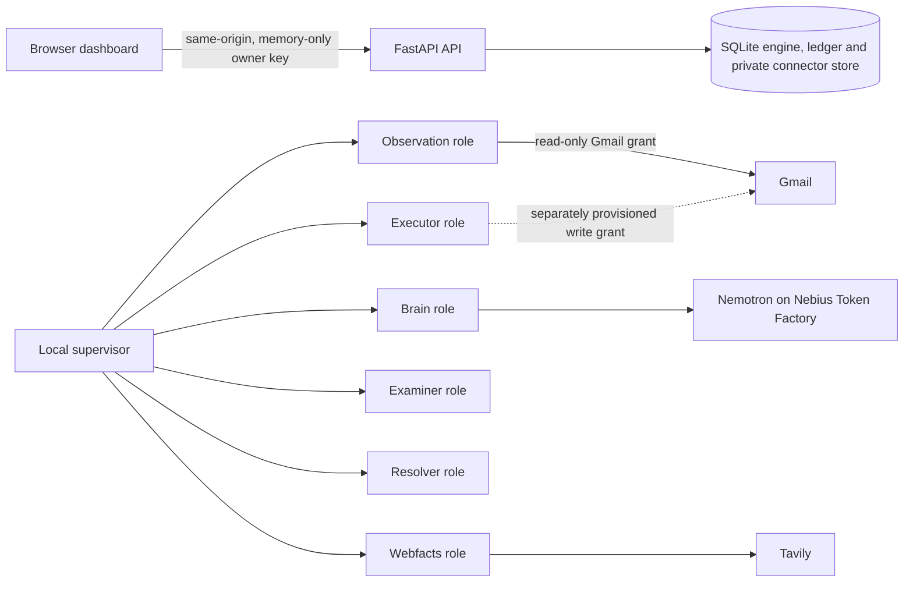

# Probation

> A personal AI that earns permission to act, one task type at a time, by proving on the user's own history that it would have done what they did.

[](LICENSE)
[](https://www.python.org/)
[](https://nodejs.org/)

Built for the **NVIDIA Global AI Hackathon** (Personal AI Track) using **NVIDIA Nemotron** on **Nebius Token Factory**, with **Tavily** web grounding for asymmetric entity verification.

---

## What this is

Probation is a **permission engine**, not a generic inbox assistant. It watches what you do, predicts one proposed action, explains the evidence, and then either asks, suggests, acts with undo, or acts quietly — only for the exact kind of task and action that has earned that level.

The current prototype demonstrates the idea through email:

- **Gmail is the first end-to-end integration.** The private demo uses a read-only Gmail test account. No send, archive, trash, forward or reply is enabled.
- **Google Calendar and Google Drive are shown as planned integrations** in **Connect apps**. They are not connected and cannot be connected in this build.
- The engine is designed for more than email. Calendar, files, chains, Radar and Reading have pack-level work in the repository, but they are **not part of this focused email release** and are not presented as finished workflows.

The core promise is **earned autonomy**, not a trust score. A useful request for approval is a valid result. A new mailbox does not arrive with permission.

---

## What the demo currently shows

### The live read-only path

1. Sign in to the private app with the local **owner key**. The key stays in memory and is never stored in the browser.
2. Open **More → Connect apps** and choose **Connect Gmail**. This opens a genuine Google read-only consent flow in a separate local setup process. The API receives no Google tokens, callbacks or authorization URLs.
3. The setup verifies the exact `gmail.readonly` scope, the configured test account and the approved native label (`Label_1`), then stores a read-only refresh token under the owner-only private store.
4. The supervised runtime starts **API, observation, Brain, Examiner and Resolver** roles. The observation role reads the approved label. The current live database contains **1 email needing a decision** and **167 watching observations** from the recorded history.
5. **Overview** shows the next review, permission state and connection status. **Review** and the item detail show the proposed action, evidence and the exact review controls. **Permissions** explains what is allowed for each task/action. **More → Performance, Counts & trends and Trick tests** show the recorded history; **Privacy & web**, **Cost & usage**, **Integrity record**, **Settings in use** and **Help & limits** provide the supporting record.
6. The **Executor is deliberately not provisioned** because no Gmail write grant exists. Review requests are recorded, but nothing is sent or changed. This is a read-only demo.

The live account's first request is a cold-start **ASK** — the product asking for a decision, which is the correct outcome for an account without earned permission. The Nemotron/Tavily path is wired and has separate D5 live evidence; this D6 live read-only item did not incur a new paid model or Tavily call.

### What the jury can click

| Where | What it demonstrates |
|---|---|
| **Overview** | The next email, the review desk, permission snapshot, workspace clock and connection state. |
| **Review / item detail** | The proposed action, the email, the reason, evidence, web verification card, and the owner's exact decision controls. |
| **Activity** | What Probation actually did, pending/held/completed/unknown states, and undo only where the server offers it. |
| **Permissions** | One task/action at a time: Watching, Suggests, Acts with undo, Acts automatically; evidence counts and caps. |
| **More → Connect apps** | Gmail read-only connection, plus Calendar and Drive clearly marked Planned. |
| **More → Performance / Counts & trends / Trick tests** | The historical record, measured counts and code-graded exam history. |
| **More → Privacy & web / Cost & usage / Integrity record / Settings / Help** | Exact web queries and sources, model/usage and spend authority, the hash-chained record, effective settings and limits. |

There are honest empty states where the current live account has no data — for example no confirmed actions, no Tavily calls for this cold-start item, and no earned permission yet. Probation does not fill them with sample rows.

---

## App and pack coverage

| App or pack | Status in this repository |
|---|---|
| **Gmail** | **Prototype, read-only.** Real OAuth consent, read-only grant, observation, proposed review and dashboard. No writes. |
| **Google Calendar** | **Planned.** Shown in Connect apps; no connect action and no execution. |
| **Google Drive** | **Planned.** Shown in Connect apps; no connect action and no execution. |
| **Files** | Code exists in the wider engine; not part of this email release and not shown as a working workflow. |
| **Chains / Habits / Radar / Reading** | Not part of this focused release. Legacy deep links show an explicit unavailable explanation, never fake boards. |
| **Local data import** | Command-line import only; there is no browser upload. |

The Gmail, Google Calendar and Google Drive product icons are served locally from Google's Brand Resource Center. They identify the corresponding integrations; Google retains all rights, and inclusion does not imply endorsement or availability. See [`frontend/public/integrations/ATTRIBUTION.md`](frontend/public/integrations/ATTRIBUTION.md).

---

## Architecture and invariants



**Non-negotiable rules:**

- LLM output is **data only**; it holds no credentials or tools, and every output is schema-validated.
- Only the **Executor** performs target side-effects and holds write credentials. The API, Brain, Webfacts and the local setup process hold no write credential.
- **Fail closed:** a validation, provider, budget or clock failure becomes ask or watch, never an autonomous action.
- **No peeking:** computation uses `HistoryView(as_of=t)` only.
- The ledger is **append-only and hash-chained**; it is never updated or deleted.
- **Licences are derived from evidence**, not stored as user-editable truth. Caps and hands-off rules are hard-coded.
- The Examiner is **code**, not an LLM.
- Redaction happens before egress; no message body is logged; no URL from a mail body is fetched.
- Web facts may only **restrict or inform**, never raise autonomy. Raw web text stays inside the quarantined extractor and never reaches the policy, licence code or reply writer.
- No `.env` or secret is committed, printed or sent to an LLM.

The detailed authority is [`docs/CONTRACT.md`](docs/CONTRACT.md). The D6 API and frontend contract is summarized in [`docs/wp9/D6_API_CONTRACT.md`](docs/wp9/D6_API_CONTRACT.md).

### Model mapping

| Role | Configured model |
|---|---|
| Email reader (`reader.mail.v4`) | `nvidia/nemotron-3-super-120b-a12b` |
| Other reader / quarantined extraction | `nvidia/NVIDIA-Nemotron-3-Nano-30B-A3B` |
| Writer / wording | `nvidia/nemotron-3-super-120b-a12b` |
| Exam edits | `nvidia/Nemotron-3-Ultra-550b-a55b` (listed; not claimed as exercised) |
| Local novelty | `sentence-transformers/all-MiniLM-L6-v2`, CPU ONNX, local only |

The model mapping is fixed in configuration. There is no automatic model fallback. The D5 six-case intent smoke is discussed under **Measured evidence**, with its scope stated.

---

## Live evidence and measured results

### Verification on the final tree

| Check | Result |
|---|---|
| Frontend TypeScript | `npx tsc --noEmit` — clean |
| Frontend production build | `npm run build` — passed |
| Frontend unit tests | `npm run test:unit` — **11/11 passed** |
| Full browser acceptance | `npx playwright test --reporter=list` — **40/40 passed** (system Chrome, built bundle, isolated synthetic workspaces) |
| Focused Gmail setup/ACL/runtime tests | **67 passed** (grant identity, token ACL, setup API, callback parser, live-role allowlist) |
| Gmail read-only preflight | all local booleans true; fixed redirect `http://127.0.0.1:8765/` |
| Gmail read-only consent | completed; SHADOW read-only grant; token ACL verified |
| Live observation | one incoming synthetic email observed; **1 ASK**, **167 watching** from the recorded history |
| Gmail writes | none; Executor not provisioned; no write manifest approved |
| Paid model/Tavily calls in this D6 live session | **0** |
| Full backend gate | `python scripts/check.py` — **1462 passed, 2 deselected, 0 failed**; ruff/format and both mypy gates clean; protected fixture/result hashes unchanged |

The browser suite covers known answer/copy truth, all primary routes, the More destinations, the Connect apps chooser, responsive layouts at 360/390/768/1440, 200% zoom, keyboard-only review, visible focus, announced errors, reduced motion, session isolation, safe links, production-bundle verification and zero console errors.

### The six-case Super smoke — scoped

The D5 frozen six-case mail-intent cohort scored **6/6 with configured Super** and **2/6 with Nano**. This is a **six-case smoke** only:

- it is **not** general model accuracy,
- it is **not** a Gmail flow score,
- it is **not** an autonomous permission result,
- and it does not transfer to the private account.

The D6 live read-only request is a cold-start ASK; the current demo does not claim that the live email produced a Nemotron draft.

### Budget authority

The paid-call authority is `data/d5/live/accounting.db`, scope `d5-nemotron-tavily` (gitignored local evidence; not committed). It has one budget scope per provider/model; ceilings are cumulative across milestones and worktrees.

| Provider | Confirmed | Unresolved | Usable position |
|---|---:|---:|---|
| Nebius Nano | $0.001109 (22 reconciled attempts) | 0 | per-model $1 scope; ~$0.9989 remaining |
| Nebius Super | $0.003896 (15 reconciled attempts) | 0 | per-model $1 scope; ~$0.9961 remaining |
| Tavily | 8.0 credits (9 recorded calls, 8 reconciled) | 1 `ambiguous` call | **11 credits usable** |

Nebius confirmed total across both scopes: **$0.005005** (29 succeeded, 8 failed closed). The one Tavily `ambiguous` row is an unresolved hold: it stays counted and must never be re-sent to "clear" it. **No new paid calls were made in this D6 live session.** Do not create a fresh allowance; re-read the authority before any paid run.

---

## Run it locally

### Prerequisites

- Python 3.11+
- Node.js 20+ and npm
- Google Chrome is optional for the Playwright suite; the suite uses the installed system Chrome (`channel: "chrome"`).
- For live Gmail: a Google Cloud project with the Gmail API enabled, a test account, and either a **Desktop app** OAuth client (recommended) or a Web client with the exact redirect below.
- For live model/Tavily calls: Nebius/Tavily credentials and an approved spend position.

### Install

From the repository root:

```powershell
# Windows
C:\Users\shaah\miniconda3\python.exe -m pip install -e ./backend[dev]
cd frontend
npm install
cd ..
```

```bash
# macOS / Linux
python -m pip install -e './backend[dev]'
cd frontend && npm install && cd ..
```

If `make` is available, `make setup` is the shortcut; on Windows use `make.cmd setup`. The explicit commands above are the portable path.

### Configure

```powershell
Copy-Item .env.example .env
```

Set these local values in `.env` (never commit it, never paste them into chat or logs):

```text
PROBATION_GMAIL_OWNER_API_KEY=<local owner key used by the dashboard>
PROBATION_GMAIL_OWNER_ID=local-owner
PROBATION_GMAIL_STORE=data/private/connectors/gmail_metadata.db
PROBATION_GMAIL_ACCOUNT=<the Google test account>
PROBATION_GMAIL_CLIENT_ID=<OAuth client id>
PROBATION_GMAIL_CLIENT_SECRET=<OAuth client secret>
PROBATION_GMAIL_LABEL=Label_1
PROBATION_GMAIL_REDIRECT_PORT=8765
LLM_API_KEY=<Nebius Token Factory key>
TAVILY_API_KEY=<Tavily key>
```

`PROBATION_GMAIL_LABEL` is the **native Gmail label ID**, not the display name. The setup script also accepts `PROBATION_GMAIL_READ_CLIENT_ID` / `PROBATION_GMAIL_READ_CLIENT_SECRET` if you keep a separate read-only OAuth client.

For a **Web** OAuth client, add this exact URI under **Authorized redirect URIs**:

```text
http://127.0.0.1:8765/
```

For a **Desktop app** client, no redirect registration is needed; the loopback port is accepted by that client type. The setup script pins the callback to the same fixed URI so both client types can work.

The `.env.example` documents the model and embedding settings. The local MiniLM novelty model is optional for a read-only demo but is required for the policy/novelty path; if it is missing, novelty is unavailable and autonomous execution cannot be authorized. The reviewed manifest command is:

```text
python -B scripts/verify_embeddings.py --model-dir data/models/all-MiniLM-L6-v2/d13954661f83248295ba75c1ed411eef3b7b936e --manifest data/models/all-MiniLM-L6-v2/manifest.json
```

### Initialize the database

```powershell
C:\Users\shaah\miniconda3\python.exe -m probation.cli db migrate
```

`db migrate` applies the complete current schema (WP1, lifecycle, replay, provenance and accounting) and leaves the ledger records unchanged. It refuses a missing database rather than creating one silently. Back up `data/db/probation.db` before changing an existing local database.

### Start the app

Use a local terminal from the repository root. Do not run a plain `serve` on port 8000 at the same time as the live runtime.

```powershell
# Terminal 1 — supervised API + observation + Brain + Webfacts + Examiner + Resolver
make.cmd serve-live
# equivalently:
# C:\Users\shaah\miniconda3\python.exe -m probation.cli serve --gmail-runtime

# Terminal 2 — frontend
make.cmd web
```

Open `http://localhost:5173`, enter the **owner key** from `PROBATION_GMAIL_OWNER_API_KEY`, then open **More → Connect apps**.

If port 8000 is occupied by an older server, use the documented override:

```powershell
C:\Users\shaah\miniconda3\python.exe -m probation.cli serve --gmail-runtime --port 8001
cd frontend
$env:PROBATION_D6_E2E_API_TARGET="http://127.0.0.1:8001"
npm run dev -- --port 5174
```

Then open `http://localhost:5174`. The Vite proxy sends `/api` to the selected local API.

### Connect Gmail

1. Sign in with the owner key.
2. **More → Connect apps → Connect Gmail**.
3. Choose the configured test account and approve **read-only Gmail access only**.
4. The setup child writes the read-only refresh token under the owner-only `data/private/` store and registers a `SHADOW` connection. It verifies the exact scope, account and label before persisting anything.
5. The runtime then observes the approved label. The UI shows **Connected / read-only**; email processing and suggestions have their own separate state.

If Google blocks the request, run the safe preflight from the project root:

```powershell
C:\Users\shaah\miniconda3\python.exe -B scripts\d6_gmail_setup.py --check
```

It prints booleans and the exact redirect URI, never a token or secret. The common cause is a Web OAuth client without the saved `http://127.0.0.1:8765/` redirect; the other causes are the wrong test account, a non-Desktop client with no registered loopback URI, or an expired consent window.

To diagnose a failure with visible safe output, run:

```powershell
C:\Users\shaah\miniconda3\python.exe -u -B scripts\d6_gmail_setup.py --authorize-read
```

### Tests

```powershell
# Full backend gate (isolated snapshot; ruff, format, mypy and pytest)
C:\Users\shaah\miniconda3\python.exe scripts\check.py

# Frontend
cd frontend
npx tsc --noEmit
npm run test:unit
npx playwright test --reporter=list
```

The Playwright harness builds the production bundle, starts a throwaway synthetic API and a built frontend on separate loopback ports, and uses the installed system Chrome. It does not use the private Gmail account or the private owner key.

---

## Security and privacy

- The dashboard owner key is **memory-only**. Logout clears the token, cached private data, drafts and in-flight responses. The browser test suite verifies that no private row is left in storage or the DOM.
- The API holds **no Google credential** and receives no OAuth callback, authorization URL or token. The setup child runs locally; the runtime supervisor reads the owner-only refresh file and injects exactly one read-only grant into the observation child.
- The private connector store and refresh file are protected by a verified Windows owner-only ACL. A failed ACL check denies the setup instead of falling back to an unprotected path.
- Only the Executor can perform target side-effects. In this demo the Executor has **no write grant**, so review is recorded without a Gmail effect.
- Message bodies are not logged, sent to Tavily, or used to fetch URLs. Tavily queries are built by code from public entity strings only. Raw web text is quarantined and never reaches the policy, licence code or reply writer.
- Web facts can only restrict or inform; they never raise autonomy or change policy probabilities.
- `.env`, `data/private/`, provider manifests, tokens and local logs are not committed. The repository contains synthetic data only.

---

## Limitations and what is not claimed

- This is the **D6 demo release**, not the full F01–F42 product.
- **No Gmail writes** are enabled: no send, archive, trash, forward, reply or undo against the provider. A write requires a separate exact operation manifest and owner approval; the Executor is not provisioned without it.
- **Google Calendar and Google Drive are planned**, not implemented.
- Files, chains, habits, Radar and Reading are not part of this focused email release. Their legacy routes state that they are unavailable; they do not render fake data.
- No public deployment, multi-user accounts, real personal data, mobile app, push notifications or hosted URL are claimed here. Deployment is a separate step and was intentionally not performed.
- The six-case Super smoke is not accuracy, a Gmail score or an autonomy result.
- The live read-only item is a cold-start request for approval; it does not claim that a model draft was produced for that specific email.
- The local cost panel reflects the app's recorded spend; the cumulative D5 accounting authority is a separate record. Neither is a provider invoice.

---

## Documentation

- [`docs/CONTRACT.md`](docs/CONTRACT.md) — the highest authority and invariants.
- [`docs/USER_FLOW.md`](docs/USER_FLOW.md) — the product journeys.
- [`docs/TAVILY_AND_NEW_PACKS.md`](docs/TAVILY_AND_NEW_PACKS.md) — web grounding and pack boundaries.
- [`docs/WP9_D6_IMPLEMENTATION_PLAN.md`](docs/WP9_D6_IMPLEMENTATION_PLAN.md) — D6 implementation scope.
- [`docs/reports/phase-9-d6.md`](docs/reports/phase-9-d6.md) — the D6 handoff, exact tests and live evidence.
- [`docs/wp9/D6_ACCEPTANCE_MATRIX.md`](docs/wp9/D6_ACCEPTANCE_MATRIX.md) — the acceptance matrix and blockers.
- [`docs/wp9/D6_DEMO_POLISH_PLAN.md`](docs/wp9/D6_DEMO_POLISH_PLAN.md) — the approved demo completion extension.
- [`docs/TEST_PLAN.md`](docs/TEST_PLAN.md) — the test catalogue.

The local `build_history/` directory is intentionally gitignored and is used for construction notes; it is not part of the published repository.

## License

MIT License. See [`LICENSE`](LICENSE).

## Credits and assets

- Dashboard: React, TypeScript, Vite, TanStack Query, Tailwind CSS and Lucide.
- Backend: Python 3.11, FastAPI and SQLite.
- Models: NVIDIA Nemotron served through Nebius Token Factory.
- Web grounding: Tavily.
- Gmail, Google Calendar and Google Drive icons: Google Brand Resource Center; see [`frontend/public/integrations/ATTRIBUTION.md`](frontend/public/integrations/ATTRIBUTION.md). Google retains all rights; the marks identify the integrations and do not imply endorsement.
