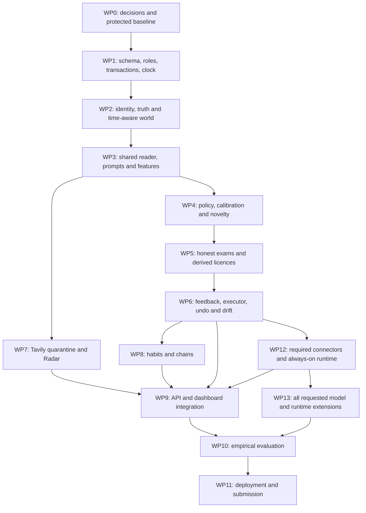

# Verified remediation and implementation plan

Revision 2: complete-product scope, 22 October 2026, Asia/Kolkata. Baseline commit: `808e72f8b9694d978f5bce64ad20ecc9a82c7bab`.

Status: **full scope retained; WP0/WP1 implementation authorized and in progress**. This plan answers `changes.md`; it does not silently supersede the contract, locked decisions or original phase gates. Read the accompanying [verification report](reports/changes-audit-2026-10-22.md) for reproduced results, source evidence, qualifications and external sources. Inventory: [changes-review-inventory.csv](reports/changes-review-inventory.csv).

**Full completion now requires all F01-F42 capabilities in [FULL_PRODUCT_SPEC.md](FULL_PRODUCT_SPEC.md).** That specification adds exact native/compatibility connector contracts, always-on operation, Reading, model/runtime extensions, signed receipts, dataset ingestion, the real human study and release acceptance. The latest user instruction removes feature cuts for the full product. Required approval/availability gates remain blockers, not permission to omit a feature.

Source coverage: [changes-coverage.csv](reports/changes-coverage.csv) and [coverage summary](reports/full-product-coverage.md). Additional opinion: [PRODUCT_OPINION_REVIEW.md](PRODUCT_OPINION_REVIEW.md), O01-O23. A covered proposal is planned or explicitly corrected; it is not thereby implemented or empirically proven.

## 1. Intended result

Deliver a demonstrably correct earned-permission loop over synthetic history: ingest observations, propose before reveal, collect genuine user decisions, derive evidence, pass meaningful exams, execute through one boundary, undo or cancel safely, detect change, and explain the result truthfully in the dashboard. Complete the native/compatibility connectors, always-on private runtime, all six packs and requested extensions, then evaluate and release the full product with a separate synthetic public demo. Connector implementation is mandatory for full completion; account/credential/provider approvals must still be resolved before live work.

Success is **not** a predetermined agreement percentage, a guaranteed promotion date, or forcing level 2 to appear. A valid system may remain at Watch/Suggest because history, calibration, exams, novelty or hard caps do not justify more. Report that result. Never tune on held-out personas to manufacture the planned demo.

The current 198 passing tests are the starting point, not acceptance evidence for the missing lifecycle. The four mypy errors, broken truth join, incomplete schema validator, invalid evaluation fallbacks, action ordering/idempotency, and temporal issues are release blockers.

## 2. Scope and governing decisions

### 2.1 Required repair scope

Preserve the existing FastAPI/SQLite/React architecture and NVIDIA/Nebius model roles. Repair the modules already built in Phases 1-10; finish deployment and submission in Phases 11-12 only after their prerequisites pass. Deliver mail, calendar, files, REPLY/BLOCK_TIME/CREATE_TASK chains, exams, entity vetting, Radar and Reading, plus all F01-F42 capabilities. Earlier Reading/extension cut lines apply only to the superseded deadline-limited scope; the current user request requires their full implementation and evidence.

Every implementation slice must:

- Identify the original phase and invariant/test IDs it owns.
- Write regression tests first for ledger, no-peeking, evidence/licences and gate behavior.
- Keep I/O at role boundaries; use pure feature/policy/gate computations internally.
- Use `core/clock.py`, synthetic data, recorded HTTP fixtures and deterministic seeds.
- Add or update the original feature logs using `docs/BUILD_LOGGING_PROTOCOL.md` and `docs/templates/log_schema.md`, and update `build_history/index.md` locally.
- Run `make check` before committing; separately validate the frontend when it changes.
- Use `phase-N-name` branches and `phase-N: description` commits. Review and hand off a slice before starting the next phase; do not bundle a cross-phase rewrite.

The plan's work-package numbering is dependency order, not permission to skip the original phases or start all lanes simultaneously.

### 2.2 Decision gates before dependent code

The exact conflict descriptions, proposed alternatives and authority are in report section 6. Record the selected resolutions in `docs/DECISIONS_AND_OPEN_QUESTIONS.md`; only a human edits `docs/CONTRACT.md`.

| Gate | Decision needed | Blocks |
|---|---|---|
| D1 / CCR-A | Who records normal explicit-feedback outcomes and how the API acknowledges asynchronous completion | Feedback worker, acceptance lifecycle, API acceptance test |
| D2 / CCR-B | Temporal outcome/correction/undo event storage and projection, with ownership and migration | Undo, repeat feedback, historical replay of corrections |
| D3 / CCR-C | Human-approved action authority when autonomous licence is level 0; retain all hard constraints | Accept/Edit execution for cold-start classes |
| D4 / CCR-D | Approve edited-body request schema and persistence; keep editing unavailable in intermediate builds until approved | Real reply editing; F06 cannot close while this is blocked |
| D5 / CCR-E | Preserve public source/since adapter contract with an internal raw helper, or human-approved signature change | Ingestion interface remediation |
| D6 / CCR-F | Typed ownership for habit deny and admin examiner jobs | Compliant API mutation/admin lifecycle |
| D7 / CCR-G | Exact task/action report-card scope, or unavailable-score UI | Task-specific historical score |
| D8 / DOC-A/B/C | Draft FK ordering, correct web monotonicity, query grammar, theme/readiness conflicts | Spec-aligned regression expectations |
| D9 | Live data, provider destinations, credential split, new dependencies, any receipt signing key | Connectors/MCP integrations/live validation beyond approved existing provider scope |

Planning all requested features does not itself approve private-account access or a human-only contract amendment; resolve these decisions before the dependent implementation. Pure repairs that preserve the contract can be planned and reviewed independently; conflicting behavior stays unimplemented until resolved.

### 2.3 Changes to the supplied roadmap

1. Put schema validation, durable transaction boundaries, temporal data and valid evaluation inputs before model cascades or new services.
2. Fix action parameter construction as well as proposal insertion order; otherwise the repaired dispatcher immediately fails on missing message/event/file identities.
3. Do not implement a new all-powerful responder. Keep API intent, Executor side effects, resolver feedback and examiner drift ownership separate.
4. Do not drop SHADOW decisions from all drift/evidence calculations. Strong human-handled shadow predictions are legitimate evidence. Exclude ABSTAIN and auto-execution silence; decide weak-event drift treatment against the spec rather than inventing a rule.
5. Do not improve agreement by removing abstentions from the only headline. Publish both definitions with denominators.
6. Replace the claimed guaranteed level-2 milestone with a numeric/exam readiness demonstration and an honest no-promotion outcome if necessary.
7. Treat iCal, IMAP and Notion as three distinct integrations with differing capabilities. A read-only calendar feed cannot perform RSVP; an IMAP observation connector is not a reply-send implementation.
8. No requested capability is cut from the full profile. Implement all F rows in dependency order, including Reading, native connectors, MCP/NVIDIA extensions, dataset integration and the real study. Do not call a deadline-limited intermediate release fully complete.
9. Avoid assuming every part of the app must be hosted on Nebius to meet external eligibility. The current local deployment spec still applies until deliberately amended; see the report's official FAQ source.

## 3. Dependency graph and delivery gates

WP1 includes action-type normalization and local executor safety regression tests early, so known defects are contained while later data/model work proceeds. WP6 completes the end-to-end execution lifecycle after trustworthy evidence/exams exist. Frontend contract fixtures can be designed earlier, but UI claims of working actions wait for WP6.

| Gate | Required demonstration |
|---|---|
| G0: approved design | D1-D9 and full-spec FP-D decisions resolved for dependent implementation; no undocumented role or schema expansion |
| G1: trustworthy storage | Atomic proposal/ledger writes; role-denial tests; append-only ledger; input validation; rollback and restart tests |
| G2: valid history | Complete truth join with documented exclusions, no future footprints, generated outcomes match rendered world |
| G3: real decisions | Required reader fails closed; shared inference; calibrated policy; meaningful exams; no fabricated defaults |
| G4: closed loop | Accept/reject/edit/hold/cancel/undo work, licence recheck is current, retry does not duplicate effects, drift persists |
| G5: integrated product | Actual API data drives all claimed screens and state changes; safe citations; replay controls drive replay |
| G6: credible evaluation | Explicit datasets, real run manifests, real ablations, measured denominators/cost, frozen test split |
| G7: native/live product | All connector profiles, six packs and always-on/consent/reconciliation workflows demonstrated |
| G8: full extensions | Model tiers/cascade, Ultra/guard decision, OpenShell, Hermes/NemoClaw, MCP, receipts, NVIDIA dataset and real study complete as specified |
| G9: full release | All F01-F42 evidence accepted, fresh-clone/private/public deployment proofs and honest submission; no open blocker silently waived |

## 4. WP0 — Reproducibility, governance and hygiene

Original phases: 0/1/10. Prerequisite: approval for the chosen slice. References: `AGENTS.md`, `docs/CONTRACT.md`, `docs/TEST_PLAN.md`, `docs/BUILD_LOGGING_PROTOCOL.md`.

Files: `Makefile`, `backend/pyproject.toml`, `.gitignore`, `backend/tests/unit/test_cli_commands.py`, `backend/tests/unit/test_eval.py`, `docs/DECISIONS_AND_OPEN_QUESTIONS.md`, relevant phase reports. Preserve the user's existing working changes.

Tasks:

1. Pin the interpreter/toolchain used for the repair; record Python/Node/package versions without reading environment secrets. Provide a documented Windows command equivalent if GNU make is not installed. Do not install tools or change dependencies without required approval.
2. Keep a before/after manifest of tracked fixtures and result files. Tests may write only to their temporary directory or an explicit isolated synthetic workspace.
3. Repair `test_cli_stubs`: its `eval` invocation exports to `docs/results/` by default. Use an isolated CLI filesystem or explicit temp outputs. Test the real command contract rather than looking for the words “Phase 10.”
4. Change synthesis CLI default output to `data/synth/<persona>`; require an explicit, reviewed fixture-regeneration command to touch `backend/tests/fixtures/tiny_synth`. Validate destructive overwrite behavior.
5. Correct command shapes: support required `probation import <pack> --source PATH` and `probation serve`; keep positional import as a documented compatibility alias if useful. Align `make synth` and eval forms with the CLI.
6. Fix the four mypy errors with explicit optional attributes and an actual identity contract; do not use `Any`, blanket ignores or fake protocol properties as the fix. Avoid giving every read-only world identity credentials.
7. Add a root `build_history/` ignore rule as the protocol requires. Since logs are already tracked, prepare an exact reviewed list for `git rm --cached` in a later authorized cleanup; do not delete local files or rewrite repository history automatically. The Graphify output/hook ignore rules are already present.
8. Mark existing evaluation claims as unverified/superseded with a clear provenance note until replacement measurements exist. Preserve the old artifacts for audit history; do not quietly replace dubious numbers with new plausible constants.
9. Expand strict type coverage to actually satisfy the required core/engine policy; the existing mypy configuration is not identical to every `--strict` check. Record and fix failures; do not mislabel partial checks as strict passes.

Tests first: CLI contract tests, fixture/result hash stability after tests, output-directory safety, typing/protocol regressions. Exit: existing checks reproduce, known failures are documented, tests cannot rewrite published artifacts, correct CLI help/commands are exercised. No fabricated metrics are used in the release story.

## 5. WP1 — Trusted validation, action metadata and transaction ownership

Original phases: 1/5. Prerequisites: WP0; D2 if altering outcome storage. Invariants: I-1, I-2, I-3, I-8, I-9, I-15, I-16. Existing test groups: T-ID, T-CLOCK, T-LEDGER, T-LLM, T-SEC, T-CAPS, T-EXEC.

Files: `backend/src/probation/core/{types,hashing,clock,history}.py`, `db/{connection,access,ledger}.py`, `db/schema.sql`, `engine/caps.py`, `llm/{client,budget,cache}.py`; matching unit/security/property tests.

### 5.1 Strict output and action validation

1. Define explicit Pydantic job models with strict types, forbidden extra keys, enums, length/item limits, finite numbers and cross-field validation. Export the provider schema from the same model. Do not maintain a permissive second interpretation of JSON Schema.
2. Test the four R02 cases, nested objects, enum-only constructs, nullable constraints, `bool` versus integer, NaN/Infinity, missing keys, unknown enum values and unsupported schema features. Cache hits must pass the same current validator as fresh output.
3. Decide the generic client's supported schema surface explicitly. Use already installed Pydantic where possible; adding `jsonschema` or a YAML parser is a dependency decision, not an incidental import.
4. Introduce one parsed-action representation: canonical type and a case-preserving optional parameter. Reject malformed/empty parameters and unsupported actions. Central caps/loss/recall use type; policy labels and evidence retain the complete parameterized action. Never uppercase a case-sensitive file path or collection name.
5. Make catalog membership pack-specific. A globally recognized `CREATE_TASK` is not valid for the mail pack. No-op/ABSTAIN never create actions or evidence pairs. Unknown types fail closed.

### 5.2 Unit of work and role enforcement

1. Remove internal commits from `append_ledger`; accept the caller's transaction. Audit cache, exposure and helper commits for the same atomicity problem. An exception anywhere must roll back the intended unit of work.
2. Serialize ledger head allocation and insertion with an appropriate SQLite write transaction. Verify concurrent appenders cannot fork or share a sequence. Preserve triggers that reject UPDATE/DELETE.
3. Make repository operations role-bound. Eliminate unrestricted connections from policy/exam/prediction call signatures where practical; validate actual SQL targets rather than trusting a separately supplied table name. If SQLite authorizers are used, install them on dedicated role connections and test triggers/migrations/read paths. Schema/bootstrap administration is a separate capability.
   Separate read/decision pack descriptors from executable adapters: the current registry transitively imports pack executor modules into brain/exam paths. Check the complete import graph, not just direct imports, and load write credentials/executable adapters only at the Executor boundary.
4. Write all final proposal state once: generate and validate any draft in memory; begin transaction; append proposal ledger entry; insert immutable proposal with complete parameters/explanation; insert draft referencing that proposal; commit. Only after commit may the Executor consume it. Resolve DOC-A first.
5. Do not wrap external effects in a SQLite transaction and call that atomic. Persist durable intent first; remote execution/reconciliation is WP6.
6. Canonicalize ledger payload names for new entries and make readers accept explicitly documented historical names. Preserve old payload bytes and their hashes.
7. Fix ledger API count/head queries using a consistent read transaction; test empty, one, multiple and corrupt entries. A valid chain proves integrity, not correctness or permission.

### 5.3 Clock, event identity and timestamp rules

1. Inject one context clock into resolver, brain, examiner, executor, budgets, quarantine and API replay context. Do not infer the replay horizon from a newly constructed default Clock.
2. Derive replay exam/case/habit/chain identifiers from stable semantic inputs, seed and versions. A retry uses the same ID. Separate a deliberately new exam attempt with an explicit stable attempt ordinal.
3. Define a consistent UTC timestamp representation and ordering before relying on SQL text comparisons. Reject backwards clocks. Same-instant response/proposal events need sufficient timestamp precision or an approved event-order extension; do not fabricate `known_at + 1 second` to satisfy strict I-7.
4. Scan application modules for direct clock calls, including `utcnow`, aliases and indirect imports; the current test checks too narrow a subset. Duration timing, if allowed outside clock, needs an explicit consistent rule in the docs.

Exit: invalid output cannot reach any gate; metadata is consistent across all parameterized actions; rollback preserves no partial proposal/action; two appenders produce one valid linear chain; failure remains ASK/SHADOW. Add regression tests before enabling a formerly unreachable EXECUTE path.

## 6. WP2 — Synthetic identity, observation chronology and world fidelity

Original phases: 2/3/6. Prerequisites: WP1, D5. Invariants: I-6, I-7, I-17, I-18. Tests: T-ID, T-SYNTH, T-RESOLVE, T-NOPEEK, T-E2E.

Files: `synth/{generator,render,world,importers,habits_dsl,body_pool,personas}.py`, `packs/{base,registry}.py`, pack intake/resolvers/clues, `workers/{ingestor,resolver}.py`, `core/history.py`, test fixtures/stub reader, `engine/replay.py`.

### 6.1 Reproducible identity and imports

1. Trace source/native reference → raw ID → situation ID → truth ID for mail, calendar and files. R07 confirms incompatible formulas. Select one shared deterministic helper used by generator and ingestion, or emit an explicit source-to-situation truth mapping in the evaluation harness. Never teach engine code to read truth.
2. Distinguish stable source identity from physical export path. Moving the same export to another checkout must not silently produce unrelated evaluation identities. Document intentional multi-account/source distinctions.
3. Centralize exact address parsing/normalization and identity propagation. Remove substring membership and empty tokens. Handle display names, case, aliases and plus tags exactly as PACKS_SPEC requires. Pass the persona's identity into imports, packs and resolvers; test non-default personas.
4. Define primary situations separately from sent replies, self-created study blocks and derived chain/Radar situations. Sent messages are observations, not new incoming mail. Self-organized events are not new RSVP decisions. Every additional derived situation has declared truth/provenance or is explicitly outside a metric cohort.
5. Require uniqueness/idempotency across repeat import, replay restart and source relocation. Preserve native Message-ID/References/UID fields needed for reply and RSVP linkage.
6. Existing ID changes invalidate cached joins. For synthetic repair runs, generate a new database/run namespace and record versioned manifests. Do not rewrite ledger IDs or hashes in place to make an old run appear compatible.

### 6.2 Temporal world state and rendered footprints

1. Retain separate initial state, user event stream and final export state. A decision at t cannot read the final mailbox labels, final RSVP or final folder as if observed at t.
2. Render file moves as actual dated user events and matching final locations. Store enough origin/final identity for the resolver, reconstruct allowed-root directories before execution tests, and ensure truth moves are neither lost nor applied before their time.
3. Replies already exist in generator output. Diagnose full-persona failure by identity, time window, Message-ID/thread matching and censoring, not by adding a second reply generator. Count successful linkages by persona and rule.
4. Make RSVP response observations available only when actually known. Early calls return no future-known outcome; final-state snapshots use their documented conservative known time. Use the observed export horizon for censoring.
5. Separate the historical/user-world stream from Executor-induced changes. An archive performed by Probation must not become a later STRONG user archive footprint. Silence after execution stays weak/report-only.
6. Apply the same observation adapters to synthetic and eventual live data. A mode-specific implementation may supply I/O, but no `if synthetic` branch may change policy or evidence semantics.

### 6.3 Event-driven replay

1. Remove the resolver pre-pass that appends all outcomes before proposals. Discover potential events without exposing their contents to inference; materialize observed outcomes only at their known event time after the corresponding proposal is durable.
2. Retain the specified tie order: outcome-known, review, retrain, situation. Add a stable tie-break ID and explicit handling for new derived situations and same-time strict-I-7 conflicts.
3. Derive feature history at each situation's historical cutoff, not using a future-influenced batch snapshot. Training rows must come through a bounded history interface and exclude invalid reader/hands-off rows.
4. Pass the same Clock to all role functions. Enforce `until` as a horizon, including derived events and finalization. Pausing or resuming replay must not skip held actions, reveal future data or replay effects twice.
5. Extend HistoryView with bounded, indexed queries needed for training, aggregate evidence, exams, habits, chains and known domains. Private history queries must not bypass it with arbitrary SQL. Current-item access and current role-owned operational state must be explicit, separate capabilities.

Tests before implementation:

- Exact truth join for all primary situations, zero duplicate IDs, explicit derived-item accounting and idempotent re-import.
- Seeded habit adherence measured on resolved/rendered outcomes, with noise/multiple-rule sampling defined precisely; not merely action counts in truth.
- Reply/forward/trash/archive priority, RSVP, move/leave and all censoring boundaries.
- Two identical fresh replay runs with identical ledger heads, including exams, chains and outcomes.
- 50 seeded no-peeking cuts that rebuild features and training, mutate future raw observations and final states, and compare proposals before the cut.
- Strict `proposed_at < known_at` and ledger proposal sequence before outcome sequence for every applicable situation. Ensure the test actually contains future outcomes, trained policies and at least one licensed execution case.

Exit: corrected tiny and full personas reconcile by identity and time; no answer key enters application inference; full run statistics can be reproduced from an explicit run manifest.

## 7. WP3 — Shared reader pipeline, prompts, redaction and drafts

Original phases: 1/3/4/8b. Prerequisites: WP1/WP2; D4 for body editing. Tests: T-REDACT, T-LLM, T-SEC, T-PACK, T-GATE, T-QUAR.

Files: `workers/brain.py`, `llm/{client,cache,budget,redact}.py`, `llm/prompts/`, pack reader descriptors, new narrowly scoped prompt/reader/writer modules under `llm/`, `config.py`, `config/prices.json`.

### 7.1 One reproducible inference pipeline

1. Separate orchestration from a typed prediction result: current situation + bounded HistoryView + fixed policy/novelty snapshot + validated reader result + restriction-only web data → features, predicted action, caps and final gate. Reuse this path in replay, live ticks and exam edits.
2. Determine required-reader status from each pack's reader contract, not API-key presence. Missing key/client, invalid response, timeout or budget failure for a required reader gives reader_ok false and final ASK. Files with the documented optional reader disabled are valid deterministic-only cases.
3. Catch typed failures and retain safe reason codes. Do not swallow deterministic-clue exceptions as success; validate finite/ranged deterministic values before policy inference.
4. Implement mail header/reader consistency checking and pass the real result into the gate. The gate's fail-closed order remains exactly as specified; do not reorder hands-off versus failures by intuition.
5. Fill policy-version/feature provenance with the actual encoder, prompt, reader model and dependency versions. A changed reader model or prompt cannot reuse a stale feature row silently.

### 7.2 Prompt loading and immutable versions

1. Inventory the exact prompt IDs required by PROMPTS.md, the pack descriptors and real callers. Do not treat the audit's “14” as a verified count; enumerate each job and its acceptance tests. Include mail/invite/file readers where active, opportunity reader, reply writer, wording, exam edits, synthesis jobs, quarantined extractors and Radar digest.
2. Load real system/user templates and enforce their metadata. Preserve used prompt versions; create new versions for changed behavior. Fail startup or the affected job on missing/mismatched ID/version/schema rather than falling back to one generic sentence.
3. Choose an explicit front-matter parsing approach. Existing files use nested YAML, while no YAML parser is a declared direct dependency. Approve a parser dependency or a documented JSON-compatible metadata format for new versions; never rely on an undeclared transitive package or unrestricted YAML loader.
4. Package prompt assets in the wheel and test installed-package loading outside the checkout, including safe path containment and malformed metadata.
5. Replace obsolete `complete_json` callers with supported `chat_json`/`chat_text` paths and strict models. Remove plain Meta-Llama fallback IDs and the literal model `writer`. Models come from settings only.

### 7.3 Redaction, caching and provider behavior

1. Supply header display names and sender-domain class without sending addresses. Redact subjects, incoming body, style examples, edited examples, exam text and quarantined text before every LLM call. Restore only permitted person placeholders locally after validation.
2. Preserve actual per-call redaction counts in exposure logs. Redaction failures do not trigger a second unredacted route. Never log model responses, prompts, private URLs or raw exception bodies.
3. Make the cache identity cover every semantic request input, including style examples, structured context and prompt/model version. Deduplicate concurrent identical requests; validate cache payloads.
4. Distinguish transport/auth/model errors from structured-output rejection. Only a provider-specific unsupported-format response triggers fallback. Honor bounded retries, ConnectTimeout and Retry-After; deterministic retry jitter uses an injected seeded source if required.
5. Read only final answer content for schema output. Empty or truncated final content is a failure, even if reasoning text contains JSON. Verify reasoning controls on the selected model in a later approved live spike.
6. Before concurrency, implement durable spend synchronization and reservations across workers. Include retry/repair calls and unsuccessful billable responses in accounting; release/reconcile reservations explicitly. Missing price/usage information uses a safe bounded policy, not invented cheap usage.
7. Introduce concurrency only after reservation tests pass; use a semaphore/worker pool and deterministic ordered result persistence. Do not share a SQLite connection across arbitrary worker threads.

### 7.4 Reply writer and validation

1. Retrieve at most the approved historical examples through HistoryView, with known outcomes before t, and derive style facts from that bounded history.
2. Generate only when the preview gate warrants a draft. Writer failure/invalid draft after the permitted regeneration ends at ASK; needs_user_input cannot auto-send.
3. Validate original-sender-only recipient, no new URLs/addresses, attachments absent, bounded length, and unsupported commitments/numbers/dates according to PROMPTS.md. Do not claim a regex guarantees semantic truth.
4. Keep raw web text out of writer requests. Typed cited fields are the only web-derived input, and only for the jobs allowed to use them.
5. Persist proposal/draft atomically in FK-safe order. Executor loads the validated stored draft and immutable action parameters; never trust arbitrary body/recipient fields supplied by a browser.
6. Until D4 is approved, remove the cosmetic body editor from intermediate builds and explain the unavailable edit capability; this does not fulfill full-scope F06. Once approved, implement the editor, validate the edited body under the same recipient/content constraints and preserve original generated provenance.

Exit: fake-client tests prove actual template/tagged content, redaction, strict output, failure handling and cache behavior; an optional approved Nebius smoke demonstrates the selected model/request format and measured cost without exposing credentials.

## 8. WP4 — Policy, calibration, novelty and explanations

Original phases: 4/6. Prerequisite: WP2/WP3. Tests: T-POLICY, T-NOVELTY, T-NOPEEK, T-LB.

Files: `engine/{features,policy,novelty,report}.py`, `config.py`, pack clues, `core/history.py`, relevant benchmark helpers.

Tasks:

1. Use `COLD_START_MIN_SITUATIONS=200`, independent of `L1_MIN_N=20`, and require at least two actions. Keep cold-start ABSTAIN/SHADOW distinct from failed-featurization ABSTAIN/ASK.
2. Train only on strong, time-eligible, reader-valid, non-hands-off user decisions. Exclude system-generated silence and undo pseudo-actions from policy labels. Specify how later corrected user decisions appear at historical cutoffs through D2.
3. Implement chronological out-of-fold calibration. Fit encoders/scalers inside each training fold; use expanding time splits with no future labels. Skip/report folds with insufficient classes, align probability columns for missing classes, and use the documented fallback T=1 when calibration is not estimable. Do not backfill missing folds with in-sample predictions.
4. Fit the final model on eligible training history only after choosing T from held-out fold predictions. Preserve decay weights, solver settings and finite probability checks. Test input immutability and stable class ordering.
5. Files: implement the documented top-K named folders, minimum training count, OTHER and LEAVE handling. An OTHER prediction is ABSTAIN, never a guessed filesystem destination. Folder parameters retain their original case.
6. Fix encoder column-name alignment before using coefficients. Hash all coefficients, intercepts, class order, numeric statistics, categorical levels, T and feature version into policy_version; not just 20 coefficients.
7. Implement the approved local embedding path, or explicitly approve/document the fallback. `fastembed` is declared but model artifacts may be absent; provisioning/downloads must be an approved setup step. Inference/tests use preprovisioned offline artifacts or deterministic test embeddings; engine code must not fetch a model implicitly.
8. Use strict novelty `d > theta`; deterministic tie handling; family-specific training-only neighbors; cold-data behavior; explicit zero-vector and identical-text cases. Bound memory with nearest-neighbor operations instead of unbounded pairwise matrices where needed.
9. Index temporal clues behind HistoryView: sender counts, reply rates/latency, thread participation, organizer history, accepted-event conflicts, origin/folder counts. Benchmark query counts and relative scaling on increasing synthetic sizes; do not promise a universal time threshold without hardware context.
10. Build explanations from actual aligned feature contributions plus bounded historical examples and typed evidence. Missing explanations render unavailable, not invented justifications.
11. Report all-items agreement, non-abstained agreement and coverage with distinct denominators. Keep ABSTAIN misses in the all-items metric. Define would_ask for unresolved/weak cases explicitly against ENGINE_SPEC 17 and the approved API contract.

Exit: chronological calibration tests pass, duplicates are not automatically novel at a zero threshold, feature explanations identify the right columns, and baseline comparison uses the same eligible cohort and ordering.

## 9. WP5 — Exams, evidence and licence derivation

Original phases: 5/7. Prerequisites: WP4; WP1 validation/roles. Invariants: I-5, I-6, I-10, I-11, I-12, I-13. Tests: T-EXAM, T-EVIDENCE, T-LB, T-CAPS, T-GATE.

Files: `engine/{exam,evidence,licence,caps}.py`, pack `exam_ops.py`, `workers/{examiner,scheduler}.py`, `packs/registry.py`, `core/history.py`.

### 9.1 Meaningful counterfactual exams

1. Require a real fitted policy/prediction snapshot and supported pack operators. Missing policy, empty operator set, reader failure or invalid snapshots cannot pass. Remove .99 defaults.
2. Sample only eligible base situations for the exact `(class_key, action)`, with outcomes known at exam time, using deterministic month stratification. Evaluate the candidate level as specified, without reading future private observations.
3. Run base and edited cases through the same redaction, reader, deterministic clues, trained encoder/policy, novelty, hands-off, conditional cap and gate path. Recompute action-specific loss/recall after the predicted action changes. Edited unknown sender must actually recompute sender history.
4. Freeze base model/history cutoff and audit draw for comparable counterfactuals. Do not retrain on edited cases, count them as real evidence, insert operational actions, or let their temporary IDs change audit selection arbitrarily.
5. Get pack/family/operator dispatch from the registry, supporting `file` class aliases without treating every unfamiliar family as files. Radar/Reading operators must be invoked when enabled; chains need an explicit tested policy or remain unable to earn autonomous licences.
6. Validate each edit with code before inference. Invalid edit counts and failed-reader counts remain visible. Enforce minimum base coverage and operator coverage so many repeated easy edits do not hide absent critical tests.
7. Preserve exact invariant and directional verdict semantics from ENGINE_SPEC. Add focused tests showing money/unknown-sender edits lower allowed caps, and injections cannot raise autonomy. At maximum base autonomy, “no more autonomous” alone is weak evidence; add expected-cap/hands-off assertions for critical operators rather than claiming the comparison proves all hazards are caught.
8. Train a real keyword-sensitive policy on controlled features and show that an eligible perturbation catches it; pair with a sound policy and insufficient-case run. A toy predictor reading a different feature schema is not sufficient.
9. Record deterministic run/case IDs, tested level, policy/feature/prompt/model versions, actual base IDs, cutoffs, operator coverage, discarded cases and verdicts. Case details are synthetic/redacted.
10. Cap attempts per daily review and persist candidate ordering so restart does not reset quotas. Do not repeatedly run known-insufficient exams on every tick without new evidence or an explicit retry schedule.

### 9.2 One derived licence path

1. Use one read-only derivation function accepting time-bounded evidence, exams and alarms. Examiner may cache it; API may display it; Executor must compute it again at action time without writing examiner-owned cache tables.
2. Exclude ABSTAIN, auto-executed items, undo and override from agreement counts; include audit holdouts and valid human-handled SHADOW/SUGGEST/ASK predictions. Deduplicate multiple feedback events for one proposal.
3. Keep weak evidence at level 1 only. Preserve clipped pooling priors, raw strong minimum, recent-count threshold and all golden numbers. Do not substitute the unused `l2_min_n=50`/`l3_min_n=100` for the actual spec formula.
4. Pass every tunable from Settings into derivation explicitly. Recompute licences for formerly active pairs with no remaining evidence as well as current pairs, so expired/aged evidence cannot leave stale permissions cached.
5. Enforce exam validity against `finished_at <= as_of`, age, tested level, latest pair drift and latest family alarm for every family. Reject future alarm/cache state in historical derivation.
6. Return coherent evidence counts, bound, valid passing exam ID, cap reasons and valid_until. The API currently omits exam_ok when deriving and suppresses level 2/3; fix it with the same derivation path rather than just trusting the cache.
7. Canonicalize new licence-change ledger payloads and support the existing `prev_level` field for historical reads without rewriting entries.

Exit: a fresh qualifying evidence+exam fixture derives level 2/3 only where allowed; missing/stale/future/failed exams never do; a new alarm demotes until a later passing exam; every consumer sees the same as-of result.

## 10. WP6 — Feedback, Executor, undo/cancel and durable drift

Original phase: 5, with phase-3/6/8/8b adapters. Prerequisites: WP1-WP5 and D1-D3. Invariants: I-2, I-3, I-7, I-8, I-10, I-12, I-20. Tests: T-EXEC, T-EVIDENCE, T-CUSUM, T-PSI, T-API, T-E2E.

Files: `workers/executor.py`, resolver/examiner/scheduler handlers, approved response-processing module, `api/routes/{queue,actions}.py`, pack executors, approved outcome/receipt schema and repositories, `engine/drift.py`.

### 10.1 Response ownership and state transitions

The recommended D1 resolution uses existing roles. A reusable coordinator may call role functions in replay, but it must not receive every credential or widen table permissions. In deployment, read and write capabilities remain in their specified processes.

| Event | API responsibility | Worker responsibility | Evidence/result |
|---|---|---|---|
| Accept | Authenticate scope, validate proposal/response, record immutable request idempotently | Executor constructs validated action and performs approved operation; resolver records explicit human decision under the approved ownership model | One strong agreement for the decision; execution success/failure is separate |
| Reject | Record explicit rejection | Resolver records strong disagreement; no action | Do not invent which alternative the user chose |
| Edit action | Validate against that pack's allowable action set; record original proposal association | Executor uses the validated edited action/parameters; resolver records the actual selected action | One strong feedback event; original proposal remains immutable |
| Edit body | Only if D4 approved; validate/store immutable edited payload | Executor applies approved draft validation and provenance rules | Editing a reply body is not changing the predicted action class |
| Undo DONE | Record undo request | Executor revalidates reversibility/window and restores the original state if possible | Strong correction feeds drift, never agreement counts |
| Cancel HELD | Record undo request through the existing action endpoint | Executor cancels without sending; no remote undo | CANCELLED plus strong disagreement event |

Tasks:

1. Define first-decision-wins and retry semantics for concurrent Accept/Edit/Reject submissions. The current SELECT-then-INSERT is a race; use a reviewed unique key/transaction design. Repeating the same request returns its existing result. A conflicting later request returns a typed conflict; it must not silently replace the first decision.
2. Define response-consumption receipts and replay cursors with explicit owner, unique response ID and transaction boundaries. Workers cannot add processed fields to API-only `user_responses` by bypassing permissions. Keep this schema behind D1/D2.
3. Do not return “done” when the API merely accepted a request. Define accepted, pending, succeeded and failed states using existing responses/actions or an approved additive result shape. The UI may remove a decided queue item while showing execution pending.
4. Do not overwrite the proposal or a previously known outcome on correction. Use D2's event/projection model; a historical as-of query must still reproduce the original decision.
5. Persist all required action parameters with pack-owned builders: message/native thread/recipient identity, invite UID/attendee, file source/target, tracker/library identity or chain context. Client input cannot invent paths or recipients.
6. Human approval bypasses the autonomous hold only under D3's explicit authority rule. It never bypasses a hard hands-off rule, catalog membership, filesystem boundary, validated draft or credential separation.

### 10.2 Executor durability and failure behavior

1. Replace INSERT OR REPLACE with create-if-absent and a validated read of the existing action. Verify type/params/proposal consistency; do not return a freshly constructed PENDING object for a stored DONE action.
2. Define a transition table for PENDING, HELD, DONE, UNDONE, CANCELLED and FAILED. Terminal states cannot be reset by request replay. Claim/lease metadata or an additional state requires an approved schema change; a process-local lock is insufficient across restarts.
3. Re-derive the licence immediately before an autonomous effect, including after hold expiry, using current evidence/exam/alarm time. Revalidate catalog, parameters, current hands-off and conditional caps. The Executor may read restriction-only facts but must not call an LLM/provider outside its allowed target apps.
4. On licence loss, cancel the pending effect and create a clearly linked follow-up suggestion under the approved proposal/brain ownership path. Do not mutate the old immutable proposal's gate or insert a brain proposal from the Executor role.
5. Persist action intent before external I/O and persist the result afterward. Use provider-supported idempotency keys or deterministic native object IDs. SimWorld operations must enforce action identity too.
6. Test the crash gap after remote effect but before local DONE. Reconcile by action ID/native state where possible; if a non-recallable send's outcome is ambiguous, fail closed and require resolution instead of resending. SQLite insert-ignore is not an exactly-once guarantee for arbitrary services.
7. Capture the actual original state for undo: archive of an already archived message must not add INBOX later; trash of an already trashed item must not erase pre-existing trash state; tracker/library changes restore the actual prior fields/status.
8. Enforce the undo deadline from actual execution time and the shared Clock. Cancel a held action before its effect; reject already-sent non-recallable undo; handle two undo requests idempotently.
9. Failed remote action or failed undo records a typed failure and unchanged safe status. Radar/Reading/chain adapters cannot catch an exception and report success. Never expose raw provider exceptions containing account data.
10. Files: validate resolved source and destination against allowed roots; repeat validation for undo. Handle `..`, absolute paths, drive changes, case sensitivity, symlinks/junctions and destination collisions. No overwrite and no folder creation. Missing source/destination must not become simulated success. Test only within synthetic controlled roots.

### 10.3 Drift and family shift

1. Feed CUSUM only the event categories specified by ENGINE_SPEC: eligible disagreement evidence plus undo/override. Exclude ABSTAIN and system-execution silence. Strong SHADOW predictions remain eligible; document/test weak evidence behavior rather than blindly deleting it.
2. Examiner owns persistent drift state and alarms. Executor emits the correction event; it does not write `drift_state` directly. Drain those correction events before the next licence derivation/execution so ownership separation does not leave a stale authority window.
3. Derive two-undo/override-in-30-days counts from durable events, not a newly constructed tracker's empty list. Deduplicate retries and persist alarms monotonically across process restarts.
4. Update baseline error from the specified posterior at licence changes and pass configured allowance/thresholds. Avoid repeated alarm emission for the same consumed event.
5. Select PSI features from the actual aligned fitted coefficients, including reader fields if selected. Aggregate encoded categories back to a documented original-feature score; use reference-window quantile bins and disjoint reference/current windows.
6. Retain the distinction between covariate shift and behavior drift. A changed response habit with unchanged inputs may trigger CUSUM while PSI stays quiet. Test both planted cases and negative controls.
7. Route every family's alarm to exam invalidation, including class-prefix aliases and chains/Radar/Reading. One later exam re-enables only its authorized class/action/level, not the whole family.

Exit: a deterministic end-to-end synthetic test demonstrates Suggest → Accept → one effect → strong feedback; held send → cancel; reversible effect → undo; two corrections across restart → alarm → demotion → later valid exam. Failure injection proves no effect occurs after an invalid licence or malformed parameters.

## 11. WP7 — Entity vetting, quarantine, Radar and mandatory Reading

Original phases: 6b/8b. Prerequisites: WP1-WP3; WP5/WP6 before autonomous pack execution. References: `docs/TAVILY_AND_NEW_PACKS.md`, `docs/PROMPTS.md`, I-21 through I-26. Tests: T-WEBQ, T-WEBISO, T-VET, T-LINK, T-QUAR and per-pack conformance.

Files: `web/{client,query_guard,derive,view,fixtures}.py`, `workers/webfacts.py`, `links/{sanitise,extract,quarantine}.py`, `packs/radar/`, `packs/reading/`, `config/brands.json`, relevant synthetic generation/intake, API boards/webfacts routes.

### 11.1 Budgets, clocks, provenance and request scope

1. Search and Extract share durable daily/monthly reservation accounting and the same injected Clock. A failed budget query, missing accounting store or failed required call logging denies the outbound request; baseline behavior remains unchanged with not_checked.
2. Count actual attempts/credits under one agreed policy, reserve before HTTP, request usage metadata where supported, and reconcile after responses. Distinguish cache hits, guard rejections, failed calls and successful billable operations. IDs must not collapse repeated charged calls with equal query/time.
3. Forward the allowed options explicitly: Extract depth, format, focused query and chunks; Search relevant domain/time filters and controlled limits. Use documented bearer headers. No key is stored in params_json, logs or fixture bodies.
4. Limit vetting to the specified packs and triggers. Compute known domains from user-handled past outcomes known at t; cache using the correct positive/negative TTL. Vet unfamiliar body-link domains as domains only. Do not fetch those links.
5. Normalize registrable domains consistently through the existing public-suffix dependency, including regional suffixes, subdomains and case. Keep display-brand tokens separately from person names and restrict query construction to approved public-entity fields.
6. Fix `vet_report` by changing the code-built query and lower-authority documentation to the allowed grammar. Do not remove query-length, personal-token, URL, address or digit guards.
7. WebFactsView must enforce live as-of and TTL semantics. Present-day recorded fixtures carry the documented present_knowledge flag and restriction-only exception, never masquerading as historical user knowledge.

### 11.2 Lookalike derivation and verification evidence

1. Replace one-domain-per-brand with a reviewed set of official registrable domains, with primary-source verification date/URL. Regional official domains are not automatically impostors.
2. Match the claimed brand before applying edit-distance/containment checks; avoid unrelated global brand scans and ambiguous one-word tokens. Keep explicit homoglyph and separator cases. A longer-label threshold is a tunable hypothesis subject to fixtures, not an assertion of correctness.
3. Implement known-domain trigger policy faithfully. Treat missing web evidence conservatively without asserting that every empty result is a verified absence or every top result is official.
4. Deduplicate report sources before requiring independent hits. Separate brand-list provenance, search evidence, reports and cache origin. Display cited uncertainty, not a fraud verdict.
5. Benchmark legitimate domains and fictional lookalikes using recorded Tavily responses. Include the reported false-positive domains as regression fixtures, while independently verifying catalog labels. Report precision/recall, false vetoes and no-web-presence confusion with counts.

### 11.3 Quarantine and official-page workflow

1. Wire opportunity derivation after the validated mail reader identifies opportunity intent; do not rely on an unreachable Radar branch selected by a raw mail pack or on subject keywords alone. Define ownership for derived situations under D5/approved pack ingestion rules.
2. Build official search queries only from validated organizer/opportunity public strings. A provenance-bearing discovered URL is required before Extract; a browser boolean `is_official_search=True` is not sufficient authority.
3. Select official candidates with deterministic domain/title/brand rules and allow-list restrictions where verified. Ambiguous search results stay unverified. A first organic result is not proof of official status.
4. Apply sanitization and domain-veto checks at the registrable-domain boundary, including subdomains. Reject secret-bearing URLs, private hosts, schemes, credentials, unsafe ports/redirectors according to the approved sanitizer policy. Preserve provenance so mail-body URLs can never be promoted to fetchable saved/search URLs accidentally.
5. Store raw Extract content only in the permitted quarantine store, truncated to EXTRACT_MAX_CHARS with source URL/hash/time/TTL. Only the quarantined reader receives up to QUARANTINE_MAX_INPUT_CHARS. No raw snippets/pages enter policy, evidence, licence or writer prompts.
6. Actually call the strict quarantined extractor and validate its fields against source support. Preserve supporting text spans internally for validation; expose typed data/citations. Do not replace the model with a hard-coded dictionary and claim extraction happened.
7. Date checks handle unambiguous ISO and supported textual/ordinal forms using the declared page context. If year/time zone is absent and cannot be established, return unknown rather than assuming. Compare normalized supported dates before warning of a mismatch.
8. Fee checks distinguish positive fee statements, explicit free statements and unknown. Broad tokens such as “cost” or “amount” alone are insufficient. Fail conservatively where risk facts are uncertain; do not null uncertainty into a falsely safe boolean.
9. Digest/writer output uses validated typed fields only; every web-derived claim has a permitted source URL. Validate HTTP(S) before storing/rendering hrefs and ensure displayed links match cited provenance.
10. Complete TRACK/DISMISS execution, original-state undo and outcome windows. Reading stays disabled/hidden unless its own intake, schema, execution, resolver and exams pass the same gates.

Property tests: adding restriction-only web facts never raises autonomy and never changes policy probabilities, evidence or licence derivation; removing a veto may restore baseline autonomy. Correct the backwards T-WEBISO wording before accepting its test. Injection variants leave typed permitted facts and decisions unchanged; writer request captures prove absence of raw web text.

Exit: synthetic opportunity mail → independent guarded Search → supported official candidate → allowed Extract → quarantined fields → cited tracker action; a fictional mismatched link is never fetched and is safely restricted. Budget exhaustion/outage preserves baseline behavior and truthful not_checked status. A separate approved live Search+Extract run supplies actual usage evidence.

## 12. WP8 — Habits and the required cross-tool chain

Original phase: 8. Prerequisites: WP2-WP6; D6 for denial flow. Tests: T-HABIT, T-CHAIN, T-NOPEEK, T-EXEC, T-EXAM.

Files: `engine/habits.py`, `packs/chains/{mining,proposer,executor,__init__}.py`, `workers/{scheduler,resolver}.py`, bounded history/query helpers, habit/chain API views.

Tasks:

1. Mine only outcomes/raw observations known at t through HistoryView. Do not let future response labels or partially observed follow-up windows create support or apparent missing follow-ups.
2. Define a permitted explanatory clue set; exclude target-derived/self-referential clues and unsupported raw feature names from statements. Preserve exact counts, BH correction and denied-habit exclusion.
3. Fix wording API use and prompt versioning; deterministic templates are valid labeled fallback. Numeric preservation is necessary but not sufficient: validate action, polarity and task meaning as well.
4. Make denial a durable typed request under D6, consumed by the permitted owner. Read-only UI must not silently mutate habits from API role.
5. Find the planted deadline → reply + time-block chain with actual source links and counts. Distinguish STRONG explicit/thread evidence from WEAK similarity evidence; no retrospective guessing of exact linkage strength.
6. Each follow-up has a stable variant ID, complete parameters, its own immutable proposal and its own evidence/exam/cap. Prevent recursive chain derivation, duplicate variants and inference from the system's own actions as user agreement.
7. The current chain fallback emits NONE immediately. Only emit weak NONE after a fully observed window closes with no response/link. Feed explicit accept/reject into strong chain outcomes through WP6.
8. Do not hard-code budget_ok/reader_ok/novelty as success in chain proposal creation. Reuse the applicable shared decision path and document which follow-up policy is examined.
9. Keep chain REPLY as a validated draft following mail sending rules. A private BLOCK_TIME is reversible and must preserve the original event state on undo. CREATE_TASK is required alongside the reply-plus-block workflow for the full product.

Exit: deterministic discovery tests, future-window mutation tests, explicit-feedback promotion tests and one executed/undone core chain pass. Unsupported chain exams keep level at most 1; no copied files-family pass may authorize it.

## 13. WP9 — API, replay control and dashboard integration

Original phase: 9. Prerequisites: stable backend types from WP3/WP5/WP6/WP7/WP8; D4/D6/D7 for affected flows. Read `docs/USER_FLOW.md` and `docs/FRONTEND_IMPLEMENTATION_PLAN.md`. Tests: T-API and browser behavior tests.

Files: `api/app.py`, all `api/routes/`, `frontend/src/api/{client,types,fixtures}.ts`, `App.tsx`, views, shared components/styles, frontend tooling config.

### 13.1 Endpoint-by-endpoint contract

| Surface | Required final behavior | Must be tested with |
|---|---|---|
| `/health` | Report actual mode/service readiness; separate provider capability from API liveness | Backend unavailable, provider unconfigured, replay paused/running |
| `/report-card` | Correct family scope; task/action only after D7; strong resolved denominator and censored counts | All families, ABSTAIN, no strong rows, future/weak outcomes |
| `/licences` | Same fresh derived result as Executor at same as-of; evidence, exam/cap/drift and five canonical changes | Level 0-3, expired exam/cache, family alarm, parameter action, historical payload keys |
| `/queue` | Only unanswered/unresolved as-of ASK/SUGGEST; documented digests; audit_holdout spot checks | Historical responded/handled items, concurrent responses, empty state |
| `/items/{id}` | Bounded summary, actual clues/examples, permission evidence, safe sources and validated draft | Missing explanation, unavailable draft, typed web facts, unknown ID |
| `/queue/{id}/respond` | D1/D3/D4-compliant intent, validation, idempotency and completion semantics | Accept, reject, valid/invalid edited action/body, duplicate/conflicting requests |
| `/actions`, `/actions/{id}/undo` | Real status, hold/undo deadlines, pending/cancelled/failed results | Held cancel, successful/failed/late undo, double request |
| `/habits`, deny, `/chains` | Time-bounded actual patterns; compliant denial request; evidence strength visible | Denied pattern, future observation, zero support |
| `/exams`, run | Exact class/action/level, real policy, per-case code verdict; admin restriction | Missing class must not silently substitute another class; insufficient cases; non-admin request |
| `/web-facts` | Recorded exact allowed queries, real credits/cache/origin/sources | No new outbound call merely from viewing transparency |
| `/boards/{pack}` | Active means complete enabled workflow, real entries/sources; Reading remains visibly unavailable until its mandatory workflow passes | Unconfigured world, failed pack readiness, disabled pack |
| `/metrics/summary` | Correct time ranges, operational counts, drift series; no invented trust score | Empty and populated series, scoped task filters |
| `/settings` | Effective tunables with units, caps and hands-off list, no secrets; read-only | Overrides, omitted settings, secret-field exclusion |
| `/exposure` | Counts/cost by documented scope, explicit totals and per-item availability | Cache hits, retries, failed calls, no raw prompt content |
| `/ledger/verify` | Correct length/head/first corruption; consistent snapshot | Empty, multiple rows, concurrent append, tamper fixture |
| `/replay/*` | Real replay service shares clock/worker state, starts/pauses/changes speed and resumes durably | Process restart, two tabs, held expiry, invalid speed, end-of-run |

Use explicit request/response models and a single uniform error envelope for HTTP errors, validation errors and safe internal failures. Type assertions in TypeScript are not runtime response validation. Introduce schema generation/validation with existing tools where possible; new libraries need approval.

### 13.2 Frontend behavior and truthful copy

1. Keep the five primary destinations Home/Queue/Actions/Permissions/More. Add URL-backed navigation/deep links/back-forward using ordinary browser routing or an approved router dependency; do not install one by assumption.
2. Use the installed TanStack Query for loading, polling and invalidation if its current version supports the intended API. Invalidate Queue, Actions, Permissions, Metrics and relevant detail after mutations. Keep pending operations visible and roll back optimistic changes on failure.
3. Group Queue into Needs you/Ready for you from gate semantics, with digest counts and spot-check labels. Do not infer safety categories from arbitrary probability thresholds or label audit items “high risk.” Avoid duplicate cards in multiple heuristic buckets.
4. Fetch `/items/{id}` when opening detail. Remove fixture-only required fields or add explicitly reviewed backend presentation fields. Render unavailable facts plainly instead of substituting invented summaries, risk pills or confidence explanations.
5. Replace free-text action entry with allowed choices for that pack and validated parameters. Send edited text only under approved D4; otherwise remove the cosmetic editor.
6. Source health/replay/provider status from data. Replace literal “AI systems online” and “Replay up to date.” On unknown connectivity, do not default to “Live Service.”
7. Correct the lower-bound label to the documented Bayesian/Beta posterior lower bound; keep measured agreement, lower bound and exam verdict separate. No global trust/accuracy headline; no family score copied to every task.
8. Inspect Settings/Exposure response shapes against the actual backend. Both screens already exist; fill missing units/caps and reconcile names/totals rather than duplicate them.
9. Add the missing web-query transparency destination under More; retain Radar only with active backend capability. Do not display a usable Library/Connections screen for an unimplemented workflow.
10. Centralize safe source links: HTTP(S) only, controlled external target/rel, no javascript/data schemes. Render returned titles/text as text, never HTML. Apply safe URLs to all source surfaces, including detail and Radar.
11. Implement dialog role/title, Escape, focus trap/restore, keyboard actions, aria-live feedback, labels, contrast and reduced-motion support. Verify at mobile/desktop widths and with keyboard-only interaction.
12. Preview mode remains visibly synthetic and isolated. Preview mutations cannot hit real endpoints. Service errors cannot silently substitute preview data or hide missing capabilities.

### 13.3 Verification

Add API integration tests using a database produced by the real corrected pipeline, not only hand-authored response fixtures. Test browser Accept/Edit/Reject and held-cancel/undo against that backend, including latency/failure. Add frontend lint and meaningful behavioral tests only with approved dependencies/tooling; do not confuse a build with interaction coverage. Build, typecheck, inspect browser console and run accessibility checks. Record screenshots/observations only from synthetic data.

Exit: every claimed destination operates on actual backend shapes, user mutations complete or show a true failure, browser navigation survives refresh, and no displayed status/metric is fabricated.

## 14. WP10 — Empirical evaluation and result provenance

Original phase: 10. Prerequisites: G1-G5. References: `docs/EVALUATION_PLAN.md`; tests T-EVAL plus complete invariant regressions.

Files: `eval/{run_eval,metrics,baselines,human_study}.py`, `engine/baselines.py`, CLI evaluation commands, `docs/results/`, `docs/reports/phase-10.md`, README result references.

### 14.1 Input and run integrity

1. Require explicit engine database, truth dataset and run manifest. Reject wrong/missing paths, schema mismatches and incomplete joins. Never fall back to a tiny fixture or treat a world DB as an engine DB.
2. Remove fabricated prediction generation when no proposals exist. A missing replay is a failed/unavailable evaluation, not a truth-predicting level-2 system.
3. Separate preparation, replay and metrics export. The runner executes real conditions rather than evaluating one cached proposal table for every ablation. Every condition has an isolated fresh engine/world state.
4. Record code commit/dirty hash, seed, personas, source/truth/fixture hashes, config, exact model IDs, prompt/reader versions, policy versions, cutoff/cohort rules and run timestamp from Clock. Split deterministic ledger identity from wall-time performance metadata.
5. Keep all reported metrics traceable to counts and event IDs in local synthetic run artifacts. Publish aggregate non-personal results and reproducible commands. Never put answer-key per-item data in application inference or the public demo API.

### 14.2 Baselines, ablations and denominators

1. B0 learns the same family-specific past actions by known_at, not future chronological rows. It is agreement-only. B1 asks always. B2 uses the documented fixed rules, not a personal model under another label.
2. B3 actually uses the writer-tier model over redacted text and ten eligible historical examples. Cache the same predictions across confidence thresholds; include all documented tau values. If no client/cache exists, mark B3 not run rather than substitute keyword rules or .95 confidence.
3. Delete all literal ablation measurements. Implement no-pooling, no-exam, no-audit, no-drift, weak-for-level-2, no-calibration and no-novelty as explicit reproducible experimental conditions, scoped to the synthetic evaluation harness. Intentional invariant-violating controls must never be selectable in deployed/live execution.
4. Tests prove each condition changes the intended mechanism and leaves other controls fixed. Assert schema/provenance/denominator relationships, not the absence of specific magic decimal strings.
5. Distinguish proposed autonomous gates, holds, actual executed effects, correct effects and pending/cancelled/failed actions. Match the EVALUATION_PLAN definitions and add executed-action metrics where needed; do not silently substitute one cohort for another.
6. Report agreement including abstentions and among non-abstained strong outcomes. Separate weak/unresolved/censored items. Avoid treating default missing truth as REPLY or adding unsupported chain/Radar variants to the denominator.
7. Empty autonomous sample: error rate unavailable with n=0 and coverage=0, rather than a safety success. Zero exams: pass rate unavailable. Zero planted chains: recall unavailable; no retrieved chains with planted truth: recall=0, precision unavailable. Keep exact numerator/denominator fields.
8. Implement the chosen Brier definition explicitly. Current code measures squared top-confidence correctness; if reporting multiclass Brier, use the full class distribution and encode the observed label. Name both accurately if retained.
9. Tune operating points on development personas only. Freeze held-out persona seeds before looking at results. Bootstrap intervals over personas, not individual correlated messages. Report insufficient sample size honestly.

### 14.3 Evaluation run ladder

| Step | Dataset/run | Required evidence before scaling |
|---|---|---|
| E0 | Hand-computed metric fixtures | Exact arithmetic, unavailable cases, boundary definitions |
| E1 | Tiny all-pack synthetic replay with deterministic reader | Complete joins, ledger ordering, no-peeking, one forced eligible lifecycle |
| E2 | One full persona, deterministic reader | Resolve/render agreement; timing/query counts; valid exams and permissions or explicit reasons |
| E3 | One full persona, real approved cached reader | Exposure/cost/latency; reader accuracy measured separately from action policy |
| E4 | Multi-persona development pilot | At least five distinct personas if budget allows; do not call this the full 20-persona main study |
| E5 | Planned dev/test main evaluation | Complete the documented 15/5 split; a reduced pilot remains a labelled intermediate result |
| E6 | B3 and all listed ablations | Same situation stream and cutoffs; isolated worlds; measured deltas and uncertainty |
| E7 | Tavily E10/E11/E12 | Recorded legitimate/fictional domain catalog, mismatch detection and injection tests with counts/provenance |

Stop scaling if identity, chronological access, exam validity, budget accounting or output provenance fails. Do not spend live credits to diagnose deterministic plumbing failures.

Read credit/quota information through an approved operator workflow without reading secrets into the agent. Account balance is not verified by the resources page. Never silently raise the configured hard limit to match an estimated $50 grant. Cost concurrency and retry accounting must already be correct.

Exit: published results come from reproducible runs, all negative/zero-coverage outcomes are visible, invalid phase-10 statements are corrected with a provenance note, and no evaluation branch can affect a deployed licence.

## 15. WP11 — Safe deployment, demo and submission

Original phases: 11/12. Prerequisites: G6 for an explicitly partial release; G7-G9 and deployment approval for full-product completion. References: `docs/TECH_STACK_AND_REPO.md`, `docs/SECURITY_PRIVACY.md`, `docs/DEMO_AND_SUBMISSION.md`.

Files to prepare: backend/frontend Dockerfiles, compose/reverse-proxy configuration, a documented VM/deployment script, CI checks, demo bootstrap/reset scripts, README and release/submission documents. These are proposed files; their existence is not claimed.

Tasks:

1. Build from pinned dependencies with all runtime assets, prompt files, embeddings and saved synthetic answers. Verify installed-package paths outside the repo; no build-time access to private exports or `.env` is needed for the public demo artifact.
2. Run API, brain, examiner, webfacts and Executor with appropriately separated credentials and writable stores. A single replay orchestrator may call role functions only with role-bound capabilities, as the contract permits. A general process with all write tokens defeats the design.
3. Synthetic demo data only; create a golden seed and session/reset strategy. Shared visitors cannot mutate each other's queues/licences or exhaust a global budget by repeatedly resetting. Precomputed demo mode must not impersonate a live provider call.
4. Expose only intended routes. Require admin authority for exams, costly web lookup and reset operations; correct CORS to intended origins; enforce request-size/rate limits, HTTPS and safe error messages. Disable real external execution in the public synthetic demo.
5. Prepare a deliberate live Tavily demonstration with approved public-entity inputs, guard, rate limit, hard budget and exact audit logging. The full F37 sender checker requires its approved endpoint, quota and abuse boundary; it cannot be an unrestricted passthrough search.
6. Test hard budget exhaustion, provider outage, exhausted quota, missing saved answer, interrupted replay, invalid ledger and restart recovery. The demo must remain usable with truthful unavailable states and no automatic authority increase.
7. Test a fresh browser and phone-sized viewport over a deployed URL, not just localhost. Demonstrate modes, detail/explanation, feedback/action/undo, earned permission, drift/exam and cited Radar. Show unsupported capabilities as unavailable.
8. Verify ledger at startup and before release; fail closed on corruption. Preserve old ledgers on reset as separate runs, never repair them with UPDATE/DELETE.
9. Add README setup/reproduction, architecture, limitations, synthetic-data statement, model-role and Tavily explanations, measured results and licence. Record actual tools feedback, not generic praise.
10. Keep a maintenance/budget/availability owner through the judging period. Do not assume October credits cover hosting until December. Prepare restore/restart and cached-demo instructions.
11. Record a working video around 2:50. Show the real Token Factory/NVIDIA model use and Tavily evidence; use fictional scam examples and only permitted media. Prepare Devpost text and the complete testing-access instructions.
12. Run the final contract tests, frontend checks, fresh-clone flow and a secret scan that reports locations only. Human review decides how to handle any suspected secret; do not print it or inspect `.env`.

Exit: release artifacts are reviewable before publishing; deployment has user authorization; demo works through failures; submission claims match measured capabilities. Final publication/submission is a separate deliberate action, not implied by approval of this implementation plan.

## 16. WP12 — Required native connectors, compatibility profiles and always-on operation

Full scope: F17-F27 and F42. Prerequisites: trusted core through WP6, approved FP-D decisions and strict fake-provider conformance. These capabilities are required, not stretch/deferred work. Detailed step order, files, schemas, auth, sync, recovery and acceptance are in [FULL_PRODUCT_SPEC.md](FULL_PRODUCT_SPEC.md) sections 4-13 and 19.

| Slice | Concrete implementation | Blocking acceptance |
|---|---|---|
| 12.1 Shared foundation | Typed capabilities/observations/cursors, connection restrictions, OAuth/secret lifecycle, owned command/event/attempt tables and migrations | Role and scope isolation, atomic page/cursor commit, restart/rollback proof |
| 12.2 Gmail REST | Selected mailbox/Sent backfill, incremental history, archive/trash/reply/forward catalog, validated drafts, ambiguous-send reconciliation | Wrong-scope/account denial; stale cursor resync; one effect; hold/cancel and conflict-safe label undo |
| 12.3 Google Calendar | Selected calendar sync, recurrence/timezones, owner-only RSVP, private BLOCK_TIME, version preconditions | No future snapshot labels; correct attendee preservation; no post-send recall claim |
| 12.4 Local files | Live watcher plus rescan, stable identity and strict source/destination/undo boundaries | Overflow/duplicate events, junction/race/collision/occupied undo and crash tests |
| 12.5 Notion | Pinned API/data-source/property mapping; Radar, Reading and CREATE_TASK; actual before-state and reconciliation | Capability/version/schema/pagination failures; real create/update/undo with synthetic content |
| 12.6 IMAP/iCal | Defined read-only observation profiles with constrained credential handling and native cursor/snapshot provenance | No mutating IMAP commands, UIDVALIDITY recovery, private-feed secrecy, no claimed feed RSVP |
| 12.7 MCP client/server | Approved typed tool manifests, pinned transport/schema, check_permission/propose/explain and Executor binding | Hostile/schema-changing server, revoked/stale authority, no alternate write bypass |
| 12.8 Runtime/consent/UI | Durable role workers, leases, restriction revisions, due-time scheduling, connection/backfill/shadow/pause/revoke states | Synthetic soak, restart/in-flight ambiguity, real browser connection lifecycle and private authorized pilot |

Implement each slice under the original phase ownership and review its handoff before the next. A read connector alone does not close a write capability. A login or tool discovery result does not close workflow execution. Live test resources and credentials require later explicit authorization; the plan contains no instruction to read `.env` or personal exports.

## 17. WP13 — All requested model, integration, evaluation and product extensions

All previously optional section-13 proposals are retained. The full specification has concrete steps and evidence for each; the following is the authoritative disposition for this revision.

| Proposal | Full requirement | Detail/evidence |
|---|---|---|
| Reader tier comparison and cascade | F29 | Same held-out forms; per-field risk/error, escalation, latency/cost; actual cached Nano/Super/Ultra calls |
| Ultra targeted red team and guard | F30 | Allowed as-of model context, validated edits/code verdicts; supported guard or visible unresolved provider decision |
| Writer style and plain-language explanations | F06/F11 | Real writer, protected examples; exact counts/action/polarity, style metric limitations |
| OpenShell enforcement | F31 | Real supported platform/effective policy, blocked network/filesystem/credential probes |
| Hermes and NemoClaw | F32/F33 | Both pinned interoperability profiles; approved external-runtime boundary; no bypass around Executor |
| Nebius serverless/parallel evaluation | F34 | Real supported endpoint/batch interface, durable job results, reservations and chronological equivalence |
| Live Radar and Reading | F13/F14 | Both complete, including Notion effects/undo, source provenance, quarantine and exams |
| Sender checker, TTL history and transparency | F37 | Approved domain-only command, independent quotas, exact query/source/cost/history UI |
| Skills and learned-about-you editing | F35 | Actual pack readiness; safe note/label/correction/deny without modifying counts or caps |
| Signed portable receipt | F36 | Approved signing format/key lifecycle, exact action/resource binding, expiry/revocation/replay/recheck |
| Nemotron-Personas-India | F38 | Pinned attributed source ingestion, lineage and actual generated/evaluated cohort |
| Real human study | F39 | Approved anonymous study on synthetic stimuli; real collected decisions, distinct from simulation |
| Full evaluation, deployment and claims | F28/F40/F41/F42 | All specified experiments/ablations, source evidence, runbooks and measured claim register |

Unavailable provider support or participant approval remains a blocker for the affected full-scope row. Do not manufacture a compatibility claim or silently relabel the feature optional. An experiment is complete when honestly conducted/reported, even if its aspirational target fails.

## 18. Milestones, estimates and stop rules

The earlier eight-day calendar is not a credible promise for the complete expanded product. Full scope is scheduled by evidence/dependency milestones; any deadline-limited submission is explicitly partial. No requested feature is deleted to meet a date.

| Milestone | Required deliverable | Depends on |
|---|---|---|
| M0 Design closure | Core and full-scope decisions; complete source/opinion register; approved interfaces/credential/provider distribution profile | Read-only planning/review |
| M1 Foundation | Strict output/role/transaction/clock/identity/history repair | M0 for affected decisions |
| M2 Complete synthetic loop | Six packs, all chain actions, real exams/permissions/execution/undo/drift and core UI | M1 |
| M3 Connector foundation | Auth/consent, durable observations/cursors/commands/attempts and migration conformance | M1/M0 |
| M4 Native provider workflows | Gmail/Calendar/files/Notion and defined IMAP/iCal profiles with fake + authorized live tests | M2/M3 |
| M5 Always-on product | Supervisor, recovery, connection UI, pause/revoke, protected private deployment | M4 |
| M6 Security/interoperability | MCP, receipts, OpenShell, Hermes and NemoClaw no-bypass profiles | M5 |
| M7 Model/data extensions | Tier/cascade, targeted exams/guard decision, Personas-India and supported parallel/batch runs | M2 and provider approvals |
| M8 Full evidence | Every planned experiment/ablation and actual approved study; claim evidence | M4-M7 |
| M9 Full release | All F rows closed, platform/fresh-clone/backup/soak proofs, runbooks, honest public demo/submission | M8 |

Estimate each reviewed slice as tests + code + migration/configuration + integration + evidence/review. Record external provider/verification/recruitment lead times separately from engineer effort. Re-estimate after interface spikes and measured throughput. No exact completion date is asserted without that information; extra reasoning cannot make third-party approvals or unfinished tests disappear.

Stop the affected implementation when contract/spec decisions are unresolved, tests would need weakening, credentials/real data/destinations/dependencies are not authorized, or an external effect/accounting state is ambiguous. Continue unaffected planning where permitted. Do not edit CONTRACT.md, bypass approval or declare a partial milestone complete to avoid the blocker.

## 19. Executable acceptance catalogue

New test names below are proposed regression cases, not files claimed to exist. Add them to the current matching test modules or focused new modules below about 400 lines.

| ID | Regression scenario | Pass condition |
|---|---|---|
| V01 | Invalid structured output, including R02 | Rejected before cache/policy/gate use; no side effect |
| V02 | Parameterized action metadata | Same cap/loss/recall as type; parameter case preserved; malformed type/params denied |
| V03 | Proposal/ledger/draft exception between writes | Entire unit rolls back; no action references missing proposal |
| V04 | Concurrent ledger append and API verify | One chain, unique sequence, correct snapshot count/head |
| V05 | Foreign role writes through public helpers/raw-SQL escape | Denied; denial causes safe fallback |
| V06 | Required reader missing/fails/budget-exhausted | Reader false + ASK; optional disabled file reader remains valid |
| V07 | Source/truth IDs across personas and repeat import | Complete primary join, no duplicates, declared derived-item exclusions |
| V08 | Future raw/footprint/final-state mutation at 50 cuts | Pre-cut features, probabilities, gates and ledger commitments unchanged |
| V09 | Same-seed full loop twice, including exams | Same deterministic proposal/event IDs and final ledger head |
| V10 | Proposal versus outcome chronology | Strict timestamps and proposal ledger sequence before outcome sequence |
| V11 | Chronological calibration and encoder alignment | No future fold data; names map to actual columns; full version hash changes with semantic state |
| V12 | Novelty identical points/zero threshold | Equality is not novel; insufficient-history and zero-vector cases explicit |
| V13 | Cold start/files OTHER | 200-row rule, two actions; OTHER never becomes an invented destination |
| V14 | Exam exact cohort and real feature path | Only scoped known cases; missing policy/operators cannot pass; keyword-dependent fitted policy fails |
| V15 | Exam expiry/drift/family aliases | Future/stale/pre-alarm exam invalid; newer tested-level pass works for the exact pair |
| V16 | Duplicate/concurrent Accept/Edit/Reject | First valid decision wins; one durable request/evidence event; typed conflict for the rest |
| V17 | Autonomous action plus retry/restart | One remote effect or safely unresolved ambiguity; terminal status never reset |
| V18 | Hold time and licence loss | No early effect; fresh recheck; cancelled effect yields compliant linked suggestion |
| V19 | Held cancellation/DONE undo/expired undo | Correct transition, original state restored once, no irreversible resend/retraction claim |
| V20 | File source/destination/undo escape and collision | Both endpoints remain within allowed roots; no overwrite/folder creation/fake success |
| V21 | Two undo/override events across restart | One correct immediate alarm; duplicates not counted; agreement evidence unchanged |
| V22 | PSI versus behavior drift | Correct top features/bins; covariate and response changes diagnosed separately |
| V23 | LLM retries/auth/schema fallback and cache | Typed errors, bounded repair, no reasoning JSON accepted, no duplicate request on cache hit |
| V24 | Concurrent model/Tavily spend plus accounting failure | Reservations never exceed cap; missing accounting denies call; every attempt accounted |
| V25 | Query guard/privacy and official URL provenance | No private/free-form/mail-body fetch; forged boolean provenance cannot authorize Extract |
| V26 | Legitimate/regional/fictional domain benchmark | Measured false-veto/recall with real labeled fixtures; no assumed winning threshold |
| V27 | Page injection/quarantine/digest citations | No decision increase/raw writer text; unsupported/uncited fields rejected |
| V28 | Habit/chain time and evidence strength | No future support; NONE only after window; explicit feedback and weak limits respected |
| V29 | All actual API shapes and uniform errors | Backend-pipeline integration fixtures pass; exact task scope maintained |
| V30 | Browser detail/response/undo/navigation/a11y | Real requests persist, state refreshes, keyboard/mobile work, no misleading fallback |
| V31 | Metric fixtures/missing data/ablations | Hand counts match; unavailable n=0 rates; real condition deltas and isolated states |
| V32 | Test-suite filesystem purity | Tracked fixtures/results unchanged; no secret reads or external network |
| V33 | Fresh install/deployment failure exercise | Packaged assets load; outage/kill-switch/restart stays fail closed; ledger verifies |

For every original contract invariant, map these regressions plus existing tests to its implementation. Execute relevant targeted tests first, then the full required checks after a slice stabilizes. Do not repeat successful broad tests without a change or unresolved concern that warrants it.

## 20. Definition of completion and immediate next slice

The planning deliverable includes this core/remediation sequence, the full-product specification, complete source/opinion coverage and concrete acceptance/evidence contracts. Planning completion does not establish implementation completion.

The recommended first implementation slice is **WP0 baseline/hygiene preparation**, followed, after review, by **the Phase 1 portions of WP1: strict output validation, transaction ownership and their regression tests**. Keep the Phase 5 action-metadata work and its handoff explicitly separate. Hold all feedback/schema/contract-dependent changes pending D1-D8 decisions. After each slice passes and is reviewed, proceed through the dependency gates; do not start live services while deterministic core failures remain.

Full implementation is complete only when every F01-F42 capability meets its evidence contract, all governing decisions are approved, invariant tests and `make check` pass, frontend/provider/runtime integration checks pass, measurements and the actual study are reported, local build logs/index and phase handoffs are reviewed, and release/restore proofs have no unresolved P0. There is no implicit cut/defer list in the full profile. No report may substitute “all tests pass” for an end-to-end demonstration of the earned-permission loop.
