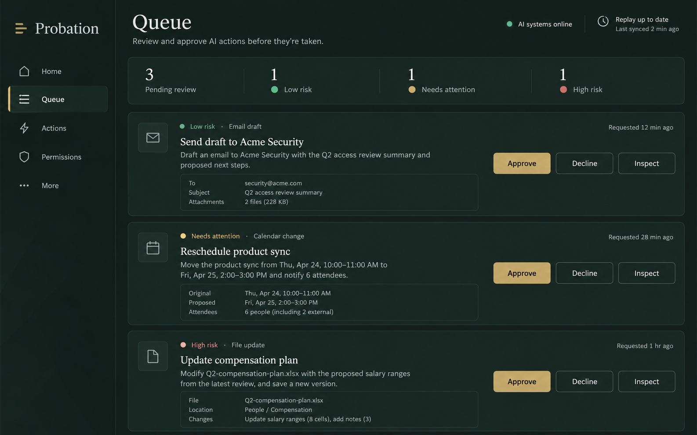
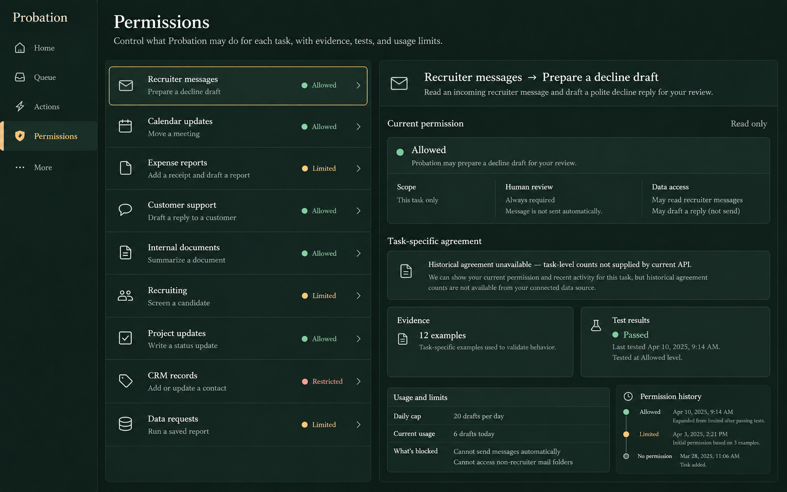

# Frontend and API Product and Implementation Plan

**Status:** Phase 9 specification and implementation guide.  
**Scope:** Phase 9 covers both `backend/src/probation/api/` (all CONTRACT.md section 9 HTTP endpoints) and `frontend/` (responsive React dashboard).  
**Authority:** This plan sits below [`CONTRACT.md`](CONTRACT.md) and [`USER_FLOW.md`](USER_FLOW.md). The backend API in `CONTRACT.md` is the source of truth for data and actions.  
**Current frontend:** Phase 0 scaffold in `frontend/src/App.tsx`; transitioning to full 5-destination dashboard.

This document describes the intended user experience, decides which destinations belong in navigation, and maps each view to existing API capabilities. It does not authorize changes to contract rules or claim that planned endpoints already exist.

---

## 1. Product outcome

Probation should feel like a calm, capable personal assistant whose permission is visible and earned separately for each kind of task. A user should be able to answer three questions quickly:

1. **What needs me now?**
2. **What may Probation do for this specific task, and what evidence supports it?**
3. **What did it do, and how can I stop or undo it?**

The interface should make the safe next step clear without asking users to understand engine vocabulary. It should be polished and restrained, not a developer console or a wall of cards, charts, and status badges.

### Product rules

- Show permission, evidence, test result, and change history for a **specific task type and action**. Never present one overall accuracy score as the measure of trust.
- Give aggregate counts only as operational context (for example, “12 items reviewed this week”), with their time range and scope. Do not combine task scores into a global trust grade.
- Keep the system's uncertainty visible. “Not enough history yet” and “Needs you” are useful states, not failures to conceal.
- Put the reason and the next safe action beside the item. Put technical detail behind an explicit “Why?” or “Details” affordance.
- Keep undo or cancel reachable from every action that can still be stopped or reversed.
- Use synthetic examples in design previews. Do not include real personal data in fixtures, screenshots, logs, or examples.

---

## 2. Navigation and screen decisions

Use the same five top-level destinations at every breakpoint: **Home, Queue, Actions, Permissions, More**. Desktop uses a compact sidebar; mobile uses a five-item bottom bar. “More” is a normal destination that opens a labeled directory page on both layouts. On desktop, its secondary links may expand beneath More in the sidebar, but they remain nested destinations, not additional top-level tabs. Do not replace More with a mobile-only drawer behavior.

| Destination | Keep? | User job and contents | Data/action source |
|---|---|---|---|
| **Home** | Yes, primary | Answer “what needs me?” Show service/replay mode, a small attention summary, recent permission changes, and clear links into Queue and the task-specific report. Do not duplicate every chart or queue card. | `/health`, `/replay/state`, `/queue`, `/licences` when available |
| **Queue** | Yes, primary | Resolve items that need the user. Group carefully by kind of task, keep each item individually reviewable, and expose a detail view with reason and sources. | `/queue`, `/items/{proposal_id}`, `/queue/{proposal_id}/respond` |
| **Actions** | Yes, primary | See held, completed, failed, and undone actions; cancel a hold or request undo where allowed. Show the current status and remaining undo/cancel window. | `/actions`, `/actions/{id}/undo` |
| **Permissions** | Yes, primary | Inspect what Probation can do for each task/action pair, its evidence, caps, exam status, and recent changes. This is the main home for task-level confidence and permission. | `/licences`; exam details from `/exams` when implemented |
| **More** | Yes, primary | Open a directory of secondary destinations. On desktop, this destination may expand to reveal nested links; on mobile it opens the same directory page. | Static navigation; destinations appear only when their screen is in scope |
| **Insights** | Keep as a section under More | Report card, trends, “different” cases, attention, habits, chains, and exam history. Organize by task filter; no single accuracy headline. Habits/chains are patterns, not permissions. | `/report-card?family=`, `/metrics/summary`, `/habits`, `/chains`, `/exams` |
| **Radar** | Conditional under More | Show verified opportunity tracking only when the Radar pack, board API, and sources are available. If unavailable, omit it from navigation; do not show a fake empty feature. It is not a sixth primary tab. | `/boards/radar`, `/items/{proposal_id}` |
| **Library** | Defer | Reading library is a separate pack and is cut before Radar in the current implementation plan. Do not show a placeholder tab in v1. Add only when the pack and board API are in scope. | `/boards/reading` (planned) |
| **More: Privacy & web** | Keep, secondary | Explain what text was sent to models, token/cost totals, and exact web queries with source links. Separate model exposure from web lookup so users can understand each. | `/exposure`, `/web-facts` |
| **More: Activity record** | Keep, secondary | Show whether the append-only record verifies, plus a short fingerprint and record count. Avoid implying that a valid hash chain proves the decisions were correct. | `/ledger/verify` |
| **More: Settings** | Keep, secondary/read-only | Explain effective limits, caps, hands-off rules, and mode. No editable controls in v1. | `/settings` |
| **Import help** | Keep as onboarding/help, not a tab | Explain synthetic demo versus local import and what data leaves the device. No browser upload or live account connection in v1. | Static content; align with importers and privacy docs |

Pack content follows backend capability, not the existence of a folder in the repository. The current registry activates mail and calendar; Files has code but is not registered, while Radar and Reading are stubs/planned. Do not show a pack as usable until its adapter, API surface, and required actions are active.

### Why the navigation is grouped this way

- Queue, Actions, and Permissions represent different daily jobs: decide, review what happened, and understand authority. Keep them separate.
- Report card, Metrics, Habits, Chains, and Exams are related inspection tools. They belong in one **Insights** area with task filters and focused subviews, not five permanent tabs.
- Privacy, web query transparency, ledger verification, and read-only settings are important but infrequent. Keep them findable in **More** and link to them from relevant explanations.
- Radar is a distinct user-facing workflow and a demo beat, so make its board discoverable under More when real data and actions are supported. Keep the five primary destinations stable; do not add an unimplemented tab.
- The current five mock “pillars” omit Home, mix unrelated system internals, and elevate Radar/Trust before checking whether the screens can perform the promised job. Use this table as the navigation decision.

### Navigation behavior

- Desktop: persistent, narrow sidebar with exactly five top-level destinations and text labels/icons; selected destination has a clear text and shape state, not color alone. Secondary links can be shown indented under More when expanded, but Activity Record and Settings are not promoted to peer destinations.
- Mobile: Home, Queue, Actions, Perms, More. `Perms` is the compact visible label at widths where “Permissions” would crowd the bar; keep the accessible name and page title “Permissions.” Keep all five touch targets and labels visible, and show a count badge only for actionable queue items, never for all unread or historical items.
- Preserve the current route on refresh and support browser back/forward. Use ordinary links and buttons with descriptive labels.
- Global status strip: show Demo/Replay or Live mode only when the API reports it. Display the simulated date during replay; do not blend it with the machine's real date.
- Persistent alerts are reserved for actionable conditions such as a failed service, exhausted budget, or habit-change demotion. Dismissal must not hide a safety state that still applies.

---

## 3. Per-task evidence and test results

The unit of trust shown in the interface is **(kind of task, proposed action)**, matching the contract's `(class_key, action)` licence. For example, “Recruiter messages → prepare a decline draft” and “Team invitations → accept” are separate rows even if both belong to mail/calendar work.

### Permissions list

Each row or card shows:

- A plain-language task label and the action Probation may take.
- Current state: Watching, Suggests, Does it with undo, or Does it quietly.
- Evidence counts and the pessimistic safe estimate, using the values provided by the API. Never recalculate or infer permission in the browser.
- The cap or hands-off reason when it limits autonomy.
- Exam status and date, if present; drift/family-shift status and the most recent permission change.
- A “Why this level?” link to the task detail, with examples or change history when the API provides them.

Sort attention-needed rows first: habit change, expired/missing test, evidence below threshold, or a cap that explains a lower level. Keep stable rows below. Search and filters should cover pack, action, and current state without hiding safety alerts.

### Task detail and test history

- The detail view is scoped to one task/action and keeps that scope visible in its title and breadcrumb.
- **Required score:** show historical prediction agreement for this exact task/action using resolved strong outcomes: `same / (same + different)`. Always show the numerator, denominator, time range, and censored/unresolved count beside the percentage. If there are no evaluated outcomes, say “Not enough history yet”; never display `0%` as if it were a measured result.
- Show the pessimistic lower-bound estimate from the derived permission evidence as a separate measure, with its evidence count. Do not merge that estimate with backtest agreement or the counterfactual exam result.
- Show the trick-question exam for this same task/action separately: pass/fail, date, tested level, and case results. The verdict is computed by code; the LLM does not grade the test. Do not invent a percentage score from a pass/fail exam.
- The engine report-card definition currently supports family summaries (`family`) and strong outcomes, while `/licences` is keyed by `(class_key, action)`. The API contract does not currently provide the requested task-scoped report-card result. Record a **Contract Change Request** to extend the report-card query/result to accept the exact task key and action, retaining `as_of`/time-period semantics, strong-outcome denominator, and separate censored count. Do not edit `CONTRACT.md` or implement an undeclared endpoint in this document-only change.
- Until that contract change is approved and implemented, label the family report as a family summary and state that the task-specific backtest score is unavailable. Never copy a family score onto individual task cards or substitute an exam pass for the requested historical score.
- Aggregate summaries may help users find a task to inspect, but they must not be called an overall score, trust score, or accuracy score.

This makes the requested task-specific score the product target while keeping the present API limitation explicit. It preserves the family report as optional context and prevents it from standing in for a task result.

---

## 4. Page and component design

### Current scaffold review

`frontend/src/App.tsx` is a static Phase 0 landing page: it shows a fixed Phase 0 badge, a fixed replay clock label, a hard-coded budget amount, four autonomy-level cards, and three architecture cards. It has no navigation, route handling, API client, or working queue/permission actions. Treat this as a visual scaffold, not a partial dashboard. Replace the static hero and architecture showcase with the task-focused navigation and Home hierarchy below; source mode and budget from the API or omit them. Keep the four-level explanation only where it helps explain a selected permission.

### 4.1 Home

Make the first screen a practical status page rather than a product manifesto. The hierarchy is:

1. A small mode/service indicator (Demo/Replay/Live and healthy/degraded state, from API data).
2. One clear “Needs you” entry point with the actionable queue count, or the calm empty state “Nothing needs you right now.”
3. A compact task-by-task snapshot of permissions that need attention. Each item links to its task detail.
4. Recent activity or habit-change notices, limited to a few with a link to Actions/Insights.

Do not hard-code a budget amount, a replay clock label, a record count, a privacy percentage, or a success claim. Render only values returned by the API. If there is no data, explain the next step rather than displaying invented metrics.

### 4.2 Queue item card and detail

Use a calm, spacious card with a readable subject/title, safe source identity, time, exact proposed action and target, and a compact inline decision bar. Keep the `Do it`, `Not this`, and `Change` controls required by `USER_FLOW.md` visible on every queue item; routine items do not require opening a detail view first. `Why?` or the item title opens the focused inspection view. Put enough context on the card to make its action and target unambiguous, and include a short draft preview when available. The deeper view adds evidence, similar cases, full draft, and source details.

**Process permissions and queue response flow:** Under `CONTRACT.md` section 3 and `Role.API`, the API process is strictly permitted to write to `user_responses` only. When a user chooses `Do it`, `Not this`, or `Change`, `POST /api/queue/{proposal_id}/respond` writes the response row (`response IN ('accept', 'reject', 'edit')`). The API process does not perform external actions or write to the ledger. In `CONTRACT.md` section 9, the table notes "writes user_responses and a strong outcome", whereas section 3 strictly forbids API writes to `outcomes` or `ledger`. We flag this contract conflict: the API writes strictly to `user_responses` per section 3 without inventing process permissions, and the Executor / Resolver processes handle execution and strong outcome generation downstream.

The detail view includes the situation summary, proposal, task/action evidence, top clues, similar past cases, web status and source URLs if checked, and a draft when present. Show untrusted item and web text as plain text, never HTML. Cite web-derived claims directly beside the claim. Never label an organisation or sender a scam as a verdict.

### 4.3 Actions cards and holds

Show separate status labels for contract states (`HELD` / waiting, `DONE` / completed, `UNDONE` / undone, `CANCELLED` / cancelled, and `FAILED` / failed). The backend model returns `DONE`; the UI may label it as “Completed”. A hold card makes the action and target explicit, shows the remaining cancellation time as text, and offers a prominent Cancel action. A circular timer can supplement the text but must not be the only cue. Do not use a countdown for actions that are already complete.

For a completed reversible action, show Undo only while the API says it remains available. Confirm only when the specific action warrants it; confirmation must state what will be reversed. Reflect the asynchronous request lifecycle (“Undo requested”, “Undo complete”, or “Undo failed”) rather than promising instant reversal.

### 4.4 Permission cards and evidence

Use a compact level marker plus human-readable state, evidence line, exam state, and any cap or alert. A four-step level display may orient the user, but the current task's level must be visually distinct and the other levels described as possible levels, not choices the user can set. Permissions are derived by the backend and read-only in v1.

### 4.5 Insights and secondary screens

- **Report card:** make the family scope and selected time range explicit; show same/different/asked counts as counts, with a drill-in to inspect differences. Do not make one aggregate percentage the hero.
- **Metrics:** use a small number of legible weekly trends for asks, suggestions, automatic actions, and agreement, plus drift/family-shift events. Every chart has text labels, a date range, and an accessible summary.
- **Habits and chains:** show the pattern, supporting examples/counts where available, and the consequence. Denying a habit requires a clear action label and feedback. Do not imply a mined pattern grants permission.
- **Exams:** list runs grouped/filterable by task and action, show pass/fail and case summaries, and clearly mark the admin-only “Run test” action. Do not make this a global leaderboard.
- **Privacy & web:** keep exposure totals distinct from exact queries and cited sources. Web facts reads recorded Tavily activity from `tavily_calls` and `web_facts`; opening the page must not initiate an outbound web request or call. Never display raw prompt bodies under a token/exposure summary unless the API explicitly supports an appropriately redacted view.
- **Activity record:** explain “record integrity verified” as a tamper check, not proof of decision quality. If invalid, show the first broken sequence when provided and a clear warning.
- **Settings:** read-only in v1. Make “effective” values clear and explain units. Never expose secrets.
- **Radar:** show status, deadline, source and evidence on each opportunity. A fee mismatch is described with its cited source and a cautious “This does not match the official fee information” message, not a definitive fraud label.

---

## 5. Visual system: a quiet glass instrument

### 5.1 Design decision and rationale

**Chosen direction:** one dark-only visual identity called **Spruce & Brass**: deep spruce-charcoal surfaces, quiet green-gray text, and one restrained brushed-brass interaction accent. **Restrained glass appears only on the navigation shell**; all task data uses consistent opaque surfaces. Every tab shares this exact system; no tab gets its own palette or special card treatment. Do not combine glassmorphism with skeuomorphic textures or neumorphic raised controls.

Probation is a high-trust, data-heavy decision tool. People need to inspect a proposed action, understand its evidence, and recover from a mistake. The interface should feel precise, quiet, and humane, not futuristic or playful. Spruce-charcoal surfaces connect the product to stewardship and careful handling; the restrained brass accent marks deliberate interaction and earned authority. This avoids the familiar black-plus-neon AI dashboard look and avoids cream/terracotta. The base is a deep green charcoal rather than pure black; elevation comes from small shifts in spruce hue and fine borders, not translucent gray overlays or a different theme for each section.

**Why this material choice:** Apple's Human Interface Guidelines treat materials as a way to establish foreground/background hierarchy and emphasize legibility. This translates well to Probation: a subtle glass sidebar/top bar/bottom bar can feel elevated, while queue, evidence, and permission content remain opaque. Apple also grounds visual quality in purpose, user agency, responsibility, familiarity, clear feedback, and privacy; these are evaluation principles, not a request to imitate Apple's native controls or branding. The single dark appearance is an explicit Phase 9 product direction, based on the requested brand identity and this high-trust review context. It is not a claim that Apple generally recommends dark-only apps. See [Apple design principles](https://developer.apple.com/design/human-interface-guidelines/design-principles/), [Apple materials](https://developer.apple.com/design/human-interface-guidelines/materials), and [Apple Dark Mode guidance](https://developer.apple.com/design/human-interface-guidelines/dark-mode).

**Why not the other treatments:** skeuomorphic objects imply physical controls and metaphors that do not exist in this product. Neumorphism relies on low-contrast shadows and becomes ambiguous for dense controls, borders, focus, and status. Full-screen glass puts text over changing backdrops and makes legibility fragile. Use no glossy reflections, bevels, inset-control illusions, glowing edges, or decorative blur behind text.

This is Apple-informed web design, not an Apple UI clone. Use the repo's React/Tailwind/Lucide stack and familiar web interaction patterns. Do not use Apple logos, SF Symbols assets, or platform-specific patterns that conflict with browser expectations.

### 5.2 Dark-only color tokens

Phase 9 uses **one dark appearance throughout the product**. Do not add a light theme, per-tab themes, system appearance switching, or an appearance toggle. Keep colors in semantic CSS variables so the palette remains consistent and can be deliberately revisited later. These are starting values; check contrast in the browser before delivery.

| Token | Value | Use |
|---|---|---|
| `canvas` | `#111B18` | Deep spruce-charcoal page background, not pure black |
| `surface` | `#192723` | Main opaque surfaces: queue items, permission rows, dialogs |
| `surface-raised` | `#21322D` | Selected row, open menu, or raised panel |
| `surface-subtle` | `#293B34` | Input wells and quiet grouping, not a second card theme |
| `ink` | `#EDF2EB` | Primary text and headings |
| `ink-secondary` | `#B7C3B8` | Supporting text and metadata |
| `ink-tertiary` | `#91A096` | Timestamps and secondary labels |
| `line` | `#344840` | Separators, input boundaries, card outlines |
| `brand` | `#C8B27D` | Brass accent for links, selected navigation marker, primary action |
| `on-brand` | `#18231E` | Text and icon color on brass-filled controls |
| `brand-hover` | `#D8C693` | Hover/pressed brass state |
| `focus` | `#E8D5A0` | Clear keyboard focus ring |
| `success` | `#85B99A` | Success state, always paired with text/icon |
| `warning` | `#E0B663` | Needs-attention state, always paired with text/icon |
| `danger` | `#E28F88` | Failed/destructive state, always paired with text/icon |

Use these same roles and values on Home, Queue, Actions, Permissions, More, and every secondary route. Do not recolor tabs to make them distinct: differentiate destinations through content hierarchy and selected navigation state, not a new accent per page. Brass means interactive/selected; it does not mean success or warning. Reserve semantic colors strictly for their named states. Do not add neon glows, blue/purple gradients, pure-black backgrounds, or generic gray translucent layers. Use a readable dark surface ladder and clear labels instead.

#### One-screen visual reference

The Queue image below establishes the palette and shared shell. A second example for Permissions appears in section A5. Both use the same color roles and navigation style, while their content layouts differ to suit their jobs. Queue is for making review decisions, Actions is for seeing what the system did and undoing it, and Permissions is for checking task-specific evidence and limits.



Palette key: page canvas `#111B18`; normal content `#192723`; raised/selected surfaces `#21322D`; quiet grouping `#293B34`; fine borders `#344840`; primary text `#EDF2EB`; secondary text `#B7C3B8`; selected/primary action `#C8B27D` with dark text `#18231E`. Status colors stay muted and appear only beside explicit status text/icons. The image is an illustrative visual reference; its sample rows, counts, and status values are not API requirements. Implementations must use real API-backed fields and contract-supported actions.

### 5.3 Glass material specification

Apply glass to the **persistent navigation layer only**: desktop sidebar and sticky top bar; mobile bottom navigation and a transient floating toolbar if one is truly needed. The material must remain visually subordinate to content.

- Desktop glass: use the same deep spruce tint as the shell at 90-94% opacity, `backdrop-filter: blur(12px)`, a 1px spruce border, and one restrained shadow. The content must not be readable only through the glass.
- Mobile bottom bar: use the same single dark material, slightly more opaque behind labels, with a clear top hairline and safe-area inset. Keep all five labels visible and the selected item shape distinct; use brass only for the selected marker/label.
- Provide an opaque fallback when backdrop filters are unavailable, `prefers-reduced-transparency` is requested, or contrast testing finds the material unstable. Never render critical text directly over a scrolling data panel through the blur.
- Do not apply the material to queue rows, permission rows, charts, text fields, or detail panels. Those use the same opaque spruce surfaces from section 5.2.

This follows Apple's material separation: a translucent functional layer above a solid content layer. It gives the navigation a restrained depth cue without turning every content panel into glass.

### 5.4 Typography, layout, and surface craft

- Use the existing system sans stack: `ui-sans-serif, system-ui, -apple-system, BlinkMacSystemFont, "Segoe UI", sans-serif`. Use medium/semibold weights for hierarchy; avoid thin display text and oversized marketing headlines.
- Use a compact scale: page title 28-32px, section heading 18-20px, row title 15-16px, body 14-16px, metadata 12-13px. Keep body line length around 55-80 characters. Use tabular numerals for counts, durations, and ratios.
- Use an 8px spacing rhythm with 24-32px section gaps. Main desktop content max-width 1180px; reading/detail copy max-width 720px. At 1440px, leave generous canvas margins rather than growing cards to fill the window.
- Use 10-14px radii consistently: 14px for primary containers, 10px for controls, pill geometry only for small status chips. Use 1px borders on data surfaces. Use no shadow on ordinary rows; one low-elevation shadow for floating chrome, menus, and dialogs.
- Prefer a composed editorial dashboard over a card grid: use a strong page title, one primary region, aligned list rows, and whitespace. Combine related counts into one compact summary row. Avoid redundant nested cards and ornamental data visualizations.
- Use Lucide icons from the installed package as supporting marks, not as replacements for words on important navigation/actions. Keep icon stroke and size consistent (usually 16-18px in rows, 18-20px in navigation).
- Use deliberate hover, pressed, selected, disabled, focus, loading, and stale states. Hover cannot be the only cue. Motion should explain a state transition and stay brief; no parallax, pulsing ambient gradients, animated counters, or perpetual motion.

### 5.5 Component patterns and dependencies

The repository includes React, Tailwind, Lucide, TanStack Query, and Recharts. Phase 9 should default to **no new npm dependencies**. Use native HTML elements and small, purpose-built React/Tailwind components for the interaction actually needed; do not build a large custom widget library. Prefer native `<dialog>` for confirmation where it meets the flow, a real button/select for simple choices, and visible inline help instead of tooltips. A small `aria-live` status region can provide transient feedback; a toast library is not required. Current frontend package does **not** include shadcn/ui, Radix, or Sonner, and the references below do not authorize installing them. If an implementation genuinely needs a new package, stop and request approval as `AGENTS.md` requires, then check compatibility, maintenance, license, and bundle cost before proposing it.

| Pattern | Reference | Application |
|---|---|---|
| Responsive navigation and current location | [Apple tab bars](https://developer.apple.com/design/human-interface-guidelines/tab-bars), [Apple sidebars](https://developer.apple.com/design/human-interface-guidelines/sidebars), [shadcn sidebar](https://ui.shadcn.com/docs/components/sidebar) | Five top-level destinations; labels remain visible; desktop sidebar adapts to the same information architecture as mobile navigation. |
| Item context and review | [shadcn Sheet](https://ui.shadcn.com/docs/components/radix/sheet) | Use a right-side sheet only for supplementary detail that should preserve list context. Full review is a route/pane, not a narrow overlay. |
| Consequential confirmation | [Radix Alert Dialog](https://www.radix-ui.com/primitives/docs/components/alert-dialog) (behavior reference only) | Prefer native `<dialog>` where suitable. Confirm only when the action is consequential; name the exact target and reversal; preserve focus and Escape behavior. |
| Related local views | [Radix Tabs](https://www.radix-ui.com/primitives/docs/components/tabs) | Only for a small, stable set of closely related Insights views. Top-level navigation stays links/routes and is never hidden inside tabs. |
| Durable action feedback | [Sonner](https://sonner.emilkowal.ski/) (behavior reference only) | Prefer inline pending/result state and an accessible live region. The durable result remains in the Actions row; Sonner is not a Phase 9 dependency. |
| Material and clarity | [Apple materials](https://developer.apple.com/design/human-interface-guidelines/materials), [Apple color](https://developer.apple.com/design/human-interface-guidelines/color) | Glass only for chrome; solid readable content surfaces; semantic colors remain consistent across the product. |

Before adding a UI package, verify its license, maintenance, compatibility, and bundle cost against the existing stack. Build the shell and a small set of reusable primitives first; do not create a parallel design system framework.

### 5.6 Apple-informed design review rubric

Use Apple's principles as a critique framework, not as a checklist for copying Apple's product styling. Review each implemented screen against these questions before calling it done:

| Principle | Review question for Probation | Pass condition |
|---|---|---|
| Purpose | Can a person identify the main job of this screen in a few seconds? | One dominant task and one clear next step; no decorative hero competing with work. |
| Agency | Can the person see what is happening and recover from a wrong choice? | State and consequence are explicit; undo/cancel is reachable when supported; no hidden action. |
| Responsibility | Does the interface earn trust through truthful evidence and privacy? | Scope, source, uncertainty, and data exposure are accurately labeled; no invented score or implied guarantee. |
| Familiarity | Do controls behave as people expect from the web? | Links navigate, buttons act, tabs switch related local views, and dialogs are reserved for decisions. |
| Clarity | Is the information easy to read and scan? | Strong type hierarchy, sufficient contrast, concise labels, visible focus, no text over glass. |
| Consistency | Does the same state/action look and behave the same throughout? | Shared semantic tokens and component states; one meaning per color and icon. |
| Delight with restraint | Does any visual effect clarify hierarchy or feedback? | Glass only separates navigation chrome; motion is brief and purposeful; every effect has a job. |

Do a first-viewport critique at desktop and phone width, then keyboard and 200% zoom passes. Ask a reviewer unfamiliar with the engine to find a waiting item, explain one permission, and locate its undo path without coaching. If they must decode terms such as `licence`, `gate`, `class_key`, `lower bound`, or `family` before acting, revise the copy/layout. Apple recommends purpose, agency, responsibility, familiarity, transparency, privacy, and clear feedback in its [design principles](https://developer.apple.com/design/human-interface-guidelines/design-principles/); its [layout](https://developer.apple.com/design/human-interface-guidelines/layout), [color](https://developer.apple.com/design/human-interface-guidelines/color), [accessibility](https://developer.apple.com/design/human-interface-guidelines/accessibility), and [motion](https://developer.apple.com/design/human-interface-guidelines/motion) guidance inform the specific checks above.

---

## 6. Interaction, accessibility, and responsive behavior

- Support loading, empty, error/retry, and stale-data states on every API-backed view. Include “as of” time when the data can be stale.
- On request failure, preserve the last safe state where possible, label it stale, and disable actions whose validity cannot be confirmed. Fail closed in the UI too.
- Use semantic headings, links, buttons, form labels, live-region announcements for completed requests, and visible focus styles.
- Ensure dialogs/drawers have accessible names, move and restore focus, close with Escape, and do not leave background controls keyboard-active when modal.
- Keep pointer targets at least 44 by 44 CSS pixels; make the primary path work with keyboard and touch.
- Never communicate a level, alarm, or result by color alone. Pair color with a word, icon, or shape.
- Verify WCAG AA contrast for text and controls in the browser: target at least 4.5:1 for regular text and 3:1 for large text; recheck selected, disabled, focus, and tinted-glass states separately.
- Respect `prefers-reduced-motion`. Avoid pulsing status dots, decorative auto-play, and continuous timer animation. Motion is feedback, not decoration.
- At phone widths, use a single content column, persistent five-item bottom navigation, safe-area padding, and no horizontal scrolling. At 200% zoom, prioritize readable text over compact density.
- Charts need a text summary and meaningful labels, not hover-only values. Tables that remain in secondary views must reflow or provide an accessible mobile alternative.
- Use plain language from `USER_FLOW.md`; keep engine terms in optional explanations only.

Motion guidance: small press feedback and short opacity/transform transitions are enough. Do not enforce a universal `<220ms` promise, animate layout properties for decoration, or add `will-change` globally. Measure actual performance before claiming it.

---

## 7. Data and API readiness

The frontend must be an honest client of the API contract. Build typed request/response models from `CONTRACT.md` and validate the integration against actual response shapes. Do not silently fill gaps with plausible-looking fixture data in the real product.

At the time this plan is written, `backend/src/probation/api/app.py` implements health, settings, exposure summary, and ledger verification. The remaining contract routes are not yet registered there. Therefore:

- Make synthetic fixtures available only in an explicit, visibly labeled demo/preview mode. Never silently substitute mock fixtures for empty, unavailable, or failed live API responses.
- Keep each screen's data requirement and endpoint visible in this plan. A screen is not complete because its static mock looks finished.
- Gate or omit routes whose endpoint is unavailable. Show a clear unavailable state only when the user reached that feature intentionally.
- Never call undeclared network destinations from the frontend. The browser talks to the local API; backend connectors remain responsible for source, LLM, and Tavily access.
- Replay controls apply strictly to demo/replay mode. Use API-provided `as_of`/timestamps and mode when available. Do not call the browser/system clock to make engine decisions or calculate permission.
- Keep mutations limited to contract actions: queue response, undo, deny habit, exam run, and replay controls. Settings remain read-only in v1.

### Known contract boundary for task scores

`GET /report-card?family=` and `engine/report.py` are family-scoped; neither currently provides exact task/action agreement counts. `GET /licences` supplies task/action evidence, and the contract specifies task/action exam history through `/exams`. These facts are related but are not interchangeable. A task-specific historical score needs an approved Contract Change Request for the report-card API and its response schema. Do not change `CONTRACT.md` or imply that the current API already supplies this score.

---

## 8. Frontend architecture for Phase 9

Keep the implementation small and aligned with existing dependencies. Add files only as the UI flows require them; do not create a large component framework up front.

```text
frontend/src/
  api/          typed API client, response types, query keys
  components/   buttons, badges, cards, empty/error states, dialogs
  layout/       responsive shell, desktop sidebar, mobile bottom navigation
  views/        Home, Queue, Actions, Permissions, Insights, More destinations
  App.tsx       routing and app-level providers
  index.css     Spruce & Brass dark tokens, focus, motion, surfaces
```

Implementation notes:

- Define the Spruce & Brass semantic variables in `index.css` as the single dark appearance; do not hard-code colors in views or add appearance switching in Phase 9.
- Use TanStack Query for server state, retry rules, and invalidation after accepted/rejected/edited queue items, undo, habit denial, and replay control.
- Keep UI filters and selected task in URL state when useful, so a task detail can be shared/reloaded and browser navigation works.
- Keep reusable components domain-neutral. A permission card should receive validated data and format it; it must not derive or change a licence.
- Keep action status synchronized with the server. Disable duplicate submission while a request is pending and handle the API's already-answered response.
- Use Recharts only for the small set of trends that answer a user question. Avoid chart dashboards added solely to make the interface look technical.
- Lazy-load lower-frequency secondary views if that meaningfully reduces initial loading cost.

---

## 9. Phase 9 delivery order

Follow `IMPLEMENTATION_PLAN.md`; this sequence refines the dashboard lane and does not start another phase.

1. **API contract client and app shell:** typed client, mode/status, navigation, responsive layout, shared loading/error/empty states. Confirm API availability before connecting a view.
2. **Queue and item detail:** synthetic fixtures for layout, then real contract responses; include safe response states and explanation details.
3. **Actions and undo:** hold lifecycle, cancel/undo request state, failure and unavailable cases.
4. **Permissions:** per-task/action cards, evidence, caps, exam status, drift alerts, and history. No overall score.
5. **Home and Insights:** operational overview, family-scoped report card, metrics, patterns, and exam history with task filters.
6. **More and optional packs:** privacy/exposure, web transparency, record verification, settings; add Radar when its endpoint and pack behavior are ready. Keep Reading out until its planned scope is restored.
7. **Polish and accessibility:** keyboard/touch flows, responsive layouts, contrast, reduced motion, source citations, and truthful stale/error states.

Use the fixtures and test cases defined by `TEST_PLAN.md` and `USER_FLOW.md`. A mock must never be mistaken for a successful backend integration.

---

## 10. Acceptance criteria

### Information architecture and trust

- [ ] Navigation matches the decisions in section 2; no placeholder destination is shown as available.
- [ ] Queue, Actions, and Permissions each have a distinct, working user job.
- [ ] Every permission and test result is scoped to a task/action or explicitly labeled family scope.
- [ ] No global accuracy, trust, or autonomy score is displayed.
- [ ] Counts, estimates, exams, and family summaries remain separate and use the scope returned by the API.
- [ ] Every automatic or pending action explains its current state and provides the contract-supported cancel/undo path.
- [ ] Web-derived claims include source URLs; untrusted text is rendered as plain text.
- [ ] UI does not claim a ledger proves decision quality, web evidence grants autonomy, or the system has data the API did not return.

### Usability and quality

- [ ] All journeys in `USER_FLOW.md` that are in Phase 9 scope can be completed in the browser using the demo database.
- [ ] The Spruce & Brass dark token set is implemented consistently on every tab: deep spruce-charcoal canvas, opaque data surfaces, and glass limited to navigation chrome. There is one coherent appearance and no per-tab color scheme.
- [ ] Keyboard focus, text, status, and control contrast are checked in the browser; no essential meaning depends on color, blur, shadow, or motion alone.
- [ ] The app is reviewed against the Apple-informed rubric in section 5.6 at desktop, phone, keyboard-only, and 200% zoom.
- [ ] Every API-backed view has loading, empty, error/retry, and stale states.
- [ ] Queue and actions work by keyboard and touch; focus and dialog behavior are accessible.
- [ ] The five demo beats work at desktop and phone sizes without horizontal overflow or console errors.
- [ ] Reduced motion is respected; chart information is available without hover.
- [ ] Automated tests cover every Phase 9 endpoint (`GET /health`, `GET /report-card?family=`, `GET /licences`, `GET /queue`, `POST /queue/{id}/respond`, `GET /items/{id}`, `GET /actions`, `POST /actions/{id}/undo`, `GET /habits`, `POST /habits/{id}/deny`, `GET /chains`, `GET /exams`, `POST /exams/run`, `GET /web-facts`, `GET /boards/{pack}`, `GET /metrics/summary`, `GET /settings`, `GET /exposure`, `GET /ledger/verify`, `GET /replay/state`, `POST /replay/{start|pause|speed}`).
- [ ] Process write boundaries are strictly tested: API writes only to `user_responses` using `Role.API` and never writes directly to restricted tables or the ledger.
- [ ] Idempotency, error shapes (`{ "error": { "code": str, "message": str } }`), and fail-closed behaviors pass test verification.
- [ ] User journeys F1 (First run), F2 (Report card), F3 (Queue response), F4a (Item detail), F4b (Actions and undo), F5/F6 (Licences), F7/F8 (Habits/Chains), and F9 (Trust & Privacy) are validated.

Automated verification follows `pytest backend/tests/api/` and `make check`.

---

## 11. Design references

- [Apple Human Interface Guidelines: Design principles](https://developer.apple.com/design/human-interface-guidelines/design-principles/): purpose, agency, responsibility, familiarity, and transparency.
- [Apple Human Interface Guidelines: Materials](https://developer.apple.com/design/human-interface-guidelines/materials): glass/material separation between navigation chrome and content.
- [Apple Human Interface Guidelines: Layout](https://developer.apple.com/design/human-interface-guidelines/layout), [Color](https://developer.apple.com/design/human-interface-guidelines/color), [Accessibility](https://developer.apple.com/design/human-interface-guidelines/accessibility), and [Motion](https://developer.apple.com/design/human-interface-guidelines/motion): responsive hierarchy, contrast, accessibility, and purposeful animation.
- [Apple Human Interface Guidelines: Tab bars](https://developer.apple.com/design/human-interface-guidelines/tab-bars) and [Sidebars](https://developer.apple.com/design/human-interface-guidelines/sidebars): stable top-level navigation and adaptive navigation patterns.
- [shadcn/ui](https://ui.shadcn.com/): composable dashboard and form patterns.
- [Radix Primitives](https://www.radix-ui.com/primitives/docs/components): accessible interaction primitives and keyboard behavior.
- [Sonner](https://sonner.emilkowal.ski/): concise, non-blocking action feedback.
- [Emil Kowalski design engineering skills](https://github.com/emilkowalski/skills): careful motion and interaction details.
- [Tailwind reduced-motion variants](https://tailwindcss.com/docs/hover-focus-and-other-states#prefers-reduced-motion): implementation reference for honoring motion preferences.

References guide craft and interaction patterns. The plan adapts Apple guidance to a responsive web dashboard and does not require native Apple components. Probation's contract, user flow, privacy rules, and existing dependency policy remain authoritative.

---

## Appendix A. Visual screen blueprints for Phase 9

This appendix turns the product direction into buildable screen layouts. The wireframes are intentionally low fidelity: they specify hierarchy, placement, and behavior, not final pixel measurements. A Phase 9 implementer should be able to build the first complete responsive pass without inventing a different information architecture. Use the design tokens in section 5 and the exact wording and safety rules in `USER_FLOW.md`.

### A1. Shared application shell

**Desktop, 1024px and wider:** use a 232px persistent glass sidebar and a 64px sticky glass header above the deep spruce canvas. Main content caps at 1180px and aligns to the left; do not stretch reading surfaces across an ultrawide display. Use 32px page gutters at wide desktop and 24px section gaps. The sidebar contains a simple wordmark and five destinations with icons and labels; keep critical controls away from its bottom edge. The header contains the current page title/breadcrumb on the left and API-reported mode/health on the right. Keep all task data on opaque spruce surfaces. Do not add global search or a profile menu without a real user job.

```text
DESKTOP SHELL (minimum target 1280 x 800)
+----------------------+----------------------------------------------------+
| Probation            | Page title / breadcrumb      REPLAY · Healthy    |
|                      +----------------------------------------------------+
|  ◉ Home              |                                                    |
|  ◷ Queue         3   |  Deep spruce canvas; opaque content surface       |
|  ↗ Actions           |  max width ~1180px; aligned left                   |
|  ◈ Permissions       |                                                    |
|                      |                                                    |
|  More             v  |                                                    |
|    Insights          |                                                    |
|    Privacy & web     |                                                    |
|    Record / Settings |                                                    |
+----------------------+----------------------------------------------------+
```

**Mobile, below 720px:** remove the sidebar. Use a compact top app bar with the title and a small mode label; keep content in one column with 20px side padding. Pin the five-item translucent navigation bar to the bottom, include safe-area padding, and show the Queue badge only when actionable items exist. Details that use a desktop split pane become full-page routes with a clear Back link. Increase the bar's opacity behind labels and retain a solid fallback.

```text
MOBILE SHELL (390 x 844)
+----------------------------------+
| Queue                    Replay |
|----------------------------------|
|                                  |
|  Screen content, one column      |
|  cards stack; no side-by-side    |
|  controls or horizontal scroll   |
|                                  |
|----------------------------------|
| Home  Queue  Actions  Perms More |
+----------------------------------+
```

The active destination must have both a shape/surface change and a readable label. Use a consistent 44px minimum touch target. On narrow phones, the labels may shorten to `Perms`, but accessible names and the page heading remain full.

### A2. Home

**Job:** tell the user whether anything needs attention and take them directly to it. Do not make Home a metrics dashboard.

```text
HOME — DESKTOP CONTENT
Home                                         Demo · Replay · Healthy

+--------------------------------------------------------------------+
| NEEDS YOU                                                         |
| 3 items are waiting for your decision.                 [Review queue]
+--------------------------------------------------------------------+

Permissions needing attention                         [View all →]
+---------------------------+  +---------------------------+
| Recruiter messages        |  | Calendar changes          |
| Prepare decline draft     |  | Move meeting              |
| Suggests · test needed    |  | Watching · 2 cases        |
| [See why →]               |  | [See why →]               |
+---------------------------+  +---------------------------+

Recent changes                                                     
| Today  Permission lowered for “Recruiter messages → decline draft”|
| Tue    2 actions completed · [See Actions →]                       |
```

Place the mode/service strip first, then one prominent queue summary, then up to three attention cards, then at most three recent changes. The queue summary is the only large accent surface. Attention cards show task, proposed action, human-readable permission state, and one link. If there is no work, replace the queue summary with “Nothing needs you right now” and retain a useful link to Permissions. If attention or activity data is unavailable, show a labeled unavailable state; never substitute sample counts in live mode.

**Mobile:** stack the queue summary full width, then attention cards, then recent changes. Keep the Review queue button full width. Hide non-actionable metadata before shrinking text.

### A3. Queue and item review

**Job:** help the user understand each proposed action and choose what happens. The queue is a list/detail workflow, not a grid of tiny cards.

```text
QUEUE — DESKTOP
Queue                                             3 need your decision
[All 3] [Mail 2] [Calendar 1]     Sort: Oldest first

+-----------------------------------+  +-----------------------------+
| SELECTED ITEM                    |  | Review this proposal         |
| Recruiter message                 |  | Prepare a decline draft      |
| From: Example Org · 10:42         |  | Why: This matches a task you  |
| Prepare decline draft             |  | have handled before.         |
| Needs your decision               |  |                              |
| [Do it] [Not this] [Change]      |  | Evidence · 8 similar cases   |
|-----------------------------------|  | [Why this suggestion?]       |
| Calendar change                   |  |                              |
| Move meeting · Needs your decision|  | Draft preview (if available) |
| [Do it] [Not this] [Change]      |  |                              |
| ...                               |  |                              |
+-----------------------------------+  +-----------------------------+
```

On desktop, use a 360px list column and a flexible detail panel. Each list item has an inline decision bar. Use an opaque white row, fine neutral divider, and a pale selected outline/tint; do not use color alone. The row contains a safe subject/source label, exact proposed action and target, time, state, and the three user-flow responses: `Do it`, `Not this`, `Change`. Keep the action and target explicit; show a short draft preview when one is available so the user can make an informed choice without opening details. The detail panel order is item summary; proposed action and target; plain-language reason; task/action evidence; similar cases; web check and cited sources if present; full draft preview/editing if present. Retain response controls there as a second access point after inspection. Render all source/model/web text as escaped plain text.

Do not open a modal or drawer for every queue response. Use the detail pane for inspection while keeping the list and its inline decisions available. Use a dialog only for a consequential confirmation that the specific action requires. If the API cannot load the selected item, keep the list visible, label the detail stale or unavailable, and disable response buttons.

**Mobile:** show filter chips horizontally only if they fit; otherwise use a labeled filter button. Each stacked item card contains the summary and inline decision bar; opening its title/body navigates to the full detail page with Back to Queue at the top. Keep decision controls available in the detail view after its context. At very narrow widths, allow the three labeled controls to wrap into a second row rather than clipping or shrinking below touch-target size. Do not add `E`/`X` keyboard shortcuts in Phase 9; standard keyboard focus, Enter/Space activation, and visible labels are sufficient.

### A4. Actions

**Job:** show what the system did or is waiting to do, and whether it can still be stopped or undone.

```text
ACTIONS — DESKTOP
Actions                         [All] [Waiting] [Completed] [Needs help]

WAITING
+--------------------------------------------------------------------+
| Prepare reply draft for “Project update”                           |
| Waiting for your review · Cancel remains available                  |
| [Review]                                          [Cancel action]  |
+--------------------------------------------------------------------+

COMPLETED
+--------------------------------------------------------------------+
| Meeting moved: Design review                                       |
| Completed Tue 14:05 · Undo available                               |
| [View details]                                      [Undo]         |
+--------------------------------------------------------------------+

NEEDS ATTENTION
| Calendar update failed · Nothing was changed · [View reason]        |
```

Use one vertical activity list grouped by status, newest first within each group. Each row/card shows the concrete action and target, status in words, timestamp from the API, and only the currently valid control. For holds, show remaining time as readable text from the API; a timer graphic is optional. For undo, state exactly what will reverse in the confirmation. After a request, show pending/complete/failed in the row and retain it in history; a toast may echo the result but must not be the only record. Empty state: “No actions yet” with a link to Queue.

**Mobile:** filters become a horizontally scrollable chip row or a filter menu. Cards stack the action and status, then place the one valid control at full width. Never place Cancel and Undo in the same ambiguous menu.

### A5. Permissions and task/action detail

**Job:** show what the assistant is allowed to do for each specific task, why, and what evidence/test supports it. The screen is read-only in v1.

```text
PERMISSIONS — DESKTOP
Permissions                 What Probation may do for each task
[Search tasks...] [Pack ▾] [State ▾]      Attention first

NEEDS ATTENTION
+--------------------------------------------------------------------+
| Recruiter messages  →  Prepare a decline draft                     |
| SUGGESTS · exam needed   Evidence: 18 reviewed · limit: draft only  |
| Recent change: permission reduced Tue               [Why this level]
+--------------------------------------------------------------------+

STABLE
+--------------------------------------------------------------------+
| Calendar updates  →  Move a meeting                                |
| WATCHING · 4 reviewed · no exam result shown                        |
| No automatic action is allowed yet                  [View details]
+--------------------------------------------------------------------+

TASK DETAIL (select a row)
Recruiter messages → Prepare a decline draft                         
SUGGESTS · current permission     Why this level?                     
Historical agreement   Unavailable until task/action API is supported  
Permission evidence    Lower-bound estimate + evidence count           
Test                   Pass/fail + date + tested level (if available)  
Recent changes         Date, previous state → current state, reason    
```

The image below is a second, task-focused visual reference. It uses a task list plus a selected-task detail pane, so this page does not repeat Queue's review-row layout. Keep the Permissions screen read-only in v1; do not implement editing controls suggested by illustrative image details. Counts, dates, task names, and statuses in the image are examples, not API requirements.



Use full-width rows on desktop, not a wall of equal-sized tiles. Each row's first line is task and action; second line is state and strongest relevant evidence; third line is a cap, exam need, drift, or recent change only when applicable. The detail route keeps the exact task/action in both title and breadcrumb. Order detail sections as current permission, historical agreement (only if the API supplies exact task/action scope), evidence lower-bound estimate, exam result, caps/hands-off reason, and history. Keep these measures visibly separate and label denominator/time range/censored cases. Until the contract change exists, show a clear unavailable explanation for task-specific historical agreement; never copy a family score into the detail view. A four-step level marker may explain the scale, but must not look like an editable slider.

**Mobile:** rows become stacked cards with task/action as the heading and state as a text badge. Detail sections become full-width disclosure panels only for long history/examples; keep current permission and any blocking reason open by default.

### A6. More and Insights

`More` is a directory of less frequent destinations, not a sixth dashboard or a different mobile-only control. Selecting More navigates to the directory page at every breakpoint; show links as labeled rows with one-line descriptions and small icons. Do not bury Queue, Actions, or Permissions here. Do not add a persona switch in v1: the current user flow and API do not provide a dashboard persona-switching capability.

```text
MORE — DESKTOP OR MOBILE
More
+--------------------------------------------------------------------+
| Insights      Report card, trends, habits, chains, and exams     → |
| Privacy & web What was shared with models and what sources were read→|
| Activity record Verify the append-only record                     → |
| Settings      Effective limits and current mode                   → |
| Radar         Opportunity board (only when pack + API are active)  → |
+--------------------------------------------------------------------+
```

Do not render Radar's row until its pack and board API are actually active. Do not render Reading in v1. The More page can show a short empty message if no secondary screens are available, but must not show disabled fake destinations.

**Insights landing:** use a page title, one sentence describing the selected time range, task/action filter, and a small set of destination rows/cards for Report card, Metrics, Habits, Chains, and Exams. Use compact local tabs only within Insights if they remain visible and addressable; otherwise use labeled links. Preserve selected task/action and date range in the URL when supported.

```text
INSIGHTS
Insights · last 30 days                       Task: All tasks ▾
[Report card] [Metrics] [Habits] [Chains] [Exams]

Choose a view to inspect a specific part of the system:
Report card   Same / different / asked cases by task       [Open →]
Metrics       Activity and changes over time               [Open →]
Habits        Repeated patterns; these do not grant access  [Open →]
Chains        Multi-step patterns and their outcomes       [Open →]
Exams         Task-specific test runs and case results     [Open →]
```

#### A6.1 Report card

Put the task/action selector and period control above results. Below them, show separate count tiles for Same, Different, Asked, and Censored/Unresolved, followed by the historical agreement calculation only when exact task/action counts are returned. Put the numerator, denominator, and period directly below the percentage. Add a differences list/table with a short case label and “Why was this different?” detail link. A family-level result must carry a prominent `Family summary` label and cannot be presented as an individual task's score. If task scope is unavailable, show the exact reason and the counts the current API does support.

```text
REPORT CARD · Recruiter messages → Prepare decline draft
Period: Last 30 days ▾
[Same 18] [Different 3] [Asked 5] [Unresolved 2]
Historical agreement: 18 / 21 resolved cases · 85.7%
Unresolved cases are excluded · period shown above
Differences to review
| Case label                         | Result    | Details → |
| Recruiter mail with missing detail | Different | Why?      |
```

#### A6.2 Metrics, Habits, Chains, Exams

- **Metrics:** arrange up to four metric summaries in a two-column desktop grid, then one labeled trend chart at a time. Each chart has a date range, axis labels, and a text summary; no hover-only values. On mobile, summaries and charts stack.
- **Habits:** use a vertical list. Each pattern shows its plain-language description, supporting count/examples, status, and consequence. If the contract permits denial, put `Dismiss this pattern` on its row with clear feedback; explain that a habit never grants permission.
- **Chains:** show one chain per card/row with ordered steps, observed count, outcome summary, and status. Use numbered steps or a simple connecting line, not a dense flow diagram. Make clear a discovered chain is not permission to execute it.
- **Exams:** default to a task/action-filtered list grouped by date. Each run shows Pass/Fail, tested level, date, and case summary. Put admin-only `Run test` in a secondary action area, never as a global hero or leaderboard. A pass/fail exam is not a percentage score.

### A7. Privacy & web, Activity record, Settings, and conditional Radar

These are separate routes linked from More. Each route should start with a plain-language explanation of what the screen proves and what it does not prove.

| Screen | Top-to-bottom layout | Important component behavior |
|---|---|---|
| Privacy & web | Exposure summary → model exposure section → web query/source section | Keep model token/cost totals separate from public web queries. Show exact query and cited source links only when returned. Never reveal unredacted prompt bodies. |
| Activity record | Verification status → record count/fingerprint → failure location if invalid | A verified chain means the record was not changed; it does not prove decisions were correct. Put invalid status in a clear alert with the first broken sequence if supplied. |
| Settings | Current mode → effective caps/limits → hands-off rules → read-only explanation | Label every value and unit; show “effective” values from the API. No editable controls in v1 and no secret/config values. |
| Radar (conditional) | Board status → opportunity list → selected opportunity detail | Only route when pack and API are active. Each entry shows deadline, official source, evidence, and cautious mismatch wording. Never call an item a scam. |

For desktop, use a narrow explanation column (about 680px) so privacy and settings copy stays readable. On mobile, stack sections and place source links on their own line with a clear external-link label. If an endpoint is unavailable, omit the destination unless a user reached it through a valid direct link; in that case show a clear unavailable state and a return link.

### A8. Shared component appearance and states

| Component | Placement and visual treatment | Required states/content |
|---|---|---|
| Page heading | Top of main content; ink title, short context beneath, generous bottom gap | Current destination, optional breadcrumb, no marketing slogan |
| Mode/service badge | Header top right on desktop; beside title on mobile, on a quiet solid chip | API-reported mode and health in text; distinct from task permission |
| Queue count badge | Queue navigation item and Home summary only | Actionable count only; omit at zero |
| Status badge | Beside task/action or event title; softly tinted solid fill, not glass | Word + muted semantic color/icon; never color alone |
| Task/action row | Full-width opaque spruce surface, 16–20px padding, thin line divider; hover uses surface-raised tint only | Task, proposed action, permission state, relevant evidence, one clear detail link |
| Primary button | At the decision point, brushed brass fill with dark text and 10px radius | Verb + object, e.g. `Review queue`, `Approve draft`; pending/disabled state announced |
| Secondary/destructive button | Adjacent to primary, outlined neutral; destructive uses text plus muted rose icon/label | Explicit label and consequence; no icon-only controls |
| Empty state | In the content region where results would appear | Plain explanation, why it is empty, useful next step; no invented counts |
| Loading state | Preserve page title and content skeleton shape | No fake data; announce loading for assistive tech |
| Error/stale state | Inline at the affected region, with retry if safe | Say what failed; stale data labeled; disable unsafe mutations |
| Detail disclosure | Within selected item/task, below the summary | Keep main explanation visible; technical metadata behind “Details” |
| Toast | Bottom edge, above mobile nav; short transient feedback | Echo success/failure only; durable state remains on page |

Use the Spruce & Brass semantic palette in section 5.2. Leave generous empty space around queue decisions; use compact rows only for secondary logs. Keep translucent glass on the shell only. Avoid gradient fills, glow, glass content cards, nested cards, ornamental charts, and shadows on every row. The first viewport should show the page title and its primary job without requiring a scroll.

### A9. What these visuals do and do not specify

These Markdown wireframes now specify the screen structure, relative placement, responsive transformation, content hierarchy, and principal component states for every Phase 9 destination. A coding agent can implement a coherent first version directly from them. They are not a Figma prototype or pixel-perfect visual asset: exact typography sizing, final icon choices, fine spacing, and browser-level polish still need to be judged in the running app. Keep implementation within this plan and the contract; raise a question when required API fields or action semantics are missing instead of filling the gap with a mock in live mode.
