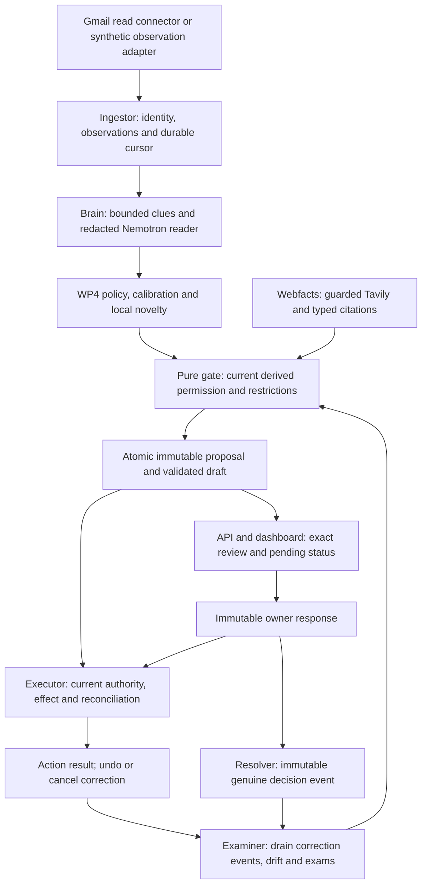

# October 29 demo build and submission plan

Revision 1 — 23 October 2026, Asia/Kolkata. Owner target: submit on **29 October 2026**. Status: **planning deliverable; implementation and release acceptance are pending**.

This is the single agent entry document for the email demo release. It defines what to build, in what order, how to verify it, and what can be claimed. It does not certify existing code, promise an error-free release or an award, or authorize account access, spending, new dependencies, deployment or publication. No application implementation accompanies this document.

## 1. Product promise and release boundary

Demonstrate one complete journey: **connect an approved synthetic-content Gmail test account → observe email → understand it with Nemotron → predict using bounded history → explain the permission → obtain approval or apply earned authority → execute through Executor → inspect the result → undo or cancel where supported → incorporate legitimate feedback and detect change**.

The product's distinctive idea is permission earned separately for a kind of task and action. Show that mechanism working, rather than a collection of disconnected model calls. A useful request for approval is a valid result. A new mailbox does not arrive with earned permission.

Two complementary demonstrations are required:

1. **Private connector proof:** an owner-controlled test account containing only approved synthetic messages demonstrates real observation and a real reversible effect, plus an explicitly approved reply to another controlled account. It is not exposed to public visitors.
2. **Public interactive product:** each visitor gets an isolated synthetic replay and simulated mailbox. It demonstrates history, earned permission where actually justified, feedback, execution, undo/cancel, exams and drift through the same engine semantics. Persistent labels identify simulated data and effects.

The video may show both, with an explicit transition. Permission and evidence do not transfer between them. Account credentials, identifiers and incidental provider emails must not enter the public database, logs, screenshots or release artifacts.

### 1.1 Required release scope

| Area | Required for this release |
|---|---|
| Email | ARCHIVE, TRASH, REPLY, FORWARD and LEAVE handled correctly within catalog constraints; full primary demonstration emphasizes archive/undo and reply review. FORWARD is explicit approval only. LEAVE creates no remote effect. |
| Permission loop | Real eligible evidence, exact pair scope, meaningful code-graded exams, current licence derivation, audit holdouts, correction-driven demotion and honest cold start. |
| One connector | Gmail bootstrap, incremental sync, controlled account binding, safe writes, conflict-aware undo, ambiguous-send reconciliation, pause/revoke and restart recovery. |
| Models | Actual configured NVIDIA Nemotron jobs through Nebius, immutable prompts, redaction, strict schemas, cache and budget evidence. Local MiniLM novelty integrated with fail-closed readiness. |
| Tavily | Guarded email entity verification with citations and usage transparency; an approved real runtime call, plus recorded responses for reliable public replay. |
| Frontend | All product navigation and destination screens; email and supporting evidence screens functional; unfinished capabilities explicitly unavailable. |
| Delivery | Portable setup tooling, documented modes, deployment/reset/recovery, focused evaluation, public repository/license, working URL and a video below three minutes. |

**Full F01–F42 completion remains a separate obligation.** Calendar/files execution, chains, complete Radar/Reading boards, Notion, IMAP/iCal, MCP, receipts, OpenShell, Hermes/NemoClaw, all model experiments, dataset studies and the human study are not silently declared completed by this demo release. Their screens explain availability without fake workflows. Existing implementations remain protected by regression checks.

### 1.2 Scope discipline

- Do not add chat, browser automation, screen monitoring, voice, payments, attachments, mailbox filters, arbitrary URL fetching or new integrations to improve the presentation.
- Do not introduce a new orchestrator framework, vector database, queue service or UI library unless a demonstrated requirement cannot be met with approved existing dependencies.
- Do not hard-code permissions, passing exams, agreement percentages, costs, provider health or dates to make a rehearsal succeed.
- Use one coherent persona and a versioned scenario suite, with positive, negative and failure controls. A selected video example is a walkthrough, not a statistically representative evaluation.

## 2. Authority, source documents and observed baseline

Read [../AGENTS.md](../AGENTS.md), [CONTRACT.md](CONTRACT.md) and its [approved amendment](CONTRACT_AMENDMENT_2026-10-22.md) first. Then use [ENGINE_SPEC.md](ENGINE_SPEC.md), [DATA_MODEL.md](DATA_MODEL.md), [PACKS_SPEC.md](PACKS_SPEC.md), [PROMPTS.md](PROMPTS.md), [TEST_PLAN.md](TEST_PLAN.md), [SECURITY_PRIVACY.md](SECURITY_PRIVACY.md), [USER_FLOW.md](USER_FLOW.md) and [TAVILY_AND_NEW_PACKS.md](TAVILY_AND_NEW_PACKS.md).

Implementation context: [CHANGES_IMPLEMENTATION_PLAN.md](CHANGES_IMPLEMENTATION_PLAN.md), [FULL_PRODUCT_SPEC.md](FULL_PRODUCT_SPEC.md), [IMPLEMENTATION_PLAN.md](IMPLEMENTATION_PLAN.md), [FRONTEND_IMPLEMENTATION_PLAN.md](FRONTEND_IMPLEMENTATION_PLAN.md), [PRODUCT_OPINION_REVIEW.md](PRODUCT_OPINION_REVIEW.md), and [DEMO_AND_SUBMISSION.md](DEMO_AND_SUBMISSION.md). WP3's current entry path is `docs/wp3/WP3_IMPLEMENTATION_PLAN.md`; its companion packages and acceptance document are in the same directory. Check final relocation links at handoff. The WP4 plan/checkpoint currently live in its separate worktree; reconcile them into the accepted branch before depending on them.

CONTRACT > specifications > plans. This document records the user's newer **email-only release and full-navigation presentation scope** where older plans describe a multi-pack video or omit unavailable destinations. It does not amend invariant, privacy, role or API authority. An unresolved higher-authority conflict stops the affected implementation; record a concrete change request. Do not edit the contract.

### 2.1 What is known, and what is not

| Observation on 23 October | Planning consequence |
|---|---|
| Root worktree was on `phase-3-wp3-reader-pipeline`, observed HEAD `5460951`; WP3 entry-document relocation remained uncommitted. | Other-agent work is active. Do not overwrite, reset, stash or treat HEAD as proof that WP3 passed. Reinspect before implementation. |
| WP4 worktree is `data/wp4/worktree`, branch `phase-4-wp4-policy-calibration`, based on committed WP2 `a5610a0`. Its checkpoint still says integration acceptance is open. | Integrate final verified WP3 first, then finish WP4's actual consumer wiring and acceptance. Component tests alone do not close WP4. |
| Earlier WP4 evidence records 426 passing tests in one isolated snapshot, with later focused follow-ups. | Historical evidence only; do not advertise that count as the final integrated release result. |
| MiniLM artifacts and manifest are under ignored `data/models/`; real offline smoke passed. | Provisioning is proven locally. Portable tracked setup and application integration still need implementation. |
| A frontend worktree/branch exists under `data/wp9/worktree`. Frontend implementation was paused by the user. | This plan authorizes no immediate restart. Start the approved release work only after the WP3/WP4 gate and the next implementation instruction. |
| Existing demo documents span calendar/files/chains/Radar and contain old scaffold/status descriptions. | Reconcile release copy and links during documentation work; do not copy stale implementation claims. |

This planning pass inspected governing documents, graph relationships, Git/worktree metadata and existing checkpoint evidence. It did not run a new application suite, authenticate Gmail, spend model/Tavily credits or validate a deployed site.

## 3. Verified submission requirements and owner schedule

The [official rules](https://nebiusglobalaihackathon.devpost.com/rules), checked 23 October 2026, close submission **30 October at 10:00 PDT / 17:00 UTC / 22:30 IST**. Keep our earlier **29 October** target. Required: working URL, public licensed repository/setup instructions, English description, track, public YouTube video below three minutes and tools feedback. Use an NVIDIA open model and qualifying Nebius runtime. Preserve judging access through its end on 15 December; recheck the exact time. The Tavily bonus requires a functional runtime call. Review eligibility, rights and current rules before submission.

Recommended submission track: Personal AI, subject to owner confirmation and truthful readiness. Judging weights implementation, design, impact and idea equally. Our engineering response is a demonstrable permission loop, coherent UX, a specific email-overload use case and clear evidence of how permission differs from model confidence. This is our strategy, not a prediction of winning.

Token Factory runtime calls can satisfy the Nebius route; every component need not be hosted there. Our deployment must still follow the repository's selected delivery profile. A change of host/profile requires an explicit decision rather than an assumed exemption.

## 4. Data, time and consent design

### 4.1 Keep three evidence contexts distinct

| Context | Allowed use | Forbidden inference |
|---|---|---|
| Historical synthetic corpus | Train eligible models; run labelled retrospective replay and evaluation in its own namespace. | Imported labels are not real prior prospective commitments and do not grant live account authority. |
| Prospective synthetic replay | Generate proposals before outcomes on a simulated timeline; derive permissions and demonstrate effects in SimWorld. | Do not describe it as weeks of actual account use or transfer its licence to Gmail. |
| Private Gmail test account | Validate the real connector using synthetic content and genuine, prospectively observed owner decisions. | Inserting old messages, changing Date headers or seeding Sent does not create genuine live permission evidence. |

Use distinct database/run IDs, ledger roots, account/connection bindings, cache provenance and browser mode indicators. Shared public model answers may be immutable content-addressed inputs; mutable requests, actions, evidence and ledgers remain session scoped. Tenant/session isolation applies to every detail/status/list route, not only the UI.

### 4.2 Scenario corpus and Gmail population

1. Freeze a deterministic seed, persona identity, timezone, source manifest and scenario version. Keep generation truth available only to the evaluator; never pass truth to prediction.
2. Generate a sufficiently long mixed-action history for the production 200-eligible-row training threshold and at least two effective classes. Generate more raw situations if exclusions reduce eligibility. A row count is not a permission guarantee; exact class/action evidence, recent counts, caps, novelty and exams still govern.
3. Include newsletters, ordinary requests, reply threads, sensitive money/personal-information mail, unfamiliar senders, misleading links, reader conflicts and ambiguous cases. Vary dates, wording, thread lengths and sender frequency; do not make an easy one-keyword corpus the only evaluation.
4. Render separate initial state, dated user events and final export. Model-generated actions stay attributed to Probation. No execution silence or Probation-created Sent/label update becomes a human agreement footprint.
5. For the Gmail proof, use designated controlled sender/recipient accounts and a small allowlisted message cohort. Real destinations must be owned/approved; fictional addresses in replay must never receive real mail. No bulk unsolicited messages or third-party impersonation.
6. Prefer owner/operator-controlled synthetic import or controlled sends. If a population tool is built, it is a separate, explicitly authorized test-fixture operation within the Executor boundary: dry-run manifest, exact test account, bounded count, separate setup scope, idempotent IDs and cleanup limited to created IDs. Do not add insertion privileges to normal observation workers.
7. Exclude account onboarding/security/recovery messages and unrelated mail from ingestion and recording. Do not purge the mailbox broadly. Prove the allowlist filter before a body fetch.
8. Historical RFC dates may test parsing and display, but actual observation/knowledge times remain truthful. A bootstrap snapshot must not expose final labels as past facts. A newly connected account cannot reconstruct unavailable provider history by assumption.

Freeze evaluation cases before tuning. Publish aggregate results for the complete declared cohort, including excluded/unresolved/failed cases; a scenario manifest identifies which cases are shown in the video and why.

## 5. System flow and ownership

The diagram is logical flow, not an authorization expansion. Brain/Examiner receive an LLM-client capability, never provider or target-app credentials directly. API records intent and serves status; it cannot send mail or call Tavily. Executor owns protected effects and write-grant lifecycle. Webfacts owns public lookup and quarantined extraction. Role-bound database helpers apply even when a synthetic orchestrator runs roles sequentially.

### 5.1 End-to-end transaction boundaries

- Observation page + native references + cursor advancement commit together; crashes repeat safely.
- Compute/validate reader, prediction and draft outside long write transactions. Commit proposal ledger entry, complete immutable proposal and FK-safe draft as one unit.
- API atomically records the first valid Accept/Edit/Reject using a stable owner-scoped request ID. Identical retry returns the same reference; conflicting initial response yields a typed conflict.
- Return HTTP 202 with status reference. Decision evidence processing and remote execution completion are separate states. Do not remove every trace of an item while its effect is still pending.
- Resolver appends decision event + ledger + owned consumption receipt transactionally. Rejection records disagreement without inventing another action.
- Executor persists bound intent/attempt before remote I/O, then confirmed result afterward. A database transaction cannot make Gmail atomic. Uncertain send results enter reconciliation; no blind retry.
- Examiner consumes correction events before further affected autonomous execution. Failure to catch up blocks that execution. Licences are freshly derived; no role treats a cached level as truth.

## 6. Build order, gates and WP contributions

Each row below is a **release package**, not a new WP number or an assertion that a whole WP is finished. One owner carries a package through tests, implementation, integration and evidence. Preserve original phase ownership, review boundaries and branch/commit conventions. If the owner still requires a whole WP to close before handoff, keep that gate; do not mark only its email slice as full completion.

| Order | Release package | WP contribution | Blocking exit |
|---|---|---|---|
| D0 | Baseline and release contracts | WP0/WP1/WP2 | Verified handoffs, protected files, exact interface/migration decisions, approved test/provider profile. |
| D1 | Finish WP3/WP4 integration | Complete current WP3 and WP4 obligations | Shared inference, training, embeddings, provenance, explanations and fail-closed integration verified. |
| D2 | Permission and meaningful exams | WP5 email acceptance; retain other-family regressions | No fabricated confidence/pass; exact pair/level/cutoff derivation and drift invalidation demonstrated. |
| D3 | Complete feedback and execution | WP6 email lifecycle | Accept/edit/reject, idempotency, hold/cancel, undo, restart and correction-driven demotion work. |
| D4 | Gmail connector and private runtime | WP12 mail/runtime slice | Fake-provider conformance then authorized private proof; account/scope isolation and reconciliation proven. |
| D5 | Web verification | WP7 email entity path; WP13 model consumers where needed | Guarded queries, real authorized call, cited facts, budgets/TTL and no autonomy increase. |
| D6 | Full navigation and working email UI | WP9 release surface | Real API/browser lifecycle, unavailable states, mobile/keyboard behavior, mode isolation. |
| D7 | Evaluation and release evidence | WP10 scoped email evaluation | Valid counts, matched baselines, explicit unrun experiments and traceable claims. |
| D8 | Packaging, deployment and submission | WP11 plus setup obligations in WP0/WP4/WP12 | Fresh clone, public session isolation, recovery, working URL, video and reviewed submission. |

**WP8:** expose habits/chains readiness only; no new chain workflow on this critical path. **WP13:** actual approved model roles can support the demo, but cascade comparisons, Ultra red teaming, guards and external runtimes require their own evidence before any claim. **WP0–WP2:** preserve all established validation, temporal identity, ledger and filesystem-purity guarantees; a later demo package cannot weaken them.

### 6.1 Branch and merge procedure

1. Record `git status`, branch, worktree path, HEAD, base and local changed-file ownership without reading secrets. Verify the accepted WP2 baseline rather than trusting an earlier hash.
2. WP3 owner completes/reviews its handoff and merges through the authorized normal process. Do not copy unfinished WP3 files into WP4.
3. Merge verified `main` into `phase-4-wp4-policy-calibration`; resolve replay/history/provenance interfaces semantically. Retain both guarantees rather than wholesale choosing a branch's files.
4. WP4 owner completes pending wiring, runs integrated checks, records exact evidence, then obtains normal merge authorization. Keep the offline embedding smoke reproducible.
5. Subsequent branches start from accepted integrated main using `phase-N-name` and `phase-N: description`. Do not use an old frontend worktree baseline without merging accepted main first.
6. Review each completed package before the next protected consumer integration. Parallel work is limited to released interfaces, independent pure components, fake-provider tests and documentation; two agents never own the same shared file simultaneously.
7. After every merge, run relevant cross-consumer regressions and record the resulting commit. Run full required checks on the release candidate. Never force-clean another agent's worktree or delete branches to simplify integration.

Planning does not request a merge or push now. The execution agent must use the latest user instruction and repository approval process.

## 7. D0–D1: foundation, integration and portable setup

### 7.1 Integration checklist

- Obtain final WP3 job/result types, provenance, shared snapshot, writer validation, retry/cache/accounting behavior and persistence handoff. Verify packaged prompts and call-site coverage; a foundation commit is insufficient.
- Wire WP4 bounded eligible cohorts into actual retraining; forward effective configuration and time cutoff. Do not leave old direct-SQL training or batch-before-timeline feature extraction active.
- Use production cold start 200 and two classes. Calibration is chronological with fold-local encoders/vocabularies and delayed-label purging; fallback T=1 is labelled. Failed refit clears stale state.
- Integrate full policy identity, correct feature-name alignment, trained file vocabulary compatibility and OTHER abstention as required by complete WP4, even though the video emphasizes mail.
- Inject real offline MiniLM into family-specific novelty. Verify strict distance comparison, duplicate behavior and bounded memory. Missing/invalid required novelty support cannot authorize execution.
- Carry actual reader validity, deterministic validity, budget and provenance through replay/live/exam. A valid cold start remains Watch; missing required reader is ASK. Web restrictions cannot change policy probabilities.
- Attach real coefficient-based explanations and up to three bounded eligible examples. Explain missing results as unavailable. Preserve identity/time cutoffs and correction projection.
- Resolve Executor-world actor attribution before learning from executed changes. If attribution is ambiguous, exclude/report it; do not count it as a human decision.

### 7.2 Tracked setup deliverables

The current `data/models/` scripts and README are local evidence, not cloneable setup. Build tracked, reusable tooling; proposed filenames are **targets, not existing commands**:

| Proposed artifact | Required behavior |
|---|---|
| `scripts/provision_embeddings.py` | Explicit operator-invoked download or verification; fixed approved repository/revision, complete expected file hashes/sizes, bounded streaming, atomic completion and resumable-safe behavior. Never execute downloaded code. |
| `scripts/verify_embeddings.py` | Offline manifest/path checks and real CPU inference; deterministic basic shape/finite/duplicate tests; nonzero exit with actionable missing-model message. |
| Tracked model manifest template under `config/` | Source, revision, license, SHA-256 of every required artifact, dimension/runtime/preprocessing identity. Verify against already obtained artifacts; a manifest generated from an untrusted download alone is insufficient. |
| Runtime bootstrap/config adapter | Derive paths from explicit project/deployment root; set all model cache/temp paths before importing libraries; use exact local artifact path and offline loading. No absolute developer path or implicit fallback. |
| README and operator instructions | Windows and Linux commands, expected disk use, model license/source, offline preparation, troubleshooting, deployment volume ownership and readiness semantics. |

Keep weights/caches/download temporaries under ignored `data/models/` for development and the explicitly mounted application model directory in deployment. No global environment changes or user-cache writes. Ensure Windows paths with spaces work. The provisioner is an operator setup tool, never a hidden startup download or a new application network path.

Current accepted identity: `sentence-transformers/all-MiniLM-L6-v2`, FastEmbed's `Qdrant/all-MiniLM-L6-v2-onnx` distribution, revision `d13954661f83248295ba75c1ed411eef3b7b936e`; seven model/config/tokenizer/card files total 91,334,489 bytes. Hashes and actual runtime smoke are in local `data/models/all-MiniLM-L6-v2/`. Preserve attribution and verify licenses for redistribution. Prefer explicit download/volume provisioning over committing weights.

The existing smoke demonstrated real 384-dimensional offline inference. It did not establish the application is wired correctly. A fresh clone must get equivalent results without the developer's original worktree, caches or hard-coded interpreter path. Ordinary visitors use the hosted server's model and install nothing.

## 8. D2: meaningful exams and earned permission

1. Use the same fitted policy, reader, feature encoder, novelty and gate snapshot for ordinary predictions and counterfactual cases. Missing policy/operator/reader cannot pass. Remove synthetic high-confidence defaults.
2. Select only eligible cases for the exact class/action with outcomes known at exam cutoff. Freeze model/history versions and seed; do not train on edits or insert operational actions from exam cases.
3. Cover mail operators in PACKS_SPEC, including unfamiliar sender, money/personal information, paraphrase and injection controls. Recompute changed deterministic clues and action metadata. Code validates edits and grades all verdicts.
4. Include a deliberately shortcut-sensitive fitted policy as a negative control and a genuine supported policy as comparison. A lack of eligible cases returns insufficient evidence, not pass.
5. Derive permission from deduplicated eligible evidence, configured bounds/recent counts, caps and current passing exam. Exclude ABSTAIN, backfilled live evidence, automated effects, undo and rejection-only invented labels.
6. Display agreement, permission lower bound and exam status separately. An expired/future/pre-alarm exam cannot authorize autonomy; a new alarm demotes until a later valid exact-pair exam.
7. Persist deterministic exam/case identities, versions, coverage, discarded/failed cases and reasons. Repeated scheduling respects quotas and does not keep retrying unchanged insufficient cases.

Acceptance: a genuinely qualifying synthetic replay case earns level 2 where supported, and a control case remains Watch/Suggest. If the frozen scenario does not qualify, diagnose against declared semantics; do not tune on held-out outcomes or lower thresholds to force the video. The private account may remain at level 0 while exact explicit approval still demonstrates real execution.

## 9. D3: feedback, actions, undo/cancel and drift

### 9.1 Required user operations

| Operation | Exact result |
|---|---|
| Accept | Server binds current reviewed action/account/resource/body to immutable request. Resolver records the actual human decision; Executor separately performs the operation. |
| Reject | Strong disagreement, no effect, no invented alternative training label. |
| Edit action/body | Validate allowed mail action and complete parameters; preserve original proposal/draft; immutable edited payload and fresh exact approval. Editing prose does not change the action class. |
| Archive / undo | Remove INBOX only when present; capture actual before-state. Undo reverses Probation's change only within the allowed window and rejects conflicts safely. |
| Trash / undo | Reversible trash, never permanent delete; preserve pre-existing trash/label state and detect conflicting changes. |
| Reply | Original sender only; correct thread/MIME/From; no new addresses/URLs/attachments or unsupported commitments; send only validated stored content. |
| Forward | Owner-selected validated controlled recipient, explicit approval, exact reviewed content; never autonomous. If its separate contract is unresolved, mark unavailable and keep the email-pack completeness gate open. |
| Leave | Record applicable decision without creating a remote no-op action or synthetic effect receipt. |
| Cancel held reply | Cancel before effect. No post-send undo/recall promise. |

Explicit approval is independent of autonomous licence and may execute immediately, including at level 0, after every hard constraint and consent binding passes. **Do not build a hold after explicit approval and describe that as current contract behavior.** Show a reply hold/cancel only on a genuinely qualifying autonomous replay proposal. Use actual replay-clock controls to show expiry, not a shortened hidden hold constant.

### 9.2 Durability and failure requirements

- State transitions are validated and restart safe. Retrying a DONE/CANCELLED/UNDONE action cannot recreate it as PENDING. Validate the existing action's binding before returning it.
- Recheck current licence/exam/restrictions immediately before every autonomous effect and after hold expiry. Pause/revoke and pending drift events block affected actions. Loss of authority requests a linked Brain-owned suggestion, not mutation of the original proposal.
- Use durable attempt correlation and provider receipts. Simulate a crash after a Gmail effect but before local completion. Reconcile confirmed results; leave uncertain sends visibly needs-reconciliation without automatic resend.
- Store genuine outcomes/corrections as append-only temporal events with approved owner-specific receipts and projection. Preserve historical as-of answers across later corrections and migration.
- Undo/cancel corrections feed Examiner-owned drift, never agreement counts or executable training labels. Deduplicate across restarts. Demonstrate two applicable corrections causing the specified alarm/demotion, plus a negative control.
- Preserve the specified CUSUM event eligibility, posterior baseline, allowance and thresholds. Compute family PSI from actual aligned fitted features with reference-window bins and disjoint windows. Test response drift and covariate shift separately; both invalidate affected exam/permission applicability as specified, without inventing agreement evidence.
- Worker loops have bounded polling, graceful shutdown, leases/fencing where necessary and safe restart. An accepted API request cannot disappear because a process restarted.

## 10. D4: Gmail connector and controlled private proof

Implement under `packs/mail/connectors/` and approved shared connector interfaces. Existing FULL_PRODUCT_SPEC section 7 is the governing detailed design. Proposed `gmail_read.py`, `gmail_write.py`, `gmail_auth.py` and focused connector tests are placement suggestions, not claims of existing files.

### 10.1 Authorization and observation

- Owner selects exact test account, allowed cohort, auth delivery profile and redirect URIs. OAuth state is bound, expiring and single use; callback/account mixups are rejected. Never place tokens in URLs, normal DB rows, browser storage, logs or prompts.
- Read worker gets read-only grant. Executor separately owns write-grant callback, exchange, refresh and protected secret references. Authentication transport and secret-store implementation need scoped approval before use.
- Verify capability per operation and account; a connection badge is not proof of sending or undo readiness. Scope mismatch, revocation or refresh failure stops dependent work.
- Implement bounded MIME/header decoding, native message/thread/reference IDs, stable source identity and idempotent reimport. Sent is an observation, not an incoming decision situation. Do not fetch remote images, attachments or mail-body URLs.
- Bootstrap pages with a watermark and catch-up interval, then durable partial sync. Commit observations before cursor advancement. Test concurrent changes during bootstrap, duplicate pages, deletion records and restart.
- Gmail requires resync when a history cursor becomes invalid; do not treat that as an empty successful poll. Follow the [official synchronization guide](https://developers.google.com/workspace/gmail/api/guides/sync).
- Polling is sufficient for this release. Do not add push/Pub/Sub infrastructure unless needed and separately approved.

### 10.2 Writes and reconciliation

Bind exact connection/account/native message/thread/content hash/restriction revision to each operation. Implement archive/trash/reply/forward semantics from section 9. Refresh race and wrong-account tests are mandatory. A broad modify grant stays exclusively inside Executor even if the provider cannot express a narrower label-only permission.

Review Google's [scope classifications](https://developers.google.com/workspace/gmail/api/auth/scopes): read/modify access can introduce restricted-scope verification and server-side assessment obligations. Test-user access and external public distribution are distinct profiles. Do not promise approval by October 29 or expose public personal-account OAuth without a verified permitted distribution path.

Private acceptance sequence: approved synthetic inbound → observation → proposed archive → owner Accept → confirmed Gmail label change → undo → confirmed restoration; then controlled reply draft/edit → exact approval → one confirmed Sent message with correct thread. Separately test trash/undo, explicit forward, pause/revoke, stale cursor and an ambiguous-send crash. Record safe native-reference hashes and results; keep actual account identifiers private.

If account/provider authorization is not ready, fake-provider conformance can proceed, but **real Gmail demonstration remains blocked**. A simulated Connected badge or replay clip cannot close this gate. Disclose a replay-only release if the owner deliberately accepts that reduced milestone.

## 11. D5: Nemotron and Tavily demonstration

### 11.1 Model roles and upgrade policy

| Role | Planned use | Acceptance |
|---|---|---|
| Configured Nemotron reader tier | Strict email form from redacted bounded text. | Actual authorized provider run, schema validation, captured model/prompt version and usage; failure becomes ASK. |
| Configured Nemotron writer tier | Reply draft from allowed source and bounded owner examples. | Draft validators, no unsupported recipient/content, faithful availability and exact immutable approval binding. |
| Nemotron quarantined extractor | Optional official-page extension below. | Raw page isolated; typed supported fields/citations only. |
| Nemotron Ultra / escalation / guard | Only if the WP13 implementation and provider capability are actually verified. | Exact model availability, budget, edit validation/code verdicts or restriction-only guard evidence. No claim from a model-name setting alone. |
| Local MiniLM | Offline novelty, not text generation or permission authority. | Verified artifacts plus real integrated runtime tests and fail-closed readiness. |

“Use updated Nemotron” means **inspect the approved Nebius catalog/account capability, record exact usable IDs, then validate the jobs**. It does not mean auto-upgrading to the newest model before recording. Model/prompt changes invalidate affected cached features/policy/exam applicability according to version rules; refit/retest before release. Freeze versions for the final candidate.

Real authorized synthetic calls establish model use. Cache genuine validated responses for public reliability and show cached/live provenance accurately. Do not turn a stub response into proof of provider use. The public demo may consume caches, but the qualifying deployed integration and exact runtime evidence must be documented.

### 11.2 Required Tavily email path

1. Trigger from approved mail entity rules after validated reader output. Normalize registrable domains; known-domain history is bounded and user-handled, not a global future list.
2. Build only allowed domain/brand/public-entity queries in code. Run query guard before request. No subject/body/address/person name, tokenized URL or arbitrary visitor search.
3. Webfacts reserves durable daily/monthly budget, makes the authorized call through `web/client.py`, reconciles actual accounting, logs exact safe query, cache/usage/source metadata and TTL. Failed accounting denies outbound call.
4. Derive conservative typed status; independent official-domain catalog provenance and search citations stay distinct. Unknown/no results is not proof of fraud or proof of safety. Include regional official domains and negative controls.
5. Present source-backed caution on email detail. With a fixed baseline prediction, adding restrictions never raises autonomy or changes policy probability/evidence/licence; removing a veto may restore baseline. Raw snippets do not enter the gate reader or reply writer.
6. On Tavily outage/exhaustion use no-web baseline semantics and truthful not-checked status. Do not add an approval boost or an undocumented universal veto.
7. Demonstrate an approved real runtime call privately or through an explicitly approved bounded demo lookup, retaining runtime evidence. Public replay uses labelled recorded results by default. Public live lookup requires separate quota/abuse authorization and a Webfacts-owned command, not API-side HTTP.

### 11.3 Search + Extract extension: separate acceptance, same email entry

The required core above uses **Search**. To claim **Extract**, additionally implement the complete evidence path: validated public opportunity fields → independent Search → deterministic supported official candidate/provenance → URL sanitization → allowed Extract → quarantined Nemotron extractor → code-supported typed fields → cited email-detail verification card. Never fetch the link supplied in the email. An `is_official=true` browser flag is not provenance.

Reject private hosts, sensitive/tokenized URLs and unsafe redirects per the existing sanitizer contract. Enforce extract input/output limits, expiration, page support for dates/fees, missing-year/timezone uncertainty and safe HTTP(S) citation rendering. Injected page instructions must not change decisions or reach the reply writer.

This is an **email verification card**, not a claim that Radar tracking, Reading or Notion execution is complete. Do not add TRACK/board mutations without the corresponding pack lifecycle. The extension is a bounded enhancement after the core route passes; if incomplete, say Search is implemented and Extract is unavailable. The bonus requirement does not by itself require implementing both APIs.

## 12. D6: API and complete frontend surface

### 12.1 API integration contract

Use CONTRACT section 9 routes under `/api`, explicit request/response models and uniform errors. Existing schema declarations do not prove route implementation. Version and test any additive connection/readiness/status interface before wiring the UI; connector tables/routes in the full spec remain proposals until reviewed.

| Surface | Required behavior |
|---|---|
| Health/readiness | API liveness separate from reader/model/embedding/connector/worker readiness; mode, last successful sync and stale/degraded states from actual data. |
| Queue/detail | True unanswered ASK/SUGGEST cohort, detail fetched by proposal ID, exact task/action, actual draft/examples/reasons/web sources. Watching is not secretly relabelled Suggest; any review of a Watch proposal needs an approved discoverable API/UI path. |
| Respond/status | Immutable idempotent request, HTTP 202, poll `/responses/{request_id}`, separate decision and execution result, pending/failure/reconciliation visible. |
| Actions/undo | Held/DONE/FAILED/CANCELLED/UNDONE states, authoritative deadlines, eligible undo/cancel, confirmed result and retry semantics. |
| Permissions/exams | Same as-of derivation as Executor, actual pair counts/bound/caps/exam/alarm; admin run command restricted and asynchronous. |
| Reports/metrics | Exact applied family/task/action/time cohort, numerator/denominator/coverage, weak/unresolved/censored items; no global trust score. |
| Exposure/web | Actual LLM usage/cost availability, attempts/cache distinction, exact guarded Tavily queries, sources and origin. Viewing does not trigger a paid call. |
| Connections | Reviewed capability/status contract for connect/backfill/shadow/paused/revoked/error; no token content; private owner controls only. Public screen explains simulated account and real connector proof. |
| Replay/ledger | Shared replay clock, durable play/pause/speed, deterministic resume; consistent ledger snapshot count/head/corruption. Session scoped. |
| Other packs/settings | Verified capabilities or explicit unavailable response; effective safe settings read-only, no secrets. No fake board data. |

### 12.2 Screen map

Keep **Home / Queue / Actions / Permissions / More**. All product destinations are discoverable; user-requested unavailable screens are explanatory pages, not working-looking fake controls.

| Screen | Required release content |
|---|---|
| Home | One-sentence purpose, explicit Public synthetic replay or Private test account mode, next useful action, attention summary, real connection/replay state. |
| Queue + item detail | Needs you / Ready for you using actual gates, safe email preview, Why, evidence, sources, draft edit, permitted action selection, clear approval button. |
| Actions | Pending, held, completed and failed operations; time/window, undo/cancel, failure/reconciliation reason and status refresh. |
| Permissions + task detail | One task/action at a time; Watching/Suggests/Does with undo/Does quietly, real evidence and cap, exam, change history. Separate performance from permission bound. |
| More → Connections | Private Gmail flow and capability state; public simulated connection explanation. Calendar/files/Notion/IMAP/iCal/MCP statuses truthful. |
| More → Skills/packs | All six pack cards, each with actual readiness. Unfinished packs open a clear unavailable page with supported scope and reason. |
| More → Insights/exams | Email report, measured outcomes and trends, actual exam cases, drift/demotion. Unsupported reports unavailable. |
| More → Habits/chains / Learned about you | Show real bounded data only if verified; otherwise unavailable explanation. No cosmetic edits that silently change evidence. |
| More → Radar / Reading Library | Clearly unavailable unless independently accepted; no seeded board masquerading as complete workflow. |
| More → Privacy & web | What leaves the device/server, model counts/cost availability, Tavily safe queries/sources and cache/live labels. |
| More → Activity record | Verification status, length/head, short explanation that integrity is not correctness or permission. |
| More → Settings/help | Effective caps/hands-off/budgets/mode, setup help, synthetic data disclosure and limitations; no editable authority settings. |

### 12.3 Premium interaction requirements

- Follow Spruce & Brass dark brief: restrained color/typography, opaque task/evidence surfaces, glass limited to navigation. Establish spacing and state components once; no redesign of every page independently.
- Prioritize readable mail content and one obvious next action. Put detailed counts/provenance behind Why; keep current permission/caution beside approval.
- Use actual API data. Never substitute preview fixtures on a failed service call. Synthetic preview must be isolated and labelled at every mode transition.
- URL-backed routes survive refresh/back/forward. Existing query tooling handles polling/invalidation; avoid extra dependencies unless approved.
- Mutations disable accidental duplicate clicks, expose progress and typed failure, retain drafts during network failure and invalidate queue/actions/permissions/reports/detail on confirmed state change.
- Validate API responses at runtime using approved tooling. Never assume a TypeScript assertion validates JSON.
- Escape text; never render email/page HTML directly. Sanitize all source links to permitted HTTP(S), with safe external-link attributes. Prevent script/data URL and title injection.
- Support keyboard navigation, labelled dialogs, focus trap/restore, Escape, visible focus, reduced motion and screen-reader status announcements. Check 360px mobile and desktop layouts with no horizontal overflow or obscured action buttons.
- Avoid misleading vocabulary from stale lower-authority copy: label the Bayesian permission lower bound precisely; do not call it a guarantee or conflate a held operation with Done.

## 13. D7: focused evaluation and claim control

Run evaluation only after the pipeline is integrated. Explicit engine DB, truth manifest, cohort and run configuration are mandatory; no tiny-fixture or invented-prediction fallback. Record source commit/dirty hash, seed, identities, prompt/model/features/policy versions, artifact hashes, cutoff and exact commands.

Required release experiments:

1. Hand-computed metric fixtures and an all-mail tiny replay containing real eligible predictions, feedback, hold/cancel and undo.
2. A frozen development scenario and a separate held-out email corpus with varied classes and failure controls. Tune on development only. Report sample sufficiency; do not label a small pilot the planned 20-persona study.
3. Temporal/no-peeking mutation tests covering reader history, calibration, novelty and explanations; deterministic fresh runs and restart comparisons.
4. Majority-from-past and ask-always controls on the same eligible IDs; applicable existing fixed-rule baseline. Missing predictions have explicit matched coverage.
5. LLM-confidence baseline only if actually run with its specified bounded examples/model and matched cohorts. Otherwise mark unrun and make no superiority claim over it.
6. Measure agreement including abstentions, agreement excluding them, coverage, strong/weak/unresolved/censored counts, requests for review and actual effects/errors/holds/cancels/failures separately. Empty denominator is unavailable, not safety success.
7. Reader field accuracy/schema failures, writer validation failures, latency/cost/attempts and caching; separate reader quality from learned action accuracy. No invented token cost when usage/price is unknown.
8. Tavily legitimate/lookalike/no-presence controls, false cautions, cited uncertainty and restriction monotonicity; injection controls if Extract is enabled.

Report negative results and exclusions. With few independent personas, uncertainty is limited; do not bootstrap correlated individual messages and imply population proof. Aspirational targets such as fewer interruptions, fast permission acquisition or catching every shortcut are not release facts.

Every README/video claim must map to exact wording, scope, feature/version, test/run artifact, limitation and reviewer signoff. Keep this register in the release handoff; no additional planning document is needed now. Prohibited unsupported claims include “fully complete product,” “all actions undoable,” “58 decisions guarantees permission,” “100% safe,” “learns everything about you,” and “all connectors work.”

## 14. D8: packaging, public deployment and operations

### 14.1 Reproducible delivery

- Pin existing approved Python/Node dependencies; package prompts, schema/migrations and synthetic fixtures. Build/install outside the checkout and verify resources. New dependencies require explicit review.
- Track reusable provision/verify/reset tooling. Keep weights, tokens, private test-account records, local logs and temporary results ignored. Publish safe checksums/aggregate evidence, not secrets or complete private provider payloads.
- Provide clean-clone modes: offline synthetic demo, authorized provider-enabled synthetic run, private Gmail test setup and hosted public replay. Exact commands must be executed successfully before README calls them supported.
- A server image must not rely on the developer's absolute path or ignored worktree. Explicit model provisioning happens before readiness; missing model/cache/input fails visibly without network fallback.
- Preserve old evaluation artifacts with a superseded/unverified note where necessary. Do not replace dubious numbers silently.

### 14.2 Public isolation and runtime

- Public workers use SimWorld only and contain no Gmail write tokens, private DB, provider account inventory or reachable private owner control endpoints. Runtime credentials are scoped server-side; no key in frontend bundles.
- Each visitor gets its own mutable database/world/ledger/request namespace from a golden synthetic seed. Test cross-session ID guessing, status/undo/replay/reset access and resource cleanup. Session identity is bound server-side, not trusted from arbitrary path fields.
- Reset creates a new run/snapshot; never deletes or edits ledger entries in an existing run. Retain previous runs per explicit storage/retention policy. Preserve global live-provider quotas across session resets.
- Serve HTTPS with restricted CORS, secure cookies/CSRF protection where applicable, body/time/rate limits, security headers and safe errors. Admin/exam/reset/private controls need appropriate authorization; ordinary judge playback must remain accessible without personal-account onboarding.
- A read-only cached demo is insufficient if the video depicts working feedback/undo: those public synthetic mutations must actually work.
- Workers survive restart with durable pending state and bounded polling. Migration failure, ledger corruption, lost budget state or unavailable model disables affected capabilities; API liveness remains distinguishable from readiness.

### 14.3 Recovery and maintenance

Test provider timeout, exhausted model/Tavily budget, missing cache entry/model, process kill during action, stale cursor, ledger corruption and restore. Preserve action reconciliation state and verify ledger before/after restore; do not blindly rerun remote effects.

Run a synthetic soak of recorded actual duration, targeting the full-spec 72 hours if the candidate is ready early enough. A shorter run remains labelled shorter and does not satisfy that full-product requirement. Capture restarts, queue lag, memory/storage growth, quota behavior and incidents, with no personal payload logging.

Assign a maintenance owner and backup through judging. Verify actual funding for hosting, storage, domains, provider calls and certificate/monitoring needs; a credits page is not a verified balance. Maintain a working URL and documented recovery/testing access; a video backup does not replace the working-project requirement.

## 15. Executable acceptance catalogue

IDs below name **required scenarios**, not tests claimed to exist. Map them to existing tests before adding new ones. Assertions must exercise behavior, not merely mirror implementation. Each row requires a passing result or explicit blocker in handoff.

| ID | Scenario | Pass evidence |
|---|---|---|
| A01 | Integrated baseline and isolation | Exact commits/hashes; no overwritten other-agent changes; protected fixtures/results unchanged. |
| A02 | Clean setup and packaged assets | Fresh supported Windows/Linux setup, installed prompts/schema, project-local model verification without developer caches. |
| A03 | Missing/invalid model and offline inference | Real verified vectors; no implicit download; invalid artifact/shape fails closed; cache/temp remain in approved root. |
| A04 | Required-reader failure/redaction/budget | ASK, no remote effect, no unredacted egress; actual attempt/reservation/cache semantics. |
| A05 | Eligibility/calibration/policy identity | Production cold-start boundaries, delayed labels, fold-local training, complete identity and failed-refit reset. |
| A06 | Temporal replay | Fifty seeded future-mutation cuts, proposal-before-outcome ordering, trained cases and at least one eligible simulated execution. |
| A07 | Truth and actor separation | Complete declared identity joins; backfill excluded from live evidence; Probation effects never counted as human agreement. |
| A08 | Meaningful exam | Real fitted policy and shared inference; critical edits, shortcut negative control, insufficient cases, stale/future/pre-alarm failures. |
| A09 | Derived permission parity | API/Examiner/Executor agree at same cutoff; evidence dedup/caps; no licence promotion from explicit approval. |
| A10 | API response race | Concurrent Accept/Edit/Reject; first valid decision wins, identical retry stable, conflict typed, HTTP 202/status truthful. |
| A11 | Draft/edit/forward validation | Immutable body binding, original recipient/thread, invalid URL/address/content denied; explicit forward recipient separate. |
| A12 | Archive/trash and undo | Actual prior state, already-archived/trashed case, conflict/expired undo, duplicate request and rollback safety. |
| A13 | Holds and explicit consent | No autonomous send early; fresh recheck at expiry; cancellation no effect; explicit approval semantics distinct. |
| A14 | Crash after remote effect | Durable attempt, reconciliation, terminal state not reset, no duplicate send after ambiguous timeout. |
| A15 | Correction/drift across restart | Owned immutable corrections, no agreement contamination, deduped alarm/demotion before next affected autonomous effect. |
| A16 | Gmail observation | Pagination, bootstrap race, duplicate history, stale cursor resync, MIME bounds, no remote image/body-link/attachment fetch. |
| A17 | Gmail auth/revoke | Wrong account/scope, callback replay/state mismatch, refresh race, pause/revoke stops affected effects; roles cannot access write grants. |
| A18 | Authorized real Gmail flow | Synthetic cohort observed, archive/undo and controlled reply/forward confirmed once; private evidence sanitized. |
| A19 | Tavily guard/accounting | Private query denied, budget/log-store failure blocks HTTP, TTL/cache/credits transparent, outage returns truthful baseline. |
| A20 | Tavily restrictions/citations | Adding facts cannot raise autonomy/probability/evidence; legitimate regional/control domains; safe cited uncertainty. |
| A21 | Extract extension, if claimed | Independent official provenance, unsafe URL denied, supported fields, injection isolation, no raw writer text. Otherwise visibly unavailable. |
| A22 | Actual browser workflow | Detail loads, edit persists, pending→confirmed/failure, undo/cancel, invalidation, refresh/back/forward and multi-tab retry behavior. |
| A23 | Complete honest navigation | All promised destinations discoverable; unavailable screens clear; readiness/mode not fabricated; preview never hits live effects. |
| A24 | Accessibility and content security | Keyboard/focus/dialog/mobile, escaped email/page text, safe source links, zero critical console errors. |
| A25 | Reports/claims | Hand counts, exact task scope, zero cohorts unavailable, matched baseline denominators and measured provider cost/provenance. |
| A26 | Public session isolation | Different visitors cannot read/mutate each other's requests/world/ledger; reset cannot reset global paid quotas. |
| A27 | Deployment failure/recovery | Fresh browser/phone, restart/kill/restore/budget/model/cache failures, safe migration rollback and ledger verification. |
| A28 | Submission rehearsal | Working URL, public license/repository/video, accurate claim register, current rules checked and confirmation retained. |

Run targeted offline regressions first, then `make check` or the documented isolated Windows equivalent (`python scripts/check.py` where supported), strict core/engine typing and relevant frontend checks. Use secret-free isolated cwd/config and temporary paths; application imports may auto-load `.env` in the root, so the test harness must prevent that. Never inspect `.env` to diagnose configuration.

Browser build/typecheck is not interaction acceptance. Use actual backend-produced synthetic data for API/browser scenarios. Live smokes are separate, explicitly authorized bounded tests after fake/offline checks pass. Retain exact commands, exit codes, versions, dataset hashes, evidence locations and unrun cases. No test weakening or production threshold override to manufacture a demo.

## 16. October 23–29 execution targets and stop decisions

These are **dependency-based targets**, not effort estimates or a promise. Re-estimate after D1 and the OAuth profile check. If a gate fails, report the blocked outcome and retain quality; do not relabel an incomplete target passed.

| Date, IST | Target outcome | Decision if missed |
|---|---|---|
| **Oct 23** | Baseline/ownership freeze; WP3 completion status; WP4 integration checklist; operator begins OAuth/test-account/provider/budget decisions. | No UI implementation over unstable shared interfaces. Escalate exact missing prerequisites. |
| **Oct 24** | D1 integrated and verified; portable model setup; permission/exam cases working; Gmail fake-provider contract prepared. | Revised critical path required if core semantics still fail. Do not start paid broad evaluation. |
| **Oct 25** | Feedback/execution closed loop in SimWorld; exam/permission/drift; Gmail conformance and authorized auth proof. | Resolve lifecycle before frontend completion claims. External OAuth delay is a visible real-connector blocker. |
| **Oct 26** | Controlled Gmail archive/undo/reply proof; Tavily Search path; functional email API/UI integration. | Core route wins priority over Extract/model extensions. Any omitted required core remains an explicit release failure. |
| **Oct 27** | Full email route and navigation accepted; scoped evaluation; deployed synthetic candidate; start/continue soak. | Stop enhancements. Decide honestly whether full agreed email milestone is achievable. |
| **Oct 28** | Freeze model/prompt/schema/feature versions; release checks, fresh clone, recovery, evidence and video rehearsal. | Fix blockers only. Do not rush unsafe sends or invent missing evidence. Record actual soak duration. |
| **Oct 29** | Final URL/repository/video verification, owner review, deliberate submission and receipt. | Submit only truthful supported claims; unresolved gates remain disclosed, not quietly waived. |

Proposed internal Oct 29 checkpoints: complete candidate review by 12:00 IST, confirm all links/access by 15:00, owner submission target 18:00. These are planning targets for confirmation, not the official deadline. Leave upload/network/review buffer; do not use Oct 30 as the engineering finish date.

Immediate external decisions that do not require application coding: authorized test accounts/cohort, permitted OAuth distribution and redirects, secret-store profile, exact Nebius/Tavily endpoints/model IDs and spend caps, deployment host/resources, maintenance owner and submission representative. Agents may prepare concrete options; they cannot infer authorization to use accounts or spend money from this plan.

## 17. Three-minute presentation and judge exploration

Target **2:50**, with ten seconds of margin. No unverified headline statistic, fake loading animation or suggestion that a cut recording is uninterrupted latency.

| Time | Demonstration | Evidence shown |
|---|---|---|
| 0:00–0:15 | “An assistant should earn permission for each kind of task.” Show the polished email workspace. | Clear value proposition and mode. |
| 0:15–0:40 | Inspect synthetic historical replay for one email task/action. | Real cohort counts; permission bound and exam separate; synthetic replay label. |
| 0:40–1:15 | Explicitly switch to private test-account proof: new synthetic email, explanation, approve archive, Gmail change and undo. | Real connector confirmation; live permission remains its actual level. Record only sanitized approved synthetic content. |
| 1:15–1:40 | Inspect Nemotron reply draft and edit/approve to a controlled account, or show exact validated review if send proof is already established separately. | Actual model/prompt provenance and complete pending→confirmed result for any claimed send. |
| 1:40–2:05 | Show unfamiliar email domain verification and sources; optional official-page card only if accepted. | Actual authorized Tavily runtime evidence distinguished from recorded replay; no mail-body URL fetch. |
| 2:05–2:30 | Explicitly return to synthetic replay: qualifying held send cancelled or an actual drift demotion/test failure. | Genuine derived state, correct simulated clock and cancel/undo distinction. |
| 2:30–2:50 | Brief product navigation and architecture close. | Functional email, unavailable broader packs, Nemotron/Nebius use, Tavily role and measured claims. |

If time is tight, keep archive/undo as the complete visible operation and shorten reply/drift explanation; do not remove mode disclosure or imply an unshown operation succeeded. Longer detailed connector/test evidence remains in reproduction instructions. Record the successful real workflow, not a scripted fake screen state.

The public judge journey should work independently: open Home without private onboarding → start isolated replay → inspect one task's evidence → review an email → approve/reject/edit → inspect action → undo/cancel where allowed → inspect exam/Privacy & web/Activity record → reset. Unavailable destinations explain scope and never require a personal account to explore.

## 18. Documentation, submission and final completion gate

### 18.1 Required tracked documentation updates during implementation

- **README:** product promise, email release scope, synthetic/public versus private connector distinction, architecture, supported platforms, exact tested setup/start commands, model provisioning/offline behavior, Nemotron/Nebius use, Tavily functionality, measured results/limits, license and troubleshooting.
- **Existing demo/submission document:** replace the obsolete multi-pack storyboard for this release, use the verified deadline, precise video length and current testing instructions. Preserve full-product plans separately.
- **Phase handoffs and local build history:** actual implemented files/interfaces, invariant/test mapping, commands/results, safe manifests, migration/backout steps, blockers and downstream full-product obligations. Follow BUILD_LOGGING_PROTOCOL and update the local index.
- **Release evidence:** claim register, sanitized screenshots, prompt/model/artifact/version manifest, evaluation counts, actual runtime calls/cost status, fresh-clone/browser/recovery/soak results and approved private connector proof. Do not publish account IDs or tokens.
- Fix moved WP3 plan references after its owner finalizes relocation. No user's absolute filesystem/worktree path should be necessary in published setup instructions.

### 18.2 Owner-reviewed submission checklist

- [ ] All required release packages D0–D8 have traceable acceptance, with every unrun/blocked case explicit.
- [ ] Core email workflow works as shown; connector test profile and synthetic replay are accurately distinguished.
- [ ] Public demo URL works in a fresh browser/mobile session and has no access to private resources.
- [ ] Repository is public with a detectable approved open-source LICENSE, necessary source/assets/tooling and tested README.
- [ ] Video is public on YouTube, English/captioned, below three minutes, uses permitted media and contains no secrets/incidental personal data.
- [ ] Description explains problem, specific audience, earned permission, architecture, actual model/web use, significant changes during the event and limitations.
- [ ] Track, team, representative and eligibility are reviewed; tools feedback is specific and truthful.
- [ ] Judging testing instructions are complete; working access and funded maintenance continue through judging.
- [ ] Actual runtime provider evidence supports eligibility claims; no cached/stub output is labelled a live call.
- [ ] Final secret scan reports locations only; reviewed source/history and built artifacts contain no secrets/private data. No agent prints or opens a suspected secret.
- [ ] Release source/version, ledger head, backup and recovery instructions are recorded. Normal review authorizes deploy/publish/submit; this planning task does not perform them.
- [ ] Current official rules and all submitted links are rechecked; submission confirmation retained privately.

### 18.3 Agent kickoff and reporting contract

Give the coding agent this file path and the current approved package, rather than pasting every specification. Suggested instruction:

> Read AGENTS.md, CONTRACT.md and docs/OCT29_DEMO_BUILD_PLAN.md. Inspect current worktree/branch ownership and final handoffs. Do not touch another agent's dirty files or secrets. Use Graphify before code searches as required. Identify the next dependency-ready release package and its original phase, write its exact task/test/file-ownership list, and follow the existing approval process before implementation. Create or use an authorized isolated phase branch from accepted main. Preserve all hard safety, temporal and evidence rules. Complete the owned package through tests, integration, logs and handoff; do not start another package or claim a whole WP complete from a demo slice. Use offline/fake providers first. Request scoped account/dependency/spend/deployment authorization only when actually needed, with concrete configuration prepared. Report evidence and blockers honestly.

At every handoff provide: package/phase and commit/dirty identity; completed requirement IDs; files/interfaces/migrations; exact checks and results; scenario/model/prompt/artifact/cutoff provenance; account/profile/scope verification status without secrets; protected-file comparison; rollback/reconciliation instructions; remaining acceptance and full-product obligations. Passing tests are evidence for their tested behavior, not a substitute for the end-to-end demonstration.

**Demo release completion:** all agreed email release requirements operate correctly with their evidence, the public product matches its claims, the real connector proof is established, setup is reproducible and submission materials/access pass review. **Full product completion:** still requires all F01–F42 and the original whole-WP acceptance programme. Neither a polished video nor this plan closes those obligations.
