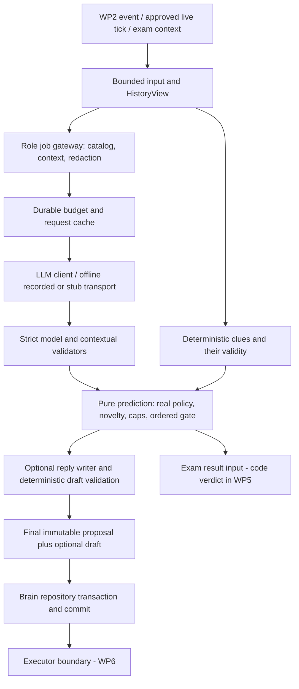

# WP3 implementation plan: readers, prompts, privacy, inference and drafts

Planning revision 1, 23 October 2026, Asia/Kolkata. **Planning only; implementation is not authorized by this document.**

Baseline: `phase-2-wp2-synthetic-chronology`, HEAD `2c57f5ef2be67bb8c06ab00770987bbbcdc9f682`, plus the uncommitted files captured in the audit inventory. HEAD alone does not identify the audited code. Other agents are repairing WP2 in this working tree. No application code, test, fixture, contract or dependency was changed for this planning task.

Final comparison detected concurrent drift in six history/identity/mail files; see the audit's final note. The findings refer to the frozen versions. P00 must review those final WP2 interfaces and any newly created files before implementation; this plan does not claim their later changes were behaviorally verified.

Read this plan with:

- [Source audit and qualifications](reports/wp3-audit-2026-10-23.md).
- [Detailed work packages](wp3/WORK_PACKAGES.md).
- [Acceptance, coverage and handoff](wp3/ACCEPTANCE_AND_HANDOFF.md).
- [Repository inventory](reports/wp3-repository-inventory-2026-10-23.csv) and [LLM call-site inventory](reports/wp3-llm-call-inventory-2026-10-23.csv).
- [Requirement traceability](reports/wp3-requirements-coverage-2026-10-23.csv).

## 1. Authority and intended outcome

CONTRACT v2 and its [approved amendment](CONTRACT_AMENDMENT_2026-10-22.md) govern this work. Then read PROMPTS, ENGINE_SPEC, DATA_MODEL, PACKS_SPEC, SECURITY_PRIVACY, TEST_PLAN and the original IMPLEMENTATION_PLAN. For quarantine/Radar/Reading read TAVILY_AND_NEW_PACKS; for edited-draft presentation read USER_FLOW and FRONTEND_IMPLEMENTATION_PLAN. This plan expands remediation WP3 in CHANGES_IMPLEMENTATION_PLAN; it is not original Phase 3 alone and does not replace original phase ownership.

Deliver one trustworthy path from a historically bounded situation through validated reader data and the real policy/gate to an immutable proposal and, where warranted, a validated reply draft. Replay, eventual live ticks and counterfactual evaluation must consume the same decision semantics. A missing reader, invalid clue, failed redaction, provider failure or missing budget authority cannot become autonomous success.

The main full-product contribution is F05. WP3 also supplies the writer/validation part of F06 and dependencies for F04/F08/F11-F16. F06's real editing and style evaluation span WP6/WP9/WP13; F08's meaningful exams remain WP5; F13/F14/F16's complete web/connector workflows remain WP7/WP12. Record those remaining obligations rather than claiming their entire F rows complete here.

## 2. What the audit establishes

The frozen text snapshot covers 136 backend application modules, 65 Python test/support modules, seven scripts, frontend interfaces, packaging/configuration and governing documents. All 208 captured Python files parsed with the standard-library AST parser. That establishes syntactic inventory, **not passing tests or behavior**. Focused source inspection covers WP3 paths and their callers; other areas have explicitly weaker review depths in the CSV. Exports, secrets, private data, live providers and deployment were not exercised. The inventory is not a full security certification or an assertion of line-by-line semantic review of every repository asset.

Important observed state:

| Area | Present in captured working code | WP3 consequence |
|---|---|---|
| WP2 C11 | `build_reader_client`, `situation_id`/`llm_client` extraction parameters and event-time extraction are present | Preserve and verify the final WP2 implementation; do not recreate the old batch pre-pass |
| Reader validity | Missing client can leave `reader_ok=True`; replay hard-codes reader_required false/deterministic_ok true/budget_ok true | Replace success defaults with explicit pack requirements and real result statuses |
| Prompts | 14 strict job-model mappings; only two Markdown prompt assets; no runtime asset loader found | Keep strict models; build the real catalog/templates and immutable provenance |
| Redaction | Useful regex pipeline and local maps exist; callers omit header names/counts; some packs store unredacted strings as redacted_text | Enforce egress sanitation for each job, not trust a field name |
| Budget | In-memory check, no durable reservation; successful final response accounts one usage record | Add short durable reservation/attempt reconciliation before paid concurrency |
| Transport/cache | Cache revalidation and atomic cache/exposure helper exist; retries/fallback/reasoning/request identity remain incomplete | Retain WP1 protections and repair remaining semantics |
| Replies | Strict output model and atomic DraftRecord storage exist; no actual writer service found; parameter builder deliberately reports draft_unavailable | Implement generation, retrieval, validation and binding before enabling REPLY |
| Other consumers | Three unsupported complete_json call sites; literal writer/model_reader IDs; quarantine workflow substitutes code-built fields | Migrate all consumers explicitly; distinguish executable model jobs from deterministic fallback |
| Editing | Target contract approved; actual response DTO/client carry edited_action, not edited_body; textarea is not an end-to-end edit workflow | Do not claim editing delivered; define and test the WP6/WP9 integration contract |

See audit findings A01-A26 for evidence and limitations. Old 19%/80% fidelity reports and previous test totals are not current measurements for this snapshot.

## 3. Mandatory WP2 handoff gate: P00

Planning may proceed now. Implementation touching shared WP2 files waits for the responsible agent's reviewed checkpoint. Inspect the final commit **and uncommitted state**, then re-run the inventory/diff against this audit. Do not switch branches, stash, reset, cherry-pick or regenerate fixtures while another agent owns those files without a coordinated handoff.

| Required incoming evidence | WP3 dependency |
|---|---|
| Canonical identity and persona propagation, exact primary truth joins and explicit derived/censored exclusions | Correct reader inputs, reply examples and evaluation cohorts |
| World observation existence and state both bounded by time; initial state separated from final exports/user events | No future clues, even when raw exports contain final labels |
| Resolver payload plumbing for mail/calendar/files and genuine event timestamps | Nondegenerate sender/folder history and honest style retrieval |
| C11 per-situation extraction at SITUATION time, after earlier eligible outcomes; same semantic Clock | Reader pipeline must preserve this ordering and horizon |
| Incremental/restarted replay does not lose unresolved outcomes or duplicate effects; stable ties | Shared service retry and resume semantics |
| Paid reading explicitly opt-in, independent of API-key presence, across CLI/replay/eval callers | No surprise provider calls during WP3 tests or cached replay |
| Fresh-run/version strategy for stale features, plus fixture regeneration decision and before/after provenance | Do not reuse stale feature rows or rewrite referenced historical proposals |
| Corrected no-peeking tests rebuild features and mutate raw/world future state; strict chronology and an actual licensed synthetic lifecycle | Reader changes must not invalidate the WP2 proof |

The snapshot shows parts of C11/C13/resume repairs already in progress. It does not establish their complete acceptance. If WP2 changes public mapper signatures, migration versions, outcome projections, CLI options or reader-callable shape, adapt the proposed interfaces here after review. D5's public source/since contract remains the target; internal raw mapping is allowed.

## 4. Boundaries: preserve the surrounding product

- Preserve FastAPI/SQLite/React, Nemotron/Nebius settings, hard-coded catalogs/caps/hands-off and exact gate order. Do not use WP3 to tune calibration, promotion thresholds or cold-start targets (WP4/WP5).
- Brain persists proposals/drafts; Examiner persists exams/wording results; Webfacts persists quarantined outputs; API records immutable intent; Executor alone performs target effects. A reusable service must not obtain all role writes or target credentials.
- Shared prediction accepts time-bounded evidence/licence/restriction inputs. It does not derive a licence from LLM confidence, train on edits, run an effect or record an exam verdict.
- Extend client/reader/writer components and their immediate adapters. Full drift/feedback workers, remote reconciliation, connectors, always-on supervision, public checker deployment, receipts, runtime integrations, model cascade and actual study remain their assigned packages.
- Those later features remain mandatory in the full scope. Their handoff tests are identified below; they are not cut or implicitly satisfied by WP3.
- Preserve tracked fixture/result bytes. Use isolated synthetic workspaces; a fixture regeneration is a separate explicit reviewed operation.

## 5. Proposed architecture and contracts

Proposed names below are design contracts, not existing files or permission to change schemas unreviewed:

| Component | Proposed responsibility | Inputs/outputs and constraints |
|---|---|---|
| `llm/prompt_loader.py` | Resolve immutable assets and validate metadata | Job ID/version, model role, schema fingerprint, template hashes; no cwd-relative fallback |
| `llm/context.py` and `llm/reader.py` | Build bounded pack-specific inputs and validated reader result | Situation + current raw record + bounded history + explicit transport mode; no truth/world-final data |
| `llm/gateway.py` | Require approved job, redaction provenance and accounting context | Return typed result/reason/provenance; no target credentials or effects |
| `engine/prediction.py` | Pure feature/policy/novelty/cap/gate composition | Immutable snapshots and typed restrictions; no database/network/web import |
| `workers/prediction.py` | Role-specific orchestration adapter | May read HistoryView and call that role's approved LLM jobs; cannot widen role permissions |
| `llm/writer.py`, `llm/draft_validation.py` | Generate and check reply content | Up to three eligible examples, safe style facts, incoming item; return draft or typed failure |
| `db/budget.py` / reviewed additive migration | Durable attempt reservation, accounting and single-flight state | Per-account/provider/unit scope, short transactions, row ownership; no private content |

Keep `extract_features_for_situations` as a compatibility entry point while moving internals behind the new service. Preserve its final WP2 situation filter, client lifetime and explicit paid-reading controls. Never pass an unbounded connection or write adapter to a pure predictor. An exam uses a non-persisting prediction context, not a second implementation with success defaults.

ReaderResult should distinguish required/optional-disabled/validated/failed/unavailable/conflicted states; carry actual model/prompt/schema/context versions and redaction counts. PredictionResult should carry features/provenance, action distribution, novelty, cap, gate and safe reasons. Names/field layouts require review; avoid expanding persisted models incidentally.

## 6. Complete prompt/job inventory

There are **14 canonical JOB_MODELS entries**, not 14 working prompt files. Only reader.mail.v2.md and reader.invite.v1.md exist in the captured asset directory. Keep historical assets unchanged. New effective template/format/context behavior receives new versions; do not claim current generic inline prompts already implement the documented versions.

| Canonical job in current specification | Output model | Model role | Required WP3 disposition |
|---|---|---|---|
| reader.mail.v2 | MailReader | reader | Real email template, safe header context, required status and consistency checks; version new behavior |
| reader.invite.v1 | InviteReader | reader | Required invitation form/context and bounded metadata |
| reader.file.v1 | FileReader | reader | Optional only when configured disabled; enabled reader must validate |
| writer.reply.v1 | ReplyWriter | writer | Actual writer, up-to-three style examples, draft lifecycle |
| wording.v1 | Wording | wording/writer tier | Supported transport; count/action/polarity preservation and code fallback |
| exam.paraphrase.v1 | ExamEdit | exam_edit | Canonical job; map calendar's paraphrase_title variant explicitly |
| exam.add_money_request.v1 | ExamEdit | exam_edit | Redacted bounded edits, code validation, no authority/verdict |
| exam.add_personal_info_request.v1 | ExamEdit | exam_edit | Same isolation and source-preservation constraints |
| synth.mail_body.v1 | SyntheticMail | synth | Versioned pool job; no per-item live generation by engine |
| synth.invite.v1 | SyntheticInvite | synth | Same pool/cache boundary; deterministic substitution remains WP2 |
| reader.opportunity.v1 | OpportunityReader | reader | Run only from validated opportunity intent and approved derived-item intake |
| extract.opportunity.v1 | OpportunityExtraction | reader/quarantine | Dedicated untrusted-page context; source validation; WP7 workflow hook |
| extract.link.v1 | LinkExtraction | reader/quarantine | User-saved provenance; typed fields only escape quarantine |
| radar.digest.v1 | RadarDigest | writer | Settings-selected model, bounded typed entries, strict cited output/fallback |

Also inventory `eval/baselines.py`'s `b3_baseline` job: it is not one of those 14 mappings and currently uses a literal model_reader value. Register/version its transport contract or keep it explicitly unavailable; actual B3 baseline semantics/measurements belong to WP10. No generic client call may silently stand in for a missing registered production job.

## 7. Pack reader requirements

| Pack/context | Required behavior |
|---|---|
| Mail | Required mail form. Missing key/client/cache/stub validity, failure or header conflict yields reader failure and ASK under the ordered gate |
| Calendar | Required invitation form, including proper title/description/domain/duration/start bucket context |
| Files | No standard reader when FILES_READER_ENABLED is false; deterministic-only may be valid. When enabled, required output for that enabled path, filename plus at most approved 600-character textual snippet |
| Radar | Required validated opportunity fields derived after mail opportunity intent; do not promote arbitrary incoming mail to a verified Radar item |
| Reading | No standard reader does not mean extraction succeeded. Require the pack's separately validated quarantine result/readiness, with deterministic-only behavior explicitly specified; no raw-page shortcut |
| Chains | Inherit trigger provenance only where applicable; no new reader success invented from reader_spec=None. REPLY uses the mail writer/recipient/draft rules |
| Exams | Same requirements for base/edited inputs at the frozen cutoff; failed reader/edit cannot become a passing valid case |

The pure gate signature/order stays as contracted. A reader/header conflict should feed an existing failure input plus a specific reason; adding a new gate argument requires a separate reviewed interface change. Define conflict rules from authoritative machine-readable headers, not a heuristic that treats every non-newsletter bulk item as invalid.

## 8. Required implementation packages and order

Twelve packages P00-P11 are review units, not twelve new original phases. Implement only after user approval of this plan. Original phase branch names/commit prefixes and handoff rules still apply; split cross-phase adapters into their original owners' reviewed changes.

| Package | Outcome | Depends on | Original ownership |
|---|---|---|---|
| P00 | Reviewed WP2 checkpoint, source/hash rebase and preserved regression baseline | Active WP2 agent handoff | Phase 2 |
| P01 | Frozen job/input/status/schema/accounting design and decision closure | P00 | Phase 1/3 design review |
| P02 | Real immutable prompt catalog, templates and installed-package assets | P01 | Phase 1 |
| P03 | Request-scoped redaction, safe context assembly, genuine exposure counts | P01/P02 | Phase 1; pack adapters Phase 3/6/8b |
| P04 | Durable reservations and attempt reconciliation, schema/role proof | P01 | Phase 1 storage; explicit migration review |
| P05 | Correct transport/fallback/error/cache/single-flight behavior | P02-P04 | Phase 1 |
| P06 | Strict reader service and final-WP2-compatible extraction wrapper | P00/P02/P03/P05 | Phase 3; files/extension adapters reviewed separately |
| P07 | Shared pure prediction with real snapshot inputs and role adapters | P06 | Phase 4 integration |
| P08 | Real reply writer, bounded examples, restore and content validation | P03/P05/P06/P07 | Phase 3 writer; Phase 8 chain consumer |
| P09 | Exam/wording/synthesis/quarantine/digest/B3 call-site migration | P02/P03/P05/P07 | Phases 7/8/2/8b/10, separate handoffs |
| P10 | Atomic final proposal/draft, edited-payload validation and Executor/API/UI contracts | P07/P08 | Phase 3 repository; Phase 5/9 handoffs |
| P11 | Offline integration, packaging, no-peeking/cost/role regression and handoff | All relevant packages | Each original phase owner; no implicit next phase |

Detailed tasks, failure cases and outputs are in [WORK_PACKAGES](wp3/WORK_PACKAGES.md). Do not start concurrency merely because llm_max_concurrency is eight. Sequential correctness and durable accounting are prerequisites; if parallel execution remains unverified, keep production dispatch sequential and report concurrency as unfinished.

## 9. Decisions required during design review

Existing D1-D9 approval stands. These narrower technical decisions are not permission to reopen those choices or change CONTRACT.md.

| ID | Recommended disposition | Gate |
|---|---|---|
| W3-D01 | Preserve old YAML Markdown assets; use new-version Markdown with JSON-compatible front matter parsed with stdlib json, generated schema metadata and explicit sections. Update PROMPTS format description after review | Format/schema loader decision before P02; no undeclared YAML dependency |
| W3-D02 | Define closed job/status/result contracts and machine-header conflict rules, retaining the gate signature | Interface review before P06/P07; avoid speculative intent/header contradictions |
| W3-D03 | Review exact budget/attempt/lease schema, integer money units, indexes and per-role row ownership | D9/FP-D3 does not approve arbitrary new tables or grants; blocks P04 |
| W3-D04 | Separate immutable request identity, physical attempt identity and application result persistence; approved unknown-usage bounds and billing namespace | Blocks paid dispatch/concurrency; unknown unbounded cost denies calls |
| W3-D05 | Define bounded reply-example access/provenance and local restoration scope; exact edited-body/draft payload storage/versioning | Blocks writer/edit activation; D4 already approves direction, not an unreviewed migration |
| W3-D06 | Resolve fee uncertainty versus PROMPTS extractor 'false when unsure' and strict boolean schema | Retain explicit uncertainty/fail closed until reviewed new schema/validator semantics; WP7 owns full risk derivation |
| W3-D07 | Keep one semantic Clock per replay. Use only separately injected core Clock timing, where needed, for operational billing/leases; never age paid reservations using historical replay jumps | Document before P04/P05; operational dates cannot enter features/evidence |
| W3-D08 | Exact model IDs/prices/request options require an explicitly authorized, bounded account-specific spike | Offline development does not require live calls; no change of provider or budget inferred |

No new package, installation, model download, endpoint, signing key, live account, public deployment or human recruitment is authorized here. Resolve unaffected pure work while a scoped operational gate is pending; never mark a blocked F row complete.

## 10. Completion and review checklist

- Every one of the 23 source WP3 tasks maps to an owner, package and acceptance case in the trace CSV.
- Required readers fail closed; actual prompt/templates/context/redaction/model/schema versions reach provenance; optional readers are not confused with failed required ones.
- No reasoning-channel answer, unsupported schema/model fallback, raw private text, raw-page writer input or accounting failure can authorize an effect.
- Budget tests cover retries, repair, concurrency, crash ambiguity and accounting persistence independently of proposal rollback. Cache tests include semantic-input changes and restart/deduplication.
- Writer tests demonstrate a persisted validated draft from bounded source/examples, with exact recipient, safe restoration and no premature send. Edited-body component support is separate from complete editing delivery.
- Replay/exam/chain adapters use the shared path or explicitly remain unavailable. No .99/default-success path may be used to claim real exam readiness.
- Run targeted tests first, then `python scripts/check.py` (portable make check equivalent) in an isolated secret-free copy. Run the required frontend checks when its implementation changes. Package smoke runs outside the checkout without dependencies/network being installed implicitly.
- Preserve fixture/result hashes, original ledger bytes, role separation, original phase logs and reviewed handoffs. Refresh Graphify after code implementation; this planning task does not rebuild implementation.
- Optional live smoke has explicit scope/cap/output handling and is recorded as run or not run. Offline checks cannot close provider support, actual cost or model quality claims.
- End with exact implemented versus deferred/blocked items, tests actually run, version/manifest hashes, rollback instructions and WP4/WP5/WP6/WP7/WP8/WP9/WP12/WP13 follow-ups. WP3 completion is not full-product completion.

Estimate each approved package as regression tests + code + migration/configuration + integration + evidence/review. Re-estimate from the final WP2 checkpoint and any approved interface spike. No credible fixed completion time or “perfect/no mistakes” guarantee follows from this planning audit.
